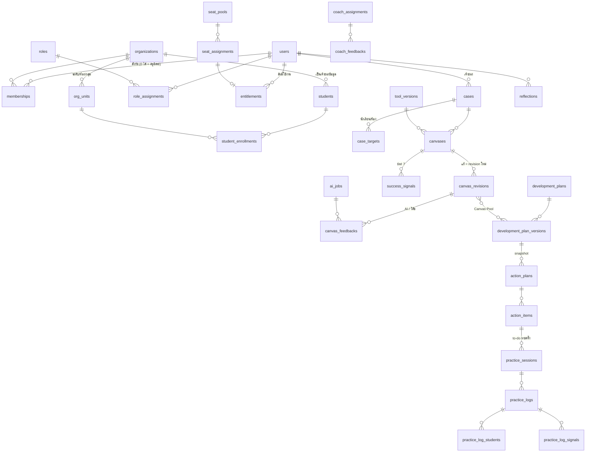

# ฐานข้อมูล SkillWise สำหรับ MVP

- **สถานะ:** [DIRECTION] ร่างออกแบบให้ทีมตรวจ ยังไม่ใช่ migration ที่ใช้จริง
- **ฐานข้อมูล:** PostgreSQL 16 ขึ้นไป (Context ข้อ 60.5, 60.11)
- **ขอบเขต:** ฟีเจอร์ระดับ Must + Should ในหัวข้อ 8 ของ `docs/sila5school-study.md`
  - ออกแบบครบทั้งสองระดับ แต่ให้สร้างระบบจาก Must ก่อน
  - ตารางระดับ Should ติดป้าย `[Should]` ไว้ใน comment ของตาราง
- **ขนาด:** 72 ตาราง + 2 view
- **อ่านประกอบ:**
  - spec รายฟีเจอร์: `docs/feature-spec/`
  - Context ข้อ 30–48 และ 60

## ไฟล์ในโฟลเดอร์นี้

| ไฟล์ | ใช้ทำอะไร |
|---|---|
| `schema.sql` | สร้างตาราง, constraint, trigger และ view ทั้งหมด |
| `seed.sql` | ข้อมูลตัวอย่างที่แต่งขึ้นทั้งหมด ไหลครบวงจรตั้งแต่สมัครจนได้ coach feedback |
| `rls.sql` | ตัวอย่าง Row-Level Security กันข้อมูลนักเรียนข้ามองค์กรในระดับฐานข้อมูล |
| `checks.sql` | ทดสอบ 27 ข้อว่ากฎสำคัญทำงานจริง (ROLLBACK ตอนจบ ไม่เปลี่ยนข้อมูล) |

## วิธีรัน

ต้องมี Docker

```bash
docker run -d --name skillwise-pg -e POSTGRES_PASSWORD=dev -e POSTGRES_DB=skillwise postgres:16-alpine
cd docs/database
cat schema.sql seed.sql rls.sql checks.sql | docker exec -i skillwise-pg psql -U postgres -d skillwise -v ON_ERROR_STOP=1
```

ผลที่ถูกต้องคือขึ้น `NOTICE: OK 1` ถึง `OK 27` ครบ และไม่มี ERROR

**seed คิดวันที่จากวันที่รัน** (เขตเวลา Asia/Bangkok) ข้อมูลจึงสมเหตุสมผลทุกครั้ง เช่น แผนลงมือทำเริ่ม 17 วันก่อนวันนี้

---

## 1. Domain และตาราง

แบ่งตาม domain ในข้อ 46 ของ Context

| Domain | ตาราง | ระดับ |
|---|---|---|
| **Identity** | `users`, `user_identities`, `auth_sessions`, `policy_documents`, `user_consents` | Must |
| **Organization** | `organizations`, `org_units`, `memberships`, `membership_org_units`, `invitations` | Must |
| **Role & Permission** | `permissions`, `roles`, `role_permissions`, `role_assignments` | Must |
| **File** | `files` | Must |
| **Access** | `features`, `products`, `product_features`, `seat_pools`, `seat_assignments`, `entitlements`, `usage_ledger` | Must |
| **Billing** | `billing_profiles`, `orders`, `order_items`, `payments` | Should |
| **Student** | `students`, `student_enrollments`, `import_jobs` | Must |
| **Tool / Case / Canvas** | `tools`, `tool_versions`, `tool_fields`, `cases`, `case_targets`, `canvases`, `canvas_revisions`, `canvas_field_values`, `canvas_feedbacks`, `canvas_feedback_items`, `success_signals` | Must |
| **AI** | `ai_jobs`, `ai_job_canvas_revisions` | Must |
| **Development Plan** | `development_plans`, `development_plan_versions`, `development_plan_sections`, `development_plan_canvases`, `plan_reviews` | Must |
| **Practice** | `practice_sets`, `practice_templates`, `action_plans`, `action_plan_members`, `action_items`, `action_item_org_units`, `action_item_assignees`, `practice_sessions` | Must |
| **Evidence** | `practice_logs`, `practice_log_revisions`, `practice_log_participants`, `practice_log_students`, `practice_log_attachments`, `practice_log_signals` | Must |
| **Reflection / Coaching** | `reflections`, `coach_assignments`, `coach_feedbacks`, `share_grants` | Must |
| **Timeline / เอกสาร** | `student_progress_summaries`, `generated_documents` | Should |
| **Notification** | `notification_templates`, `notification_jobs`, `notification_events` | Should · อีเมลเชิญเข้าองค์กร (Must) ใช้ `notification_jobs.recipient_email` · ถ้า Phase 1 ยังไม่มีระบบส่งอีเมล ให้เชิญด้วยลิงก์ (Phase 1 ส่งอีเมลหรือไม่ยัง OPEN ดู spec 10) |
| **Content** | `contents` | Should |
| **Audit** | `audit_logs` | Must |
| **View** | `usage_balances` (ยอดเครดิตคงเหลือ), `org_activity_summary` (ตัวเลขรวมสำหรับผู้บริหาร) | Must |

### ภาพรวมความสัมพันธ์ของวงจรหลัก

แสดงเฉพาะตารางในวงจร Product Loop ข้อ 48 · ตารางเชื่อมและตารางระบบไม่ได้แสดง



---

## 2. หลักที่ใช้ออกแบบ

### Normalization

1. **ตารางอยู่ในรูป 3NF เป็นหลัก**
   - ระบบเดิมเก็บ id หลายค่าเป็น CSV ใน 1 ช่อง ที่นี่แยกเป็นตารางเชื่อมทั้งหมด:
     - `action_plan_members`
     - `action_item_org_units`
     - `action_item_assignees`
     - `membership_org_units`
     - `practice_log_participants`
   - คะแนนรายช่อง `sc_score_c1`–`c7` แยกเป็นแถวใน `canvas_feedback_items`
2. **ช่องของ Tool เป็นข้อมูล ไม่ใช่คอลัมน์**
   - `tool_fields` เก็บนิยามช่อง ส่วน `canvas_field_values` เก็บคำตอบรายช่อง
   - เพิ่ม Tool ใหม่หรือปรับช่องได้โดยไม่แก้ schema (ข้อ 45)
3. **ไม่เขียนทับข้อมูลที่ใช้ดูพัฒนาการ**
   - Canvas: `canvas_revisions` (แก้ทับไม่ได้)
   - แผน: `development_plan_versions` · ฉบับที่ครูเลือกใช้คือ `development_plans.current_version_id`
   - บันทึก: `practice_log_revisions` (trigger เขียนให้ทุกครั้ง)
   - รายการที่ผูกกับบันทึก (ครูร่วม, นักเรียน, ไฟล์แนบ, สัญญาณ): เอาออกด้วย `removed_at` · แก้ข้อความ = เอาแถวเดิมออกแล้วเพิ่มแถวใหม่ (trigger กันแก้ทับ) · การห้ามลบแถวตรวจที่ API ฐานข้อมูลไม่บล็อก เพื่อให้ลบตามคำขอลบข้อมูลส่วนบุคคลได้
   - การให้ความยินยอม: `user_consents` (เพิ่มแถวใหม่ทุกครั้ง)
4. **เก็บซ้ำโดยตั้งใจ เพื่อให้ฐานข้อมูลตรวจความถูกต้องได้**
   - `organization_id` ใน `student_enrollments`, `case_targets` และ `membership_org_units` ทำให้ใช้ composite foreign key บังคับได้ว่านักเรียน ห้อง และ case อยู่องค์กรเดียวกัน
   - `tool_version_id` ใน `canvas_revisions` และ `canvas_field_values` บังคับให้คำตอบตรงกับช่องของ Tool version เดียวกัน
5. **ใช้ JSONB เฉพาะข้อมูลที่โครงไม่ตายตัวจริง**
   - ค่าตั้งของ Tool (`tool_versions.settings`) และค่าหน้าจอรายช่อง (`tool_fields.config`)
   - ข้อมูลเสริมขององค์กร (`organizations.attributes`)
   - input/output ของงาน AI (`ai_jobs.input_snapshot`, `ai_jobs.output`)
   - payload ของการแจ้งเตือน (`notification_jobs.payload`)
   - error รายแถวของการ import (`import_jobs.row_errors`)
   - ข้อมูลประกอบของ log (`audit_logs.metadata`, `notification_events.metadata`)

### กฎที่ฐานข้อมูลบังคับเอง

ทุกข้อทดสอบใน `checks.sql` (เลขในวงเล็บคือเลขข้อทดสอบ) · ข้อ 16 และ 24 เป็นการตรวจข้อมูลตัวอย่าง ไม่ใช่กฎที่ฐานข้อมูลบังคับ

| กฎ | วิธีบังคับ | ที่มา |
|---|---|---|
| แจก seat เกินจำนวนไม่ได้ แม้กดพร้อมกัน (1) | trigger ล็อกแถว pool ก่อนนับ | study 6.3 (race condition) |
| งาน AI ที่ล้มเหลวไม่ถูกหักเครดิต (2) · หักงานเดียวซ้ำไม่ได้ (3) | trigger + unique index บางส่วน | study 7.1 ข้อ 3 |
| ยอดเครดิตคำนวณจาก ledger (4) | view `usage_balances` | ข้อ 60.10.4 |
| audit log แก้หรือลบไม่ได้ (5) | trigger | ข้อ 60.7 |
| เวลาบันทึกมาจากระบบ, บันทึกย้อนหลังติดป้าย (6), บันทึกล่วงหน้าไม่ได้ (7) | trigger + generated column + CHECK | ข้อ 60.10.5 |
| แก้บันทึกแล้วประวัติยังอยู่ (8) | trigger เขียน `practice_log_revisions` | ข้อ 60.10.5 |
| ผูกนักเรียนกับห้องขององค์กรอื่นไม่ได้ (9) | composite foreign key | ข้อ 60.2 |
| นักเรียนอยู่ห้องเดียวกันซ้อนช่วงเวลาไม่ได้ (10) | EXCLUDE constraint | — |
| ไฟล์ที่มีข้อมูลนักเรียนเป็น public ไม่ได้ (11) | CHECK | ข้อ 31, CLAUDE.md |
| เนื้อหาขึ้นหน้าสาธารณะต้องผ่านอนุมัติ (12) | CHECK | CLAUDE.md |
| คำตอบ Canvas ต้องเป็นช่องของ Tool version เดียวกัน (13) | composite foreign key | ข้อ 45 |
| Canvas revision แก้ทับไม่ได้ (14) | trigger | study 7.1 ข้อ 4 |
| บทบาทองค์กรต้องระบุองค์กร บทบาท platform ต้องไม่มี (15) | composite foreign key + CHECK | ข้อ 60.7 |
| ผู้บริหารไม่มีสิทธิ์อ่อนไหว (16) | ข้อมูลบทบาทใน seed | ข้อ 31 |
| คนนอกองค์กรไม่เห็นนักเรียน · โค้ชเห็นเฉพาะนักเรียนใน case ที่ดูแล (17–20) | RLS (`rls.sql`) | ข้อ 60.2 |
| view ของผู้บริหารมีแต่ตัวเลขรวม (21) | view `org_activity_summary` | ข้อ 31, 43 |
| นัดหนึ่งครั้งมีบันทึก "ทำแล้ว" ได้แถวเดียว (22) | partial unique index | spec 08 (ระบบเดิมไม่กันซ้ำ) |
| รายการที่ผูกกับบันทึกแก้ทับไม่ได้ (23) | trigger | ข้อ 60.10.5 |
| เอาออกด้วย `removed_at` แล้วแถวเดิมยังอยู่ (24) | ข้อ 24 ตรวจข้อมูลตัวอย่างว่าประวัติครบ · การห้ามลบแถวตรวจที่ API ไม่ได้บังคับในฐานข้อมูล | ข้อ 60.10.5 |
| version ที่เลือกใช้ต้องเป็นของแผนเดียวกัน (25) | composite foreign key | ข้อ 12 |
| งานแจ้งเตือนมีผู้รับแบบเดียว: บัญชีผู้ใช้ หรืออีเมลของคนที่ยังไม่มีบัญชี (26) | CHECK | study 8 #3 (เชิญด้วยอีเมล) |
| กิจกรรมทำครั้งเดียวต้องระบุวัน (27) | CHECK | spec 07 |

ข้อ 1 ใน `checks.sql` ทดสอบการแจกทีละครั้ง ส่วนกรณีกดพร้อมกันทดสอบแยกด้วย 2 session แล้ว (session ที่สองรอ lock แล้วถูกปฏิเสธ) แต่ไม่ได้ใส่ใน `checks.sql` เพราะต้องใช้หลาย connection

**กฎที่เป็นเรื่อง [OPEN] ไม่ได้บังคับด้วย constraint** แต่เก็บเป็นค่าตั้งหรือตรวจที่ API:
- เกณฑ์คะแนนพร้อมทำแผน
- จำนวน Canvas สูงสุดต่อการสังเคราะห์
- จำนวนรูปต่อบันทึก
- ย้อนหลังได้กี่วัน
- ระยะแผนขั้นต่ำ 8 สัปดาห์
- ขนาดชุด seat 10-20-30
- ตัวเลขโควตา

---

## 3. บทบาทและสิทธิ์

**[DIRECTION]** ร่างแรกจาก `seed.sql` · แอดมินปรับได้จากหน้าแอดมิน (ข้อ 60.7) · Permission Matrix สุดท้ายยัง OPEN (ข้อ 50 #12)

หลักการ:
- endpoint ทุกตัวประกาศ permission และตรวจด้วย guard · ค่าเริ่มต้นคือปฏิเสธ
- ตำแหน่งงาน (`memberships.position_title`) ใช้แสดงผลอย่างเดียว ไม่ให้สิทธิ์ (ข้อ 32)
- สิทธิ์ `self.*` ใช้ได้กับของของตัวเองเท่านั้น API ต้องตรวจความเป็นเจ้าของทุกครั้ง
- permission ที่ `is_sensitive = true` ต้องบันทึก `audit_logs` ทุกครั้งที่ใช้

**บทบาทระดับทั้งระบบ (platform)**

| บทบาท | สิทธิ์ |
|---|---|
| `platform_super_admin` | `admin.*` ทั้งหมด **ยกเว้น** สิทธิ์อ่อนไหว |
| `platform_data_steward` | `admin.sensitive.student.view`, `admin.sensitive.reflection.view`, `admin.sensitive.coach_feedback.view`, `admin.impersonate`, `admin.audit.view` |
| `platform_support_admin` | `admin.users.view`, `admin.organizations.view`, `admin.ai_jobs.view` |
| `platform_finance_admin` | `admin.payments.verify`, `admin.seats.grant`, `admin.organizations.view` |
| `platform_content_admin` | `admin.content.manage` |
| `coach` | `coach.cases.view_assigned`, `coach.feedback.write` |
| `member` (ทุกบัญชีได้ตอนสมัคร) | `self.profile.manage`, `self.tools.use`, `self.ai.request` |

**บทบาทระดับองค์กร (organization)**

| บทบาท | สิทธิ์ |
|---|---|
| `org_admin` | `org.members.manage`, `org.seats.manage`, `org.units.manage`, `org.profile.manage`, `org.students.view`, `org.students.manage`, `org.dashboard.view_aggregate`, `org.billing.manage` |
| `org_executive` | `org.dashboard.view_aggregate` เท่านั้น (ไม่เห็น reflection และ coach feedback ตามข้อ 31) |
| `org_teacher` | `org.students.view`, `org.students.manage` |

**การเห็นข้อมูลส่วนตัว** ไม่ได้มาจากบทบาท แต่มาจากความสัมพันธ์:

| ข้อมูล | ใครเห็น |
|---|---|
| case, Canvas, แผน, บันทึก | เจ้าของ · ครูร่วมใน `action_plan_members` · โค้ชใน `coach_assignments` · คนในองค์กรเมื่อ `cases.visibility = 'organization'` |
| reflection, coach feedback | เจ้าของ · โค้ชที่ดูแล · คนที่ครูเลือกแชร์ใน `share_grants` · แอดมินที่มีสิทธิ์อ่อนไหว (บันทึก audit) |
| นักเรียน | สมาชิกองค์กร · โค้ชที่ดูแล case ของนักเรียนคนนั้น · แอดมินที่มีสิทธิ์อ่อนไหว (บันทึก audit) |
| ตัวเลขรวมขององค์กร | `org.dashboard.view_aggregate` |

---

## 4. ตารางเทียบกับระบบเดิม

| Sila5School (MySQL) | SkillWise | เปลี่ยนอะไร |
|---|---|---|
| `user` + `person` | `users`, `user_identities`, `user_consents` | ตัวตนไม่ผูกกับโรงเรียน · login ได้ทั้ง Google และ LINE · ความยินยอมมี version |
| `user_remember_tokens` | `auth_sessions` | เพิ่ม `family_id` ตรวจ token ที่ถูกใช้ซ้ำ และ `absolute_expires_at` (ระบบเดิมหมุนแล้วได้อายุใหม่ไม่สิ้นสุด) |
| `school` | `organizations` | ไม่ผูกกับโครงสร้างโรงเรียนไทย |
| `school_training_class` | `org_units` | ต้นไม้ที่องค์กรตั้งเอง ไม่ fix ป.4 ขึ้นไป |
| `school_training_kru` + `kru_type` | `memberships`, `role_assignments`, `seat_assignments` | คนหนึ่งอยู่หลายองค์กรได้ · สิทธิ์มาจากบทบาท |
| `stk_class` (CSV) | `membership_org_units` | |
| `stk_email` (คำเชิญ) | `invitations` | เก็บ token แบบ hash มีวันหมดอายุ |
| `project` + flag ใน `school_training` | `seat_pools`, `entitlements`, `usage_ledger` | สิทธิ์มาจาก Entitlement ไม่ใช่ปีโครงการ · โควตาเป็น ledger |
| `school_member` (กรอกใหม่ทุกปี) | `students`, `student_enrollments`, `import_jobs` | ระเบียนต่อเนื่องข้ามปี · มี `pseudonym_key` |
| `school_canvas` | `cases`, `case_targets`, `canvases`, `canvas_revisions`, `canvas_field_values`, `canvas_feedbacks`, `canvas_feedback_items`, `success_signals` | แยกสถานการณ์ออกจาก Canvas · แก้ = revision ใหม่ · ผูกนักเรียนด้วย relation |
| `school_ai_draft` | `ai_jobs`, `ai_job_canvas_revisions` | ใช้กับงาน AI ทุกประเภท · input ผ่าน pseudonymize แล้ว |
| `school_plan` | `development_plans`, `development_plan_versions`, `development_plan_sections`, `development_plan_canvases`, `plan_reviews` | มี version · FK ไป Canvas ที่ใช้ (ระบบเดิมไม่มี FK) |
| `school_action_plan` / `_task` | `action_plans`, `action_items`, `action_item_*`, `practice_sessions` | กิจวัตรมาจาก `practice_templates` ไม่ hard-code |
| `school_action_log` (+ picture) | `practice_logs`, `practice_log_*` | เวลาจากระบบ · แก้ได้แต่เก็บประวัติ |
| `school_post` type 2 | `student_progress_summaries` | |
| `school_post` type 1 + community | ไม่มีใน MVP | การแชร์เป็น Later #19 |
| `mail_*` (อยู่หลังบ้านกลาง) | `notification_templates`, `notification_jobs`, `notification_events` | อยู่ในระบบเดียว · กันส่งซ้ำด้วย `dedupe_key` |
| `news` | `contents` | ต้องอนุมัติก่อนเผยแพร่ |
| (ไม่มี) | `coach_assignments`, `coach_feedbacks`, `reflections`, `share_grants`, `audit_logs`, `billing_profiles`, `orders`, `payments` | ออกแบบใหม่ |

รายละเอียดราย field อยู่ในหัวข้อ 9 ของแต่ละไฟล์ใน `docs/feature-spec/`

---

## 5. เรื่องที่ยัง OPEN และกระทบ schema

| เรื่อง | ทำไว้อย่างไรใน schema |
|---|---|
| คะแนน AI ของ Canvas เป็นเงื่อนไขบังคับหรือไม่ (study 9 ข้อ 1) | เกณฑ์อยู่ใน `tool_versions.settings` และมี `"enforced": false` |
| ยังต้องตรวจแผนผ่าน/ไม่ผ่านหรือไม่ (study 9 ข้อ 2) | `plan_reviews` แยกเป็นตารางที่ไม่บังคับใช้ ยังไม่มี permission สำหรับผู้ตรวจ |
| Canvas เห็นทั้งองค์กรหรือส่วนตัว (study 9 ข้อ 3) | `cases.visibility` เริ่มที่ `private` |
| ย้อนหลังได้กี่วัน (study 9 ข้อ 4) | ฐานข้อมูลกันแค่บันทึกล่วงหน้า ส่วนการจำกัดวันย้อนหลังเป็นค่าตั้งใน API |
| รูปแบบ Coaching และการจับคู่โค้ช (study 9 ข้อ 5) | `coach_assignments.case_id` เป็น null ได้ (ดูแลทั้งคน) หรือระบุ case |
| รอบการพัฒนาผูกกับปีการศึกษาหรือ subscription (study 9 ข้อ 7) | ยังไม่มีตาราง cycle · แผนและบันทึกมีวันที่ในตัว |
| อายุ seat, ดึง seat คืน, ราคา, โควตา (ข้อ 36, 60.8) | `seat_pools.ends_at`, `seat_assignments.revoked_at`, `product_features.quota` เป็นข้อมูล |
| field สุดท้ายของนักเรียน (ข้อ 60.2) | ชื่อ นามสกุล ชื่อเล่น รหัส · ครูอิสระยังบันทึกรายชื่อนักเรียนไม่ได้ เพราะนักเรียนต้องเป็นของบัญชีองค์กร ใช้คำอธิบายกลุ่มใน `case_targets.label` แทน |
| ขอบเขตการแชร์ (ข้อ 60.3) | `share_grants` มี audience 2 แบบ และยกเลิกได้ด้วย `revoked_at` |
| Data Ownership เมื่อครูย้ายองค์กร (ข้อ 34) | case/แผนเป็นของครู (`owner_user_id`) ส่วนนักเรียนเป็นของบัญชีองค์กร |

## 6. สิ่งที่ยังไม่อยู่ใน schema นี้

ระดับ Later หรือรอทีมตัดสิน:
- **Course, Session, Enrollment, Certificate**
  - ต้องรองรับ prerequisite, lottery และ waitlist
  - ระดับ Later (Phase 1.5) ตามข้อ 60.10.3
- **LINE webhook รับข้อความจากครู** (`inbound_messages`) — ระดับ Later #18b
- **การแชร์เรื่องราวหรือรายงานออกนอกองค์กร** (`share_links`, คำขอเผยแพร่ที่มีการอนุมัติและตัดชื่อเด็ก) — ระดับ Later #19
- **FA Competency และ Skill Progression** — rubric ยัง OPEN (ข้อ 18, 19, 60.4)
- **นิยามฟอร์มบันทึกราย template** (เช่น ช่องเฉพาะของกิจวัตรแต่ละแบบ) · ตอนนี้ใช้ `practice_logs.note`
- **ค่าตั้งการรับแจ้งเตือนรายคน** (ปิดบางประเภท, ช่วงเวลาห้ามรบกวน) — ระดับ Should
- **ธงเหลืองตรวจความสอดคล้องของรายงาน** — จะยกมาหรือไม่ยัง OPEN

## 7. ตอนแปลงเป็น Prisma

สิ่งที่ Prisma schema เขียนตรง ๆ ไม่ได้ ให้เก็บไว้ใน migration แบบ SQL ดิบ (`prisma migrate dev --create-only` แล้วเติม SQL):
- trigger และ function ทั้งหมด
- EXCLUDE constraint
- generated column `practice_logs.is_backdated` และ `order_items.amount`
- CHECK constraint
- RLS policy
- view `usage_balances` และ `org_activity_summary` · Prisma ประกาศ view ได้ด้วย preview feature `views` แต่ Prisma Migrate ไม่สร้าง view ให้
- unique index แบบ `NULLS NOT DISTINCT` (`role_assignments_active_key`)

สิ่งที่ Prisma รองรับแต่ต้องประกาศเอง:
- **partial index (`... WHERE ...`):**
  - Prisma 7 ประกาศได้ด้วย `where:` ใน `@@unique` / `@@index` โดยต้องเปิด preview feature `partialIndexes`
  - version ก่อนหน้าให้เขียนใน SQL migration
- **composite foreign key:** ประกาศด้วย `@relation(fields: [a, b], references: [x, y])` และต้องมี `@@unique([x, y])` ที่ตารางปลายทาง
- **ชื่อตาราง:** ใช้ `@@map("snake_case")` ให้ตรงกับชื่อใน `schema.sql`
