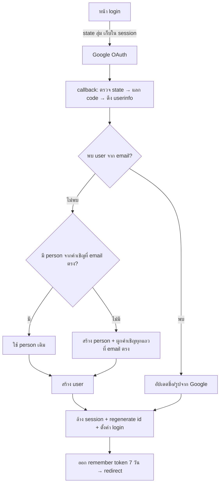
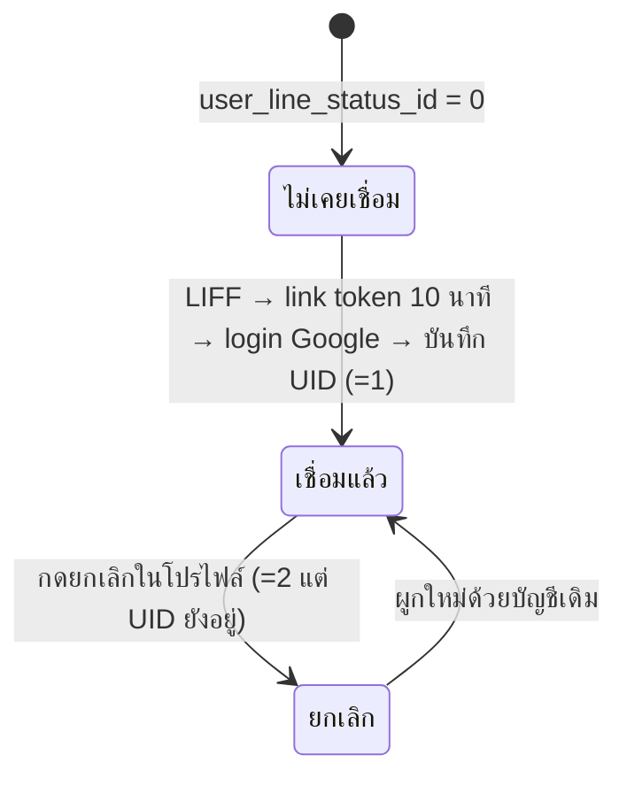

# ตัวตนผู้ใช้: Login Google, Remember-me, Session, โปรไฟล์และความยินยอม, Login-as, ผูกบัญชี LINE

- **ระดับใน MVP:** Must (อ้างหัวข้อ 8 ของ `docs/sila5school-study.md` ข้อ #1 ตัวตน · ข้อ #16 login-as ที่มี audit) · ส่วนส่งข้อความ LINE จริงเป็น Should (#18)
- **โค้ดอ้างอิง:** (path ตาม repo เดิม · สำเนาในเครื่องอยู่ที่ `reference/sila5school/` path เดียวกัน)
  - `module/user/controller/loginController.php`, `logoutController.php`, `profileController.php`
  - `library/rgt/siteAuth.php`, `library/rgt/core/{session,sessionValidator,authorization,controller,tokenStore}.php`
  - `module/line/controller/liffController.php`, `library/module/line.php`
  - ฟังก์ชันประกอบใน `library/module/global.php`, `library/module/global-master.php`
  - `public_html/user/js/user-login.js` (มีแค่ comment ว่าง) · `public_html/line/js/line-liff-connect.js` (ไฟล์ว่าง) — โค้ด LIFF ฝั่ง browser ไม่อยู่ในสำเนานี้
  - schema: `docs/schema/sila5school.sql` ตาราง `user`, `person`, `user_remember_tokens`, `line_link_tokens`
- **อ่านประกอบ:** study หัวข้อ 2.1, 5.1, 5.5, 6.2, 6.3, 7 · Context ข้อ 31, 33, 34, 42, 53, 60.2, 60.5 (Login/กฎความปลอดภัย), 60.7, 60.10.6

## 1. ฟีเจอร์นี้ทำอะไร

1. ให้ผู้ใช้เข้าระบบด้วยบัญชี Google อย่างเดียว ครั้งแรกระบบสร้างบัญชี (`user`) และข้อมูลบุคคล (`person`) ให้เอง
2. จำการเข้าระบบ 7 วันด้วย remember token ที่หมุนเปลี่ยนเมื่อถูกใช้ และตัด session เมื่อไม่ใช้งาน 30 นาที
3. หน้าโปรไฟล์: แก้ชื่อ วันเกิด เพศ รูป เบอร์โทร (ยืนยัน OTP) Line ID ตำแหน่ง/โรงเรียน (เฉพาะคนทั่วไป) และที่อยู่จัดส่งพัสดุ
4. เก็บความยินยอม 2 ค่า: นโยบายความเป็นส่วนตัว และการใช้ข้อมูลเพื่อโฆษณา
5. แอดมินจากระบบอื่นเข้าเป็นผู้ใช้คนใดก็ได้ด้วยลิงก์ที่เซ็น HMAC อายุ 5 นาที (login-as)
6. ผูก LINE UID กับบัญชี Google ผ่าน LIFF เพื่อรับแจ้งเตือน (login ด้วย LINE ไม่ได้) และยกเลิกการผูกได้

## 2. ผู้ใช้และสิทธิ์ในระบบเดิม

- **ผู้ใช้ทั่วไป:** ทุกคนที่มีบัญชี Google · ฝั่งนี้ไม่มี role/permission แยก สิทธิ์ในเมนูครูมาจาก `stk_type_id` (ดูสเปก 02)
- **ด่านตรวจ:** controller เรียก `checkLogin()` เองในแต่ละไฟล์ (`module/user/controller/profileController.php:35`)
  - คลาสแม่แบบ default-deny มีอยู่ (`library/rgt/core/controller.php:33-53`) แต่หัวไฟล์ระบุว่ายังไม่มี controller ไหนย้ายมาใช้ (`:3-4`) และไม่มี controller ในสำเนานี้ที่ extends
  - ระบบระดับสิทธิ์ตัวเลข 1/2/3/5 (`library/rgt/core/authorization.php:148-187`) เป็นของระบบแอดมิน ไม่ถูกใช้ในโมดูลที่ศึกษา
- **login-as:** action เปิดสาธารณะ ใครถือลิงก์ที่เซ็นถูกต้องและยังไม่หมดอายุก็เข้าได้ (`module/user/controller/loginController.php:278-313`)
- **LINE:** `createToken` ไม่ต้อง login (ใช้ access token ของ LINE แทน) · `connect` บังคับ login Google ก่อนผูก (`module/line/controller/liffController.php:144-152`)

## 3. ข้อมูลในระบบเดิม

| ตาราง | คอลัมน์สำคัญ / ค่าสถานะ |
|---|---|
| `user` (`docs/schema/sila5school.sql:2548-2575`) | `user_gmail` (มี index แต่**ไม่ unique**), `user_google_id` (เก็บแต่ไม่ใช้ค้น), `user_social_*` (ชื่อ/รูปจาก Google), `user_line_uid` (**ไม่มี index/unique**), `user_line_status_id` 0 ไม่เคยเชื่อม / 1 เชื่อมแล้ว / 2 ยกเลิก, `user_privacy_policy` 0/1 + เวลา, `user_advertising_policy` 0 ยังไม่ถาม / 1 ยอมรับ / 2 ปฏิเสธ + เวลา, `user_status` (ไม่มีโค้ดใช้), `user_last_signin` |
| `person` (`:1163-1190`) | ชื่อ-นามสกุล คำนำหน้า วันเกิด เพศ รูป เบอร์ Line ID ที่อยู่จัดส่ง · `person_type_id` (ตำแหน่ง) และ `person_school_id` **ได้อย่างละค่าเดียว** |
| `user_remember_tokens` (`:2625-2635`) | `urt_token` = SHA-256 ของ token (PK), `urt_user_id` (FK cascade), `urt_user_agent`, `urt_ip_address`, `urt_create_datetime`, `urt_expire_datetime` |
| `line_link_tokens` (`:751-761`) | `token` (เก็บ**ค่าจริง ไม่ hash**), `line_uid`, `display_name`, `picture_url`, `expired_at` |
| session | เก็บใน Valkey หรือ MySQL (`library/rgt/core/session.php:91-141`) ค่าใน session: `login`, `user`, `person`, `user_ip`, `user_agent`, `last_activity` (`library/module/global.php:37-42`) |

`library/rgt/core/tokenStore.php:3-11` **ไม่เกี่ยวกับ remember-me** เป็นที่เก็บ token ของ API ภายนอก (HR/Zoom) ใช้ร่วมกันข้าม request

## 4. Flow และลำดับสถานะ

**วงจร remember token:** request ที่ไม่มี session หรือ session หมดอายุ + มี cookie → หา hash → ตรวจหมดอายุ → ตรวจ fingerprint browser|OS → สร้าง session ใหม่ → หมุน token (ของเก่าเหลืออายุ 60 วินาที)

## 5. Business rule

1. Login ด้วย Google เท่านั้น ขอ scope `openid email profile` และต้องได้ email กลับมา (`module/user/controller/loginController.php:46, 162-164`)
2. OAuth state สุ่ม 32 ไบต์ เก็บใน session ใช้ค่าเดิมถ้ามีอยู่แล้ว (กันเปิด 2 แท็บ) และลบทิ้งทันทีหลังตรวจด้วย `hash_equals` (`:89-92, 117-122`)
3. หาบัญชีด้วย **email** ไม่ใช่ Google id (`:184` → `library/module/global.php:3113-3116`)
4. ผู้ใช้ใหม่: ถ้ามี `person` ที่ถูกเพิ่มไว้ในทีมด้วย email เดียวกันให้ใช้ person นั้น ไม่งั้นสร้างใหม่แล้วผูกคำเชิญที่ค้าง (`loginController.php:186-198`, `global.php:2731-2775`)
5. ทุกครั้งที่ login เขียนชื่อและรูปจาก Google ทับใน `user_social_*` แต่ไม่ทับ `person` (`loginController.php:236-244`)
6. ดึงรูปโปรไฟล์ Google มาเก็บเฉพาะครั้งแรกหรือเมื่อยังไม่มีรูป · รับเฉพาะโดเมนของ Google, ≤ 5MB, ต้องเป็นรูปจริง (`:232-234, 318-358`)
7. หลังยืนยันตัวตน ล้าง session และ regenerate session id ก่อนตั้งค่า login (`global.php:28-29`)
8. Session หมดเมื่อไม่ใช้งานเกิน 1,800 วินาที (`library/rgt/core/sessionValidator.php:9-17`) · อายุ record ใน store ตั้งให้ยาวกว่า (ค่าเริ่ม 7,200) (`library/rgt/core/session.php:111-115`)
9. ทุก request ที่ต้อง login ตรวจ User-Agent: ตรงทั้งสตริง หรือ fingerprint `browser|OS` ตรง (ไม่สนเลขเวอร์ชัน) · เครื่อง dev ข้ามด่านนี้ (`library/rgt/core/authorization.php:30-33`, `sessionValidator.php:24-73`)
10. Remember token: สุ่ม 32 ไบต์ เก็บ SHA-256 ใน DB อายุ 7 วัน (`loginController.php:259-271`)
11. Auto-login ทำงานเฉพาะเมื่อไม่มี session หรือ session หมดอายุ (`library/rgt/siteAuth.php:21-30`) · token หมดอายุ หรือ fingerprint ไม่ตรง หรือ fingerprint เป็น Unknown → ลบ token และลบ cookie (`:46-61`)
12. หมุน token ทุกครั้งที่ใช้ auto-login: token เก่าเหลือ 60 วินาที (กัน request พร้อมกัน) + ออก token ใหม่ 7 วัน ใน transaction เดียว · ตั้ง cookie หลัง commit เท่านั้น ถ้าล้มเหลวให้ใช้ token เดิมต่อ (`:74-81, 95-143`)
13. token ที่อยู่ในช่วง grace (อายุรวม < 7 วัน − 120 วินาที) จะไม่ถูกหมุนซ้ำ (`:77-78`)
14. ล้าง token หมดอายุแบบสุ่ม 1% ของ auto-login และทุกครั้งที่ login (`:83-86`, `loginController.php:257`)
15. Logout ลบ remember token **ทุกเครื่อง** ของผู้ใช้ แล้วทำลาย session (`module/user/controller/logoutController.php:39-48`, `global.php:3173-3179`)
16. Login-as: ถอด token ที่เซ็น HMAC (คีย์ต่อ context จาก secret ฝั่ง server) ต้องมี 3 ค่า (user id, รหัสแหล่งที่มา, timestamp) และอายุไม่เกิน 300 วินาที (`loginController.php:286-305`, `library/module/global-master.php:2701-2761`)
17. ความยินยอม: เมื่อส่งฟอร์ม privacy = 1 เสมอ · โฆษณา 1 = ยอมรับ / 2 = ปฏิเสธ · บันทึกเวลายอมรับทับค่าเดิม (`module/user/controller/profileController.php:42-74`)
18. แก้เบอร์โทรต้องยืนยัน OTP 6 หลัก อายุ 10 นาที เก็บรหัสใน session (`profileController.php:338-435`, `global.php:137-145`)
19. แก้ "ตำแหน่ง/โรงเรียน" เองได้เฉพาะคนที่ยังไม่อยู่ในทีมโรงเรียนและไม่ใช่นักเรียน · ประเภท 90/91 ถูกตัดออกจากตัวเลือก (`profileController.php:539-559, 613, 627-671`)
20. LINE: verify access token กับ LINE และต้องได้ `client_id` ตรงกับ channel ที่ตั้งไว้ ก่อนเชื่อ UID (`liffController.php:63-81`)
21. link token สุ่ม 32 ไบต์ อายุ 10 นาที ใช้ครั้งเดียว (ลบเมื่อผูกสำเร็จ) (`:94-105, 171`, `global.php:3655-3676`)
22. LINE UID หนึ่งค่าผูกได้กับ 1 บัญชี ตรวจในโค้ดเท่านั้น (`liffController.php:159-163`) · บัญชีหนึ่งมี UID ได้ค่าเดียว ผูกใหม่จะทับของเก่า (`global.php:3131-3141`)
23. ยกเลิกการผูกตั้งสถานะ 2 แต่ไม่ลบ UID (`global.php:3142-3148`, `profileController.php:762-779`)

## 6. การตรวจข้อมูลขาเข้า (validation)

- callback: state ต้องตรง · code ต้องไม่ว่าง · token/userinfo timeout 5 วินาที · error ทุกแบบ redirect กลับหน้า login พร้อมรหัส 403/404 (`loginController.php:114-174`)
- โปรไฟล์: ชื่อ/นามสกุลห้ามว่าง วันเกิดต้องเป็นวันที่ (`profileController.php:272-274`) · ตำแหน่งต้องอยู่ใน `0..5` และต้องเลือกโรงเรียนจาก token ที่เซ็น (`:633-650`) · ที่อยู่ต้องครบทุกช่อง (`:729-731`)
- รูปโปรไฟล์: ตรวจ MIME จากค่าที่ browser ส่งมา (jpeg/png) และขนาด ≤ 50MB (`:158-163`) ไม่ได้ตรวจเนื้อไฟล์จริงใน action นี้
- Line ID รับข้อความอิสระ ไม่ตรวจรูปแบบ (`:447-457`)
- LIFF: ต้องมี access token · ต้องได้ UID จาก profile API (`liffController.php:55-58, 90-92`)

## 7. Edge case และพฤติกรรมที่ควรรู้

- **Session timeout 30 นาทีแทบไม่มีผลจริง** ถ้ามี remember token ระบบจะ re-login ให้เงียบ ๆ และเพราะหมุน token ใหม่อายุ 7 วันทุกครั้ง ผู้ที่กลับมาภายใน 7 วันจึงอยู่ในระบบได้ไม่มีกำหนด (ไม่มี absolute lifetime)
- เปลี่ยน browser หรือ OS (เช่น เปิดลิงก์จากแอปอื่น) → fingerprint ไม่ตรง → ถูกเด้งออกและ token ถูกลบ
- เพราะหาด้วย email: ถ้า email ของบัญชี Google เปลี่ยน ระบบจะสร้างบัญชีใหม่ · และ `user_gmail` ไม่ unique จึงมีโอกาสได้แถวซ้ำเมื่อ callback ซ้อนกัน
- ผู้ใช้ใหม่อาจถูกผูกเข้ากับ `person` ที่คนอื่นสร้างไว้ (จากคำเชิญที่ email ตรง) ทันที โดยไม่ต้องยืนยัน (`loginController.php:187-189`)
- **ข้อมูลจริงพบความยินยอม 2 ค่าเท่ากันทุกบัญชี** (study 2.1) · โค้ดเทียบ `advertising == true` แบบหลวม (`profileController.php:46`) ถ้าหน้าบ้านส่งสตริง `"false"` จะถูกนับเป็นยอมรับ อาจเป็นสาเหตุ (ยืนยันไม่ได้ เพราะโค้ดหน้าบ้านที่เรียกไม่อยู่ในสำเนา)
- OTP: ไม่จำกัดจำนวนครั้งที่กรอกผิดหรือขอส่งใหม่ใน action ที่ศึกษา (`profileController.php:366-388`)
- LIFF: link token อยู่ใน query string ใครได้ลิงก์ภายใน 10 นาทีก็ผูก UID นั้นเข้าบัญชี Google ของตัวเองได้ (token ไม่ผูกกับ browser ที่สร้าง)
- UID ที่ยกเลิกแล้วยังค้างที่บัญชีเดิม ทำให้ผูก LINE เดียวกันกับบัญชีอื่นไม่ได้ ("LINE นี้ถูกเชื่อมกับบัญชีอื่นแล้ว")
- เปิดหน้าเชื่อมจาก browser ปกติโดยไม่มี token → แสดงข้อความให้เปิดจาก LINE (`liffController.php:195-197`)
- ข้อมูลจริง: ผูก LINE แล้ว 502 จาก 4,098 บัญชี (study 5.1)

## 8. สิ่งที่ห้ามทำตาม

- **Login-as ไม่มี audit log** ไม่มีเหตุผล ไม่มีป้ายบอกว่ากำลังสวมสิทธิ์ ใช้ลิงก์ซ้ำได้ภายใน 5 นาที และเซ็นด้วย secret ที่ใช้ร่วมหลายระบบ (`loginController.php:278-313`)
- หาบัญชีด้วย email แทน subject id ของ provider · `user_gmail` และ `user_line_uid` ไม่มี unique constraint
- ไม่ตรวจ `user_status` เลย จึงระงับบัญชีไม่ได้
- ขอ `access_type=offline` + `prompt=consent` ทั้งที่ไม่ใช้ refresh token (`loginController.php:99-100`)
- Logout เป็น GET และลบ token ทุกเครื่อง · redirect หลัง logout สร้างจาก `HTTP_HOST` โดยตรง (`logoutController.php:37-50`)
- Session cookie ตั้ง `SameSite=None` บน HTTPS (`session.php:49-57`)
- เก็บ link token ของ LINE เป็นค่าจริง ไม่ hash · ส่ง Telegram ชื่อจริงของครูทุกครั้งที่ผูก LINE (`liffController.php:178-183`)
- สร้าง QR ผ่านบริการภายนอก (`global.php:3611`)
- ความยินยอมเก็บเป็นคอลัมน์ทับค่าเดิม ไม่มี version ของนโยบายและไม่มีประวัติ · Meta CAPI ส่งข้อมูลโดยไม่ตรวจค่าโฆษณา (study 5.5, 6.1)
- ตำแหน่งและโรงเรียนเก็บที่ตัวคน (`person_type_id`, `person_school_id`) ขัดข้อ 32–34
- OTP เทียบด้วย `!=` แบบหลวม ไม่จำกัดครั้ง และบังคับ OTP ทาง SMS (study หัวข้อ 8 "สิ่งที่ไม่นำมา")
- เก็บที่อยู่จัดส่งพัสดุไว้ที่ข้อมูลบุคคล (เฉพาะการส่งสื่อของ Sila5School)

## 9. แนวทางใน SkillWise

**ตารางใหม่และ mapping**

| เดิม | SkillWise |
|---|---|
| `user` (บัญชี) + ส่วนตัวตนใน `person` | `users` (ชื่อที่แสดง ชื่อ-นามสกุล รูป เบอร์ สถานะบัญชี) · ตัวตนไม่มีโรงเรียนหรือตำแหน่ง |
| `user_google_id`, `user_gmail`, `user_line_*` | `user_identities` แถวละ provider: `provider` (google / line_login / line_messaging), `provider_subject`, email + verified, ชื่อ/รูปจาก provider, `linked_at`, `unlinked_at` · unique (`provider`, `provider_subject`) |
| `user_remember_tokens` | `auth_sessions` (hash ของ token, family สำหรับตรวจการใช้ซ้ำ, user agent, ip, created/expires/rotated/revoked, ผู้สวมสิทธิ์ถ้ามี) |
| `user_privacy_policy`, `user_advertising_policy` | `policy_documents` (ประเภท, version, วันประกาศ) + `user_consents` (append-only: เอกสาร/version, ยอมรับหรือปฏิเสธ, เวลา, การถอน) |
| `person_type_id`, `person_school_id` | ย้ายไป `memberships` (ตำแหน่งต่อองค์กร) ดูสเปก 02 |
| `line_link_tokens` | state ชั่วคราวใน Redis (TTL) หรือตารางที่เก็บเฉพาะ hash |
| login-as | `audit_logs` (เริ่ม/จบการสวมสิทธิ์ เหตุผล ผู้ทำ ผู้ถูกสวม) + ผูกกับ `auth_sessions` |

**Permission ที่ endpoint ต้องประกาศ**

- login/callback/logout ของ Google และ LINE: ประกาศเป็น public อย่างชัดเจน (ค่าเริ่มต้นของ guard ยังเป็นปฏิเสธ)
- ดู/แก้โปรไฟล์ ความยินยอม ผูก/ยกเลิก LINE, ดู/ยกเลิก session ของตัวเอง: `self.profile.manage` (ตรวจว่าเป็นเจ้าของ)
- แอดมินดูผู้ใช้: `admin.users.view` · ระงับบัญชี ยกเลิกการผูก identity บังคับ logout: `admin.users.manage`
- สวมสิทธิ์: `admin.impersonate` · ดู log: `admin.audit.view`

**สิ่งที่ต้องเปลี่ยนจากระบบเดิม**

1. Login ทำใน `apps/api` ด้วย Passport (Google, LINE) เก็บ session ใน httpOnly cookie โดเมนเดียวกับเว็บ (ข้อ 60.5) · `apps/web` ไม่แตะ token หรือฐานข้อมูล
2. **LINE Login เป็นวิธีเข้าระบบได้โดยตรง** และผูกหลาย identity กับ user เดียวได้ (study 7, ข้อ 60.10.6) · การผูก identity ใหม่ต้องทำขณะ login อยู่แล้วเท่านั้น และ state ต้องผูกกับ session ที่เริ่ม flow
3. หาผู้ใช้ด้วย (`provider`, `provider_subject`) ไม่ใช้ email · ใช้ email ได้เฉพาะเพื่อจับคู่คำเชิญ และต้องเป็น email ที่ provider ยืนยันแล้ว · normalize เป็นตัวพิมพ์เล็กก่อนเทียบ (PostgreSQL เทียบตัวพิมพ์ ไม่เหมือน collation ของ MySQL เดิม)
4. Remember-me: เก็บ hash, หมุนเมื่อใช้, มี grace window สั้นสำหรับ request พร้อมกัน และถ้าพบ token เก่าถูกใช้หลังพ้น grace ให้เพิกถอนทั้ง family · fingerprint browser|OS ใช้เป็นสัญญาณประกอบได้
5. ค่า idle timeout, อายุ remember-me และ absolute lifetime ทำเป็น config (ค่าในระบบเดิม 30 นาที / 7 วัน / ไม่มี)
6. Logout เป็น POST ออกเฉพาะ session ปัจจุบัน · มีปุ่ม "ออกจากทุกอุปกรณ์" แยก
7. Login-as ทำในระบบเดียว (ไม่ใช้ลิงก์ข้ามระบบ) ต้องมี `admin.impersonate` ระบุเหตุผล บันทึก `audit_logs` ตอนเริ่ม/จบ แสดงแถบบอกตลอดเวลา หมดอายุเอง และ token ใช้ครั้งเดียว · การเปิดข้อมูลอ่อนไหวระหว่างสวมสิทธิ์ต้องบันทึกทั้งผู้ทำจริงและผู้ถูกสวม (ข้อ 60.7)
8. ความยินยอมแยกตามประเภทจริง (privacy / การตลาด) มี version ของนโยบาย เก็บประวัติแบบ append-only · ถ้านโยบายเปลี่ยน version ให้ถามใหม่ · analytics/pixel ฝั่งโฆษณาทำงานได้เฉพาะเมื่อยินยอมด้านการตลาดแล้ว
9. มีสถานะบัญชี (ใช้งาน / ระงับ) และตรวจทุก request
10. ข้อมูลตำแหน่งและองค์กรไม่อยู่ที่ตัวผู้ใช้ ครูอิสระที่ไม่มีองค์กรต้องใช้ระบบได้ครบ (ข้อ 33, 34)
11. รูปโปรไฟล์และไฟล์ทั้งหมดเป็น private โดยค่าเริ่มต้น (บันทึกใน `files`) ตรวจชนิดไฟล์จากเนื้อไฟล์ ไม่เชื่อ MIME จาก browser
12. แจ้งเตือนทีมงานภายใน (แทน Telegram) ต้องไม่มีชื่อจริงหรือข้อมูลติดต่อของผู้ใช้
13. OTP/ยืนยันเบอร์ไม่บังคับ ถ้าจะมีต้องจำกัดจำนวนครั้งและเก็บ hash ของรหัส
14. LIFF / LINE ทุกช่องทางเรียก API ชุดเดียวกับเว็บและผ่าน guard เดียวกัน (ข้อ 60.5)

## 10. คำถามที่ยัง OPEN

1. ค่า idle timeout / อายุ remember-me / absolute lifetime ของ SkillWise
2. ช่วงสวมสิทธิ์ให้แก้ไขข้อมูลได้หรือดูอย่างเดียว และสวมสิทธิ์แอดมินคนอื่นได้หรือไม่ (ข้อ 60.7 กำหนดแค่ว่าต้องมี audit)
3. ผู้ใช้ 1 คนผูก LINE ได้กี่บัญชี และถ้า LINE ที่ผูกอยู่กับบัญชีอื่น จะให้ย้ายได้หรือต้องให้แอดมินจัดการ
4. login ครั้งแรกด้วย LINE (ไม่มี email) จะจับคู่กับคำเชิญทางอีเมลอย่างไร
5. ประเภทความยินยอมที่ต้องมีใน Phase 1 และข้อความนโยบาย (เกี่ยวกับ PDPA ข้อ 31, 60.2)
6. ข้อมูลโปรไฟล์ที่ต้องเก็บจริง (วันเกิด เพศ เบอร์ ที่อยู่จัดส่ง) · ที่อยู่จัดส่งจำเป็นเมื่อขายสินค้าจับต้องได้ (study 8 #21 Later)
7. ถ้าย้ายบัญชีจาก Sila5School (study 9 ข้อ 11) จะจับคู่ด้วยอะไร และขอความยินยอมใหม่อย่างไร
