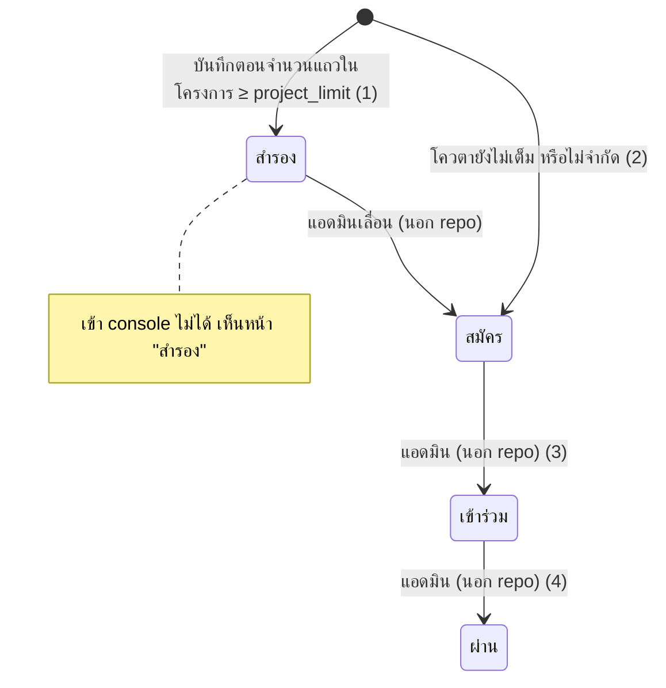
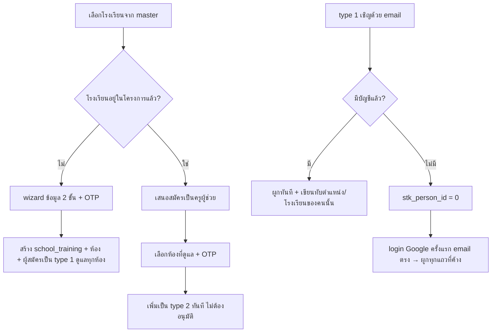

# องค์กรและทีม: โรงเรียนสมัครเข้าโครงการ, ทีมครู, ห้องที่ครูดูแล, โปรไฟล์โรงเรียน

- **ระดับใน MVP:** Must (อ้างหัวข้อ 8 ของ `docs/sila5school-study.md` ข้อ #2 องค์กร + โครงสร้างที่ตั้งค่าได้ + ครูอิสระ · ข้อ #3 เชิญครู + บทบาทจาก permission) · ส่วนโควตา/สำรอง/M1–M3 เป็นของเฉพาะ Sila5School ไม่ port (ใช้ Seat ตามข้อ #5 แทน)
- **โค้ดอ้างอิง:** (path ตาม repo เดิม · สำเนาในเครื่องอยู่ที่ `reference/sila5school/` path เดียวกัน)
  - `module/project/controller/registerController.php` เฉพาะส่วนสมัครโรงเรียนและครูผู้ช่วย (`:45-1783`) · ส่วนนักเรียนสแกน QR (`:1799-2015`) อยู่สเปกอื่น
  - `module/console/controller/teamController.php`, `module/console/controller/profileController.php`, `public_html/console/js/console-team.js`
  - ฟังก์ชันใน `library/module/console.php`, `library/module/project.php`, `library/module/global.php`
  - schema: `docs/schema/sila5school.sql` ตาราง `project`, `school`, `school_training`, `school_training_class`, `school_training_kru`, `kru_type`
- **อ่านประกอบ:** study หัวข้อ 2.2, 2.3, 6.2, 6.3, 7, 7.1 · Context ข้อ 30–35, 42, 47, 53, 54, 60.2, 60.7, 60.8

## 1. ฟีเจอร์นี้ทำอะไร

1. โรงเรียนสมัครเข้า "โครงการ" (1 โครงการ = 1 ปีการศึกษา) ผ่าน wizard 4 ขั้น: ข้อมูลผู้สมัคร/โรงเรียน/ผอ. → ระดับภารกิจ ห้อง และรอบปฐมนิเทศ → OTP ทาง SMS → บันทึก
2. คนแรกที่สมัครโรงเรียนเป็น "ผู้ประสานงานหลัก" (type 1) · โครงการมีโควตา เต็มแล้วได้สถานะสำรอง
3. ครูคนอื่นเข้าทีมได้ 2 ทาง: ผู้ประสานงานเชิญด้วยอีเมล (type 2/3) หรือ**สมัครเองเป็นครูผู้ช่วย** เมื่อเลือกโรงเรียนที่สมัครแล้ว
4. จัดห้องเรียนที่เข้าร่วม และกำหนดห้องที่ครูแต่ละคนดูแล ซึ่งเป็นตัวกรองว่าครูเห็นนักเรียนห้องไหน
5. หน้าโปรไฟล์โรงเรียนใน console: โลโก้ ข้อมูลโรงเรียน ข้อมูล ผอ. และยอดนักเรียน V1/V2

## 2. ผู้ใช้และสิทธิ์ในระบบเดิม

| type (`stk_type_id`) | บทบาท | ในส่วนนี้ทำอะไรได้ | ด่านที่ตรวจจริง |
|---|---|---|---|
| 1 | ผู้ประสานงานหลัก | เห็นเมนูบริหารทีม, เชิญ/แก้ห้อง/ลบครู, จัดห้องเรียน | เมนู (`library/module/console.php:451-453`), หน้า index ทีม (`module/console/controller/teamController.php:162-169`), ปุ่มจัดห้อง (`console.php:329-331`) |
| 2 | ครูผู้ช่วย | แก้ข้อมูลโรงเรียน โลโก้ ยอดนักเรียน · **เรียก action บันทึกของทีมและห้องได้** เพราะ action ไม่ตรวจ type | ไม่มี |
| 3 | ครูร่วมกิจกรรม | อ่านอย่างเดียวผ่าน whitelist แบบ default-deny · ดูตารางทีม (`getTable`) ได้ | `console.php:106-141` |

- **เลือกบริบท (โครงการ, โรงเรียน) จาก session:** หาแถว type 1/2 ของโครงการที่ยังไม่จบด้วย `LIMIT 1` ไม่มี ORDER BY · ถ้าไม่เจอแต่เป็น type 3 เข้า console แบบอ่านอย่างเดียว · ไม่เจอเลยถูกส่งไปหน้าสมัคร (`library/module/global.php:752-791, 960-1003`)
- **ไม่มีแอดมินใน repo นี้:** การเลื่อนสถานะสำรอง → สมัคร → เข้าร่วม → ผ่าน และการเปลี่ยนผู้ประสานงานทำในระบบแอดมินที่อยู่นอก repo

## 3. ข้อมูลในระบบเดิม

| ตาราง | คอลัมน์สำคัญ / ค่าสถานะ |
|---|---|
| `project` (`docs/schema/sila5school.sql:1319-1347`) | `project_limit` (โควตาโรงเรียน, 0 = ไม่จำกัด), ช่วงสมัคร, ช่วงดำเนินงาน, ช่วงส่งฟรี, `project_type` 0 โรงเรียน / 1 องค์กร |
| `school` (`:1608-1644`) | master data โรงเรียนไทย: ประเภท สังกัด เขต ระดับที่เปิดสอน จำนวนครู/นักเรียน โลโก้ ที่อยู่ลำดับชั้น · **ใช้ร่วมทุกปีทุกโครงการ** |
| `school_training` (`:2227-2258`) | PK (`st_project_id`, `st_school_id`) · `st_status_id` 1 สำรอง / 2 สมัคร / 3 เข้าร่วม / 4 ผ่าน (3–4 ไม่มีในโค้ดนี้) · `st_level` 1–3 = M1–M3 · `st_star` · ข้อมูล ผอ. (ชื่อ เบอร์) · `st_student_participant` (V1) / `st_student_participant_lv2` (V2) · flag สถานะของหลายเมนูในแถวเดียว |
| `school_training_class` (`:2262-2275`) | ห้องที่เข้าร่วม: `stc_class_id` (4–15 = ป.4–ป.ตรี), `stc_room` (0–25), `stc_student_quantity` |
| `school_training_kru` (`:2279-2300`) | คน × โรงเรียน × โครงการ: `stk_type_id` (FK `kru_type`), `stk_class` = **CSV ของ `stc_id`** (varchar 2000), `stk_email` (คำเชิญ), `stk_person_id` = 0 คือคำเชิญที่ยังไม่มีคน login, `stk_position` (ตำแหน่ง ไม่มี FK) · **ไม่มี unique** ทั้งคู่ (โครงการ, โรงเรียน, คน) และ (โครงการ, โรงเรียน, email) |

## 4. Flow และลำดับสถานะ

## 5. Business rule

**สมัครโรงเรียน** (ทั้งหมดอยู่ใน `module/project/controller/registerController.php` ยกเว้นที่ระบุ)
1. แสดงฟอร์มเมื่อมีโครงการที่อยู่ในช่วงสมัครและเปิดอยู่ (`:68-88`, `global.php:1072-1079`) · หน้าแรกแสดงโควตา สมัครแล้ว คงเหลือ (`:96-136`)
2. เลือกโรงเรียนจาก master ตามจังหวัด → อำเภอ → โรงเรียน ด้วย id ที่เซ็นไว้ · หาไม่พบให้แจ้งขอเพิ่มชื่อ (`:89-93, 164, 356-361`)
3. ถ้าโรงเรียนอยู่ในโครงการแล้ว: ถ้าผู้ประสานงานคือตัวเองกลับหน้าแรก ไม่งั้นเสนอสมัครเป็นครูผู้ช่วย (`:412-437`)
4. ผู้สมัครเลือกตำแหน่งในโรงเรียนจาก `person_type` ชุดแรก · ถ้าเลือกตำแหน่งรหัส 2 ไม่ต้องกรอก ผอ. และใช้ข้อมูลตัวเองเป็นข้อมูล ผอ. (`:470-472, 532-538, 1037-1047`)
5. **[เฉพาะ Sila5School]** ระดับภารกิจ: ไม่เคยเข้า → M1 · ปีที่แล้ว ≥ 5 ดาว → เลือกระดับเดิมหรือสูงขึ้น (M3 คงที่) และถ้าผ่าน 2 ปีติดที่ระดับเดียวกันบังคับขึ้น · ไม่ถึง 5 ดาว → คงระดับ และถ้า 2 ปีติดที่ระดับเดียวกันลด 1 ระดับ (`:623-659`, `library/module/project.php:214-287`)
6. ห้องที่เข้าร่วมต้องมีนักเรียน > 0 (`:838-842`) · **[เฉพาะ Sila5School]** หมายเหตุ "รวมไม่ต่ำกว่า 20 คน" เป็นแค่ข้อความ ไม่ได้บังคับ (`:678`)
7. **[เฉพาะ Sila5School]** M2/M3 แยกยอดนักเรียนทำสมุด V2 ≤ ยอดรวม และ V1 = ยอดรวม − V2 (`:853-859`)
8. **[เฉพาะ Sila5School]** ต้องเลือกรอบปฐมนิเทศจากกิจกรรมที่ `activity_type` id = 6 แบบ hard-code (`:662, 689`)
9. OTP ทาง SMS ผูกกับเบอร์ เก็บใน session ส่งใหม่เมื่อเบอร์เปลี่ยน · ข้ามบนเครื่อง dev (`:877-885, 957-981`)
10. ตอนบันทึก: อัปเดตข้อมูลผู้สมัครรวม `person_school_id` และ**เขียนทับ master ของโรงเรียน** (`:995-1020`)
11. สถานะ: `project_limit` > 0 และจำนวนแถวของโครงการ ≥ limit → 1 สำรอง ไม่งั้น 2 สมัคร (`:1023-1026`) แล้วสร้างแถว (`:1028-1048`)
12. สร้างห้อง แล้วผู้สมัครเป็น type 1 ดูแลทุกห้อง (`:1050-1063`)
13. ย้ายข้อมูลครูรุ่นเก่า: แถวใน `person_old` ที่ email **หรือเบอร์โทร**ตรง → เพิ่มคนนี้เป็น type 1 ของโรงเรียนในโครงการเก่า (`:1066`, `global.php:2652-2686`)
14. ผลข้างเคียง: จองรอบปฐมนิเทศ (เต็ม → สำรอง) + สร้างลิงก์ Zoom, voucher ส่งฟรีถ้าอยู่ในช่วง, แจ้ง Telegram, ส่ง Meta Pixel/CAPI (`:1068-1216`)
15. สถานะสำรองเข้า console ไม่ได้ (`global.php:784-789`) และหน้าสมัครแสดงสถานะ "สำรอง" (`:66, 175-202`)

**ทีม**
16. สมัครเองเป็นครูผู้ช่วย: กรอกข้อมูลตัวเอง → เลือกห้องที่ดูแลและแก้จำนวนนักเรียนของห้องนั้น → OTP → เป็น type 2 ทันที ถ้าเคยเป็น type 3 ลบแถวเดิมออก (`:1401-1714`)
17. ลิงก์สมัครครูผู้ช่วยแบบมี token (โครงการ, โรงเรียน, email) ต้อง login ด้วย email ตรงกัน และต้องเป็นโครงการปัจจุบัน (`:1230-1342`, `global.php:1090-1097`) · ไม่พบโค้ดที่ออกลิงก์นี้ในสำเนาโค้ดอ้างอิง
18. เชิญได้เฉพาะ type 2/3 (เชิญ type 1 ไม่ได้) พร้อมตำแหน่งและห้องที่ดูแล (`teamController.php:201-238`)
19. อีเมลต้องเป็นโดเมนที่อนุญาต (Gmail + โดเมนองค์กรอีก 2 โดเมนที่ hard-code) ตรวจด้วยการหาคำในสตริง (`teamController.php:245-247`)
20. กันซ้ำ 2 ชั้น: email ที่มีบัญชีและอยู่ทีมใดก็ได้ในโครงการนี้ · หรือ `stk_email` ซ้ำในโรงเรียนเดียวกัน (`teamController.php:255-265`, `global.php:2787-2809`)
21. ผู้ถูกเชิญที่มีบัญชีแล้ว: ผูกทันที และเขียนทับ `person_type_id`/`person_school_id` ของเขา (`teamController.php:268-292`) · ยังไม่มีบัญชี: รอผูกตอน login ครั้งแรก โดยอัปเดตทุกแถวที่ email ตรง และเอาตำแหน่ง/โรงเรียนจากแถวแรก (`module/user/controller/loginController.php:197`, `global.php:2742-2775`)
22. ส่งอีเมลเชิญทันทีใน request (ไม่มีคิว ไม่มี log) · type 2 ลิงก์ไปหน้าสมัคร type 3 ลิงก์ไปหน้าแรก · ลิงก์ไม่มี token (`teamController.php:294-311`)
23. แก้ห้องที่ครูดูแล และลบครูออกจากทีม (ลบแถวจริง) · ซ่อนปุ่มสำหรับแถวของตัวเองแต่ action ไม่ตรวจ (`teamController.php:132, 322-388`)
24. ครูเห็นนักเรียนเฉพาะห้องใน `stk_class` (`console.php:527-543`, `module/console/controller/memberController.php:206`)
25. ไม่มีการเปลี่ยน type หรือโอนผู้ประสานงานหลักในแอป

**ห้องเรียนและโปรไฟล์โรงเรียน** (`module/console/controller/profileController.php`)
26. ห้องซ้ำ (ชั้น + ห้อง) ไม่ได้ (`:422-426, 494-497, 529-532`)
27. ลบห้องไม่ได้ถ้ามีนักเรียน และต้องเหลืออย่างน้อย 1 ห้อง (`:576-589`)
28. เพิ่ม/ลบห้องแล้วคำนวณ V1/V2 ใหม่ และเขียน `stk_class` ของ**คนที่กด**เป็นทุกห้อง ครูคนอื่นไม่ถูกปรับ (`:452-467, 608-623`)
29. **[เฉพาะ Sila5School]** ชั้นที่เลือกได้ขึ้นกับ "ระดับที่เปิดสอน" ของโรงเรียน (ป.4–ป.ตรี) และห้อง 0–25 (`global.php:45-79, 3070-3082, 3545-3556`)
30. แก้ข้อมูลโรงเรียนเขียนทับ master `school` ส่วนข้อมูล ผอ. เก็บต่อโครงการ (`:193-252`) · โลโก้ jpeg/png ≤ 50MB ลบไฟล์เก่าทิ้ง (`:59-146`) · ยอด V2 ต้องไม่เกินยอดรวม (`:282-320`)

## 6. การตรวจข้อมูลขาเข้า (validation)

- wizard ขั้น 1: ชื่อ นามสกุล วันเกิด ตำแหน่ง ต้องมี · เบอร์ยาว 10 หลัก (`registerController.php:755-761`) · ขั้นผู้ช่วยไม่ตรวจความยาวเบอร์ (`:1493-1499`)
- wizard ขั้น 2: ต้องมีระดับภารกิจ ห้อง จำนวน รอบ (`:836`) แต่**ไม่ตรวจว่าระดับที่ส่งมาอยู่ในชุดที่อนุญาต** (`:829, 862`)
- เชิญ: email รูปแบบถูก + type ∈ {2,3} + ตำแหน่งต้องมี แต่ไม่ตรวจว่าอยู่ในรายการ (`teamController.php:234-238`) · ห้องที่ดูแลไม่ตรวจเลย (`:243, 280`)
- แก้ห้องที่ดูแล: แค่ต้องไม่ว่าง (`teamController.php:354-358`)
- ข้อมูลโรงเรียน: สังกัด ระดับ จำนวนนักเรียนต้องมี · เขตพื้นที่บังคับเฉพาะสังกัดรหัส 1 (`profileController.php:196-206`)
- แก้จำนวนนักเรียนรายห้อง: ไม่ตรวจค่า (`profileController.php:550-556`)

## 7. Edge case และพฤติกรรมที่ควรรู้

- **นับโควตาโดยไม่มี transaction** ถ้าสมัครพร้อมกันอาจเกินโควตา (`registerController.php:1025-1026`)
- สมัครโรงเรียนเดียวกันพร้อมกัน: PK ของ `school_training` กันแถวที่สองได้ แต่โค้ดไม่ตรวจผล insert (`global.php:2279-2286`) แล้วเพิ่มผู้สมัครคนที่สองเป็น type 1 ต่อ จึงได้ผู้ประสานงานหลัก 2 คน
- ขั้นบันทึกไม่ตรวจช่วงสมัครและไม่ตรวจว่าโรงเรียนสมัครแล้วซ้ำอีกรอบ (`:950-1048`)
- ดาวย้อนหลังหาจาก "ปี ค.ศ. ของวันเริ่มโครงการ" ไม่ใช่ปีการศึกษา (`global.php:2320-2335`)
- ข้อมูล ผอ. ที่ตั้งใจเติมจากปีก่อน ค้นด้วย id ของโครงการปัจจุบัน จึงไม่เคยได้ค่าตอนสมัครใหม่ (`registerController.php:372-376`, `global.php:2304-2318`)
- email ที่ถูกเชิญแต่ยังไม่ login ถูกเชิญซ้ำจากอีกโรงเรียนได้ (กันซ้ำแค่ในโรงเรียนเดียว) → login ครั้งแรกจะผูกทั้งสองแถว แล้วบริบทถูกเลือกด้วย `LIMIT 1`
- ลบห้องแล้ว id ห้องยังค้างใน `stk_class` ของครูคนอื่น ระบบแค่ข้ามตอนแสดง (`global.php:2524-2542`)
- ลบครูออกจากทีมเป็นการลบแถว ไม่มีประวัติ และไม่ได้ดูว่าครูมีงานค้าง
- ข้อมูลจริง ปี 2569: 818 โรงเรียน (สถานะ "จอง" หรือสมัครแล้ว 810, สำรอง 7, สถานะ 0 อีก 1) · ครูคนเดียว 79% · คำเชิญที่ยังไม่ login 108 · ผู้ประสานงานหลัก 818 / ครูผู้ช่วย 401 / ครูร่วมกิจกรรม 96 (study 1.1, 2.3)

## 8. สิ่งที่ห้ามทำตาม

- **SQL injection แบบ second-order:** ห้องที่ดูแลจากฟอร์มถูกเก็บดิบใน `stk_class` (`teamController.php:243, 280, 356-358`, `registerController.php:1568`) แล้วนำไปต่อใน `IN (...)` (`console.php:542`)
- **ตรวจสิทธิ์แค่ที่หน้า index** action เพิ่ม/แก้/ลบครู และจัดห้องไม่ตรวจ type (`teamController.php:165` เทียบ `:232, 350, 372` · `profileController.php:406, 481, 571`)
- **ใช้ id ที่เซ็นแทนการตรวจความเป็นเจ้าของ** ไม่เช็กว่าแถวครู/ห้องเป็นของโรงเรียนปัจจุบัน (`teamController.php:324, 352, 374`, `profileController.php:484, 519, 553, 573`) · ขั้นผู้ช่วยแก้จำนวนนักเรียนของห้องตาม id ที่ส่งมาโดยไม่ตรวจโรงเรียน (`registerController.php:1680-1686`)
- **เข้าทีมเองโดยไม่ต้องอนุมัติ** แล้วเห็นชื่อนักเรียนของห้องที่เลือก (กฎข้อ 16) ขัดข้อ 60.2
- ครู type 1/2 คนใดก็แก้ master ของโรงเรียนที่ใช้ร่วมทุกปีได้ (`profileController.php:193-252` ไม่ตรวจ type · type 3 ถูกกันด้วย whitelist `console.php:120`) · ผูกสิทธิ์ผู้ประสานงานย้อนหลังด้วยการ match เบอร์โทร
- allowlist โดเมนอีเมลแบบ hard-code และตรวจด้วยการหาคำในสตริง
- เก็บ id หลายค่าเป็น CSV · flag ของหลายเมนูในแถวเดียว · เลือกบริบทด้วย `LIMIT 1` ไม่มี ORDER BY · ตำแหน่งและโรงเรียนเก็บที่ตัวคน
- **[เฉพาะ Sila5School] ห้าม hard-code:** โครงการ = ปีการศึกษา, โควตาโรงเรียน + สำรอง, M1–M3 และดาว, V1/V2 สมุด, ≥ 20 คน, `activity_type` = 6, ชั้น ป.4–ป.ตรี, ห้อง 0–25, สังกัด/เขตแบบไทยเป็นช่องบังคับ (Context 9, 35, 47, 53)
- ส่งชื่อครู โรงเรียน และจำนวนนักเรียนเข้า Telegram · Meta CAPI โดยไม่ตรวจความยินยอม · ส่งอีเมลในตัว request ไม่มีคิว/log · บังคับ OTP ทาง SMS
- เก็บชื่อและเบอร์ ผอ. (บุคคลที่สาม) โดยไม่ระบุเหตุผลการใช้

## 9. แนวทางใน SkillWise

**ตารางใหม่และ mapping**

| เดิม | SkillWise | หมายเหตุ |
|---|---|---|
| `school` | `organizations` | ชื่อ ประเภท และ attribute ที่ไม่บังคับ · ทะเบียนโรงเรียนไทยใช้เป็นตัวช่วยค้น/เติมข้อมูลได้ แต่ไม่ใช่โครงสร้างบังคับ · แก้แล้วกระทบเฉพาะองค์กรนั้น |
| `project` + `school_training` | `seat_pools` (b2b / set) + `entitlements` | ไม่มีแนวคิด "โครงการรายปี" ในแกน · สถานะสมัคร/อนุมัติขององค์กร: OPEN |
| `school_training_class` | `org_units` (tree ที่องค์กรตั้งชื่อชั้นเองได้ เช่น ระดับ → ห้อง → กลุ่ม) | ไม่ fix ชั้นไทย (ข้อ 35) |
| `school_training_kru` | `memberships` (user × org, ตำแหน่ง, สถานะ, วันเข้า/ออก) + `role_assignments` + `seat_assignments` | ตำแหน่งไม่ให้สิทธิ์ |
| `stk_email` + `stk_person_id = 0` | `invitations` | ดูข้อ 6 ด้านล่าง |
| `kru_type` 1/2/3 | `roles` (scope organization) + `role_permissions` | เทียบกับร่างใน `seed.sql` [DIRECTION]: type 1 ≈ `org_admin` (`org.*` ทุกตัว) · type 2 ≈ `org_teacher` (`org.students.view`, `org.students.manage`) + สิทธิ์ `self.*` จากบทบาท `member` · type 3 (อ่านอย่างเดียว) ยังไม่มีบทบาทใน seed · ชุดจริง OPEN (ข้อ 50 #12) |
| `stk_class` (CSV) | `membership_org_units` (สมาชิก × `org_units` ขององค์กรเดียวกัน) | ใช้กรองหน้าจอว่าครูดูแลห้องไหน ไม่ใช่การให้สิทธิ์ |
| โลโก้โรงเรียน | `organizations.logo_file_id` → `files` (เจ้าของคือองค์กร, private โดยค่าเริ่มต้น) | ขึ้นหน้าสาธารณะได้เมื่อผ่านการอนุมัติเท่านั้น |
| การเปลี่ยนสมาชิก/บทบาท/คำเชิญ | `audit_logs` | ระบบเดิมไม่มี |

**Permission ที่ endpoint ต้องประกาศ**

- สร้างองค์กร: ใครสร้างได้ยัง OPEN (ผู้ใช้สร้างเอง หรือ `admin.organizations.manage` หลังตกลง B2B)
- ดูข้อมูลองค์กร: สมาชิกที่ active · แก้โปรไฟล์/โลโก้: `org.profile.manage`
- เชิญ, ส่งซ้ำ, ยกเลิกคำเชิญ, เปลี่ยนบทบาท/ตำแหน่ง/ห้องที่ดูแล, นำสมาชิกออก: `org.members.manage`
- รับคำเชิญ: ผู้ใช้ที่ login แล้ว (ตรวจว่าคำเชิญเป็นของ email/identity ของตัวเอง)
- สร้าง/แก้/ลบ `org_units`: `org.units.manage` · แจก seat: `org.seats.manage`
- ดูรายชื่อนักเรียน: `org.students.view` · ข้อมูลรวมของผู้บริหาร: `org.dashboard.view_aggregate`
- แอดมิน: `admin.organizations.view` / `.manage`, `admin.roles.manage`, `admin.users.manage`, `admin.seats.grant` · การเปิดดูข้อมูลนักเรียนของแอดมินต้องมี `admin.sensitive.student.view` และบันทึก `audit_logs` ทุกครั้ง

**สิ่งที่ต้องเปลี่ยนจากระบบเดิมตาม Context**

1. **แยกตัวตนออกจากการเป็นสมาชิก (ข้อ 33–34):** `users` ไม่มีโรงเรียนหรือตำแหน่ง · ออกจากองค์กร = ปิด membership (`status` = `left` / `removed` + `ended_at`) ไม่ลบผู้ใช้ และ Canvas/ประวัติการเรียนของครูไม่หาย (นโยบายความเป็นเจ้าของข้อมูล: OPEN)
2. **ครูอิสระไม่มีองค์กรต้องใช้ได้ครบ:** ห้ามมีด่าน "ไม่มีโรงเรียน → ไปหน้าสมัคร" แบบ `global.php:769-774` · สิทธิ์ใช้เครื่องมือมาจาก entitlement/seat รายคน (ข้อ 42, 60.8)
3. **หลายองค์กร:** membership เป็น many-to-many ใน schema (จะเปิดให้สังกัดหลายองค์กรพร้อมกันหรือไม่ยัง OPEN ดูข้อ 10 #2) · ทุก request ที่ทำงานในองค์กรต้องระบุองค์กรชัด (เช่น ใน path) แล้วตรวจ membership · ห้ามเดาบริบทด้วย `LIMIT 1`
4. **ตำแหน่ง ≠ สิทธิ์ (ข้อ 32, 54):** ตำแหน่งเก็บใน `memberships.position_title` เป็นข้อมูลแสดงผล (รายการตำแหน่ง OPEN ตามข้อ 50 #11) · สิทธิ์มาจาก `role_assignments` เท่านั้น · ห้าม `if (ตำแหน่ง == ผอ.)` ในโค้ด
5. **บทบาทประกอบจาก permission ที่ตั้งชื่อ (ข้อ 60.7):** ปรับได้โดยไม่แก้โค้ด · ข้อเสนอที่ยังไม่อยู่ใน Context และ schema: ผู้ที่มอบบทบาทต้องมีสิทธิ์ครบทุกตัวในบทบาทนั้น · มีผู้ดูแลองค์กรได้หลายคนและโอนได้ ต้องเหลืออย่างน้อย 1 คนเสมอ (แก้ปัญหา "โอนผู้ประสานงานไม่ได้")
6. **คำเชิญด้วยลิงก์หรืออีเมล ผูกตอน login แรก (หัวข้อ 8 #3):**
   - `invitations` เก็บ `token_hash`, `expires_at`, ใช้ครั้งเดียว (`accepted_at`), ยกเลิกได้ (`revoked_at`), บทบาทที่จะได้ (`role_id`), ผู้เชิญ, ผู้รับและเวลารับ · schema MVP ไม่มีช่องตำแหน่งหรือ `org_units` ในคำเชิญ ให้กำหนดหลังรับคำเชิญ (`memberships.position_title`, `membership_org_units`)
   - email เป็น `citext` (เทียบไม่สนตัวพิมพ์) · unique คำเชิญที่ยังค้างต่อ (องค์กร, email) · `email` เป็น null ได้ = เชิญด้วยลิงก์
   - ผูกเมื่อผู้ใช้ login ด้วย identity ที่ email ผ่านการยืนยันและตรงกัน หรือเปิดลิงก์เชิญขณะ login อยู่ (ผูกอัตโนมัติหรือต้องกดยอมรับ: ข้อ 10 #5) · คำเชิญ**ไม่เขียนทับ**ข้อมูลโปรไฟล์ของผู้ใช้
   - ไม่จำกัดโดเมนอีเมลแบบ hard-code · ส่งอีเมลผ่าน `notification_jobs` (มีคิว กันส่งซ้ำ มี log) โดยใช้ `recipient_email` + `invitation_id` เพราะผู้ถูกเชิญอาจยังไม่มีบัญชี
7. **ห้ามเข้าทีมเองโดยไม่อนุมัติ:** สมาชิกใหม่ต้องมาจากคำเชิญ หรือคำขอที่ผู้มี `org.members.manage` อนุมัติ (ตารางคำขอเข้าร่วมยังไม่มีใน schema MVP)
8. **ห้องที่ครูดูแลเป็น relation** ไม่ใช่ CSV · ตรวจว่า unit อยู่ในองค์กรเดียวกัน · ลบ unit แล้ว relation ต้องจัดการด้วย FK · ลบ unit ที่มีนักเรียนลงทะเบียนอยู่ไม่ได้
9. **ทุก action ตรวจสิทธิ์ที่ API ด้วย guard** และตรวจว่า resource ที่อ้างถึงเป็นขององค์กรใน path ไม่พึ่ง id ที่เซ็นหรือการซ่อนปุ่ม (ข้อ 60.5)
10. **ไม่มีโควตาโรงเรียนและสถานะสำรอง** ความจุคือจำนวน seat · seat และงานที่นับจำนวนต้องทำใน transaction + unique constraint (schema มี trigger `seat_assignments_capacity` ที่เรียกฟังก์ชัน `enforce_seat_capacity` ล็อกแถว pool ก่อนนับ และ unique seat ที่ยังใช้อยู่ต่อ pool × คน)
11. **ข้อมูลนักเรียน:** เห็นได้เฉพาะบุคลากรในองค์กร โค้ชที่ดูแล case และแอดมินที่มีสิทธิ์ (บันทึก audit ทุกครั้ง) (ข้อ 60.2, 60.7) · ผู้บริหารเห็นข้อมูลรวม (ข้อ 31, 60.3)
12. แจ้งเตือนทีมงานภายในต้องไม่มีข้อมูลส่วนบุคคล · analytics ด้านโฆษณาต้องผ่านความยินยอม (สเปก 01)

## 10. คำถามที่ยัง OPEN

1. ใครสร้างองค์กรได้ (ครูสมัครเอง, ผู้ซื้อ seat, หรือแอดมินหลังตกลง B2B) และองค์กรต้องมีสถานะรออนุมัติแบบเดิมหรือไม่
2. ครูสังกัดหลายองค์กรพร้อมกันได้หรือไม่ และผู้ซื้อ seat กับผู้ดูแลองค์กรเป็นบทบาทเดียวกันหรือไม่ (study 9 ข้อ 8)
3. ครูในองค์กรเห็นนักเรียนทั้งองค์กร หรือเฉพาะ unit ที่ได้รับมอบหมายแบบระบบเดิม (ข้อ 60.2 เขียนว่า "บุคลากรในโรงเรียนนั้น")
4. ชุดบทบาทและ permission ของฝั่งองค์กร รวมถึงต้องมีบทบาทอ่านอย่างเดียวแบบ "ครูร่วมกิจกรรม" หรือไม่ (ข้อ 50 #12)
5. คำเชิญผูกอัตโนมัติเมื่อ email ตรง หรือต้องให้ผู้ใช้กดยอมรับ · อายุคำเชิญ · เชิญผู้ที่ใช้ LINE Login อย่างเดียว (ไม่มี email) อย่างไร
6. ข้อมูลของครูเมื่อออกจากองค์กร: องค์กรยังเห็นอะไรได้บ้าง (ข้อ 34, 50 #10)
7. ต้องเก็บข้อมูล ผอ., จำนวนครู/นักเรียน, สังกัด/เขต ขององค์กรหรือไม่ และจะ import ทะเบียนโรงเรียนไทยแค่ไหน
8. จะย้ายทีมและโรงเรียนจาก Sila5School มาหรือไม่ (study 9 ข้อ 11)
