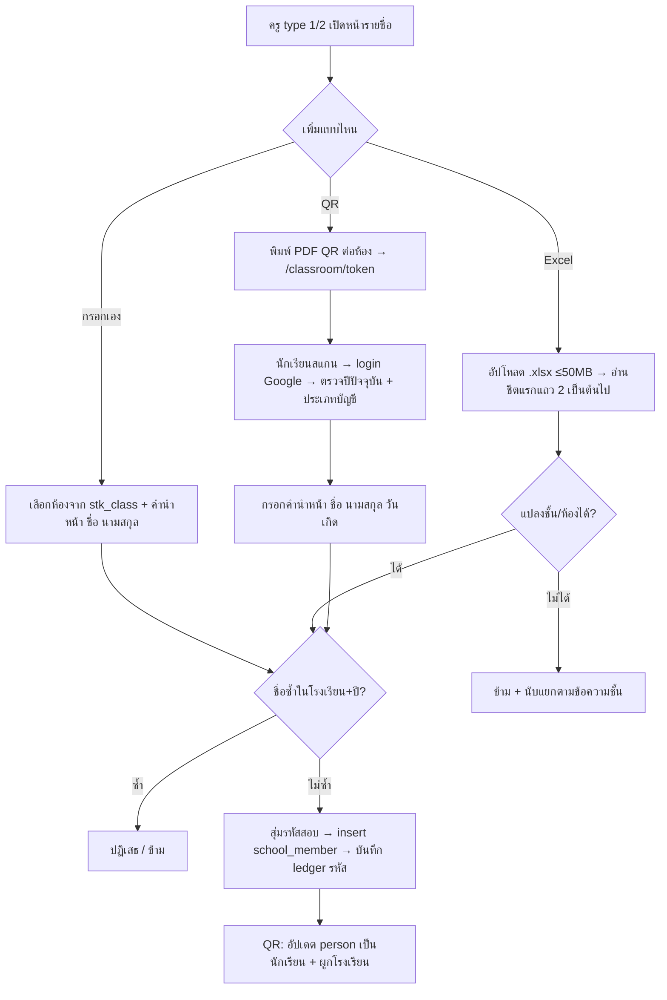

# นักเรียน: รายชื่อ ชั้น และห้องเรียน

- **ระดับใน MVP:** Must (หัวข้อ 8 ของ `docs/sila5school-study.md` ข้อ #4: ครูบันทึกนักเรียน + import Excel · ไม่มี account นักเรียน) · ทางที่ 3 "นักเรียนสแกน QR แล้ว login เอง" **ไม่อยู่ใน Phase 1** (ข้อ 44, 60.2)
- **โค้ดอ้างอิง:** path ตาม repo เดิม · สำเนาในเครื่องอยู่ที่ `reference/sila5school/` path เดียวกัน
  - `module/console/controller/memberController.php` — รายชื่อนักเรียนประเภท 1: เพิ่มเอง, Excel, QR, แก้, ลบ, คะแนนสมุด
  - `module/console/controller/member2Controller.php` — รายชื่อนักเรียนประเภท 2 (ผู้นำ) โค้ดชุดเดียวกันเกือบทั้งไฟล์ ไม่มี QR
  - `module/project/controller/registerController.php:1799-2015` — หน้านักเรียนลงทะเบียนเองจาก QR
  - `module/console/controller/profileController.php:406-479, 571-591` — เพิ่ม/ลบห้องเรียนของโรงเรียน (อ่านประกอบ)
  - `library/module/global.php` — รายการชั้น, CRUD `school_member`, ตรวจชื่อซ้ำ, รหัสสอบ
  - `library/module/console.php:106-141, 496-589` — whitelist ของครูอ่านอย่างเดียว, query รายชื่อและสรุปคะแนน
  - `library/module/global-master.php:1046-1060, 2677-2761` — ตัวอ่าน Excel, encode/decode token ใน URL
  - `library/rgt/integrations/excelValueBinder.php`, `library/rgt/integrations/excel_chunk_filter.php`
  - `library/rgt/routes.php:3` · `public_html/console/js/console-member.js`, `console-member2.js`
  - `docs/schema/sila5school.sql:1922-1948` (`school_member`), `:2262-2275` (`school_training_class`), `:2039-2043` (`school_member_type`)
- **อ่านประกอบ:** study 2.2, 2.4, 6.1, 6.2, 6.3, 7 (แถว `school_member`, `school_training_class`), 7.1 ข้อ 6 และ 9 · Context ข้อ 13, 30 (Student), 31, 35, 44, 47, 53, 60.2, 60.7

## 1. ฟีเจอร์นี้ทำอะไร

- ครูบันทึกรายชื่อนักเรียนของโรงเรียน**ต่อปีการศึกษา** (คำนำหน้า ชื่อ นามสกุล ห้อง) เพื่อใช้กับเครื่องมืออื่น เช่น เลือกนักเรียนที่ประทับใจในบันทึก, timeline รายเด็ก, ส่งคะแนนสอบ
- เพิ่มนักเรียนได้ 3 ทาง:
  1. ครูกรอกทีละคน
  2. ครู import ไฟล์ Excel (.xlsx)
  3. ครูพิมพ์ QR ประจำห้อง → นักเรียนสแกน → login Google → กรอกชื่อและวันเกิดเอง
- ห้องเรียนมาจากตาราง `school_training_class` ที่โรงเรียนตั้งตอนสมัครโครงการหรือแก้ที่หน้า "ข้อมูลโรงเรียน"
- ในระบบเดิมหน้านี้ชื่อ "ส่งคะแนนนักเรียน" งานหลักคือกรอกคะแนนสมุดบันทึกความดีและดูคะแนนสอบ 7 กิจวัตร ซึ่งเป็นของเฉพาะ Sila5School (หัวข้อ 8)

## 2. ผู้ใช้และสิทธิ์ในระบบเดิม

- ทุก action ต้อง login และต้องเป็นครูในโครงการของปีปัจจุบัน (`memberController.php:40-46`, `global.php:752-791`)
- **ครู type 1 (ผู้ประสานงานหลัก) และ type 2 (ครูผู้ช่วย):** เพิ่ม แก้ ลบ import และพิมพ์ QR ได้เท่ากัน
- **ครู type 3 (ครูร่วมกิจกรรม):** อ่านอย่างเดียว ผ่าน whitelist แบบ default-deny: `index`, `getTable`, `file`, `qrCode`, `printQrCode` (`console.php:113-114, 131-141`)
- **ขอบเขตรายชื่อที่เห็น:** เฉพาะห้องที่ครูดูแล (`stk_class` เก็บเป็น CSV) (`console.php:527-542`)
- **แต่ action แก้/ลบ/กรอกคะแนนไม่ตรวจว่าแถวเป็นของโรงเรียนหรือห้องของครู:** ใช้แค่ id ที่เซ็น HMAC มาใน URL แล้ว query ด้วย `sm_id` อย่างเดียว (`global.php:1725-1738, 1767-1770`)
- **นักเรียน (QR):** ต้อง login Google และ `person_type_id` ต้องเป็น 0 (ยังไม่ระบุ) หรือ 5 (นักเรียน) (`registerController.php:40-42, 1848-1862`)
- ไม่มี audit log ของการเปิดดูรายชื่อนักเรียน

## 3. ข้อมูลในระบบเดิม

**`school_member`** (กรอกใหม่ทุกปี ไม่มีตัวตนนักเรียนข้ามปี)

| คอลัมน์ | ความหมาย |
|---|---|
| `sm_project_id`, `sm_school_id` | ปีการศึกษา + โรงเรียน (FK ไป `school_training`) |
| `sm_class_id` | FK ไป `school_training_class.stc_id` (ห้อง) |
| `sm_type_id` | 1 นักเรียน / 2 ผู้นำ (`school_member_type`) — **เฉพาะ Sila5School** |
| `sm_prefix`, `sm_name`, `sm_surname` | varchar 40 / 100 / 100 · คำนำหน้าใน UI มี 4 ค่า: ด.ช. ด.ญ. นาย น.ส. (`memberController.php:422`) |
| `sm_code` | รหัสสอบตัวเลข 5 หลัก (ขยายเป็น 6–7 หลักเมื่อใกล้เต็ม) ห้ามใช้ซ้ำในปีเดียวกัน (`global.php:2429-2446`) — **เฉพาะ Sila5School** |
| `sm_person_id` | บัญชีผู้ใช้ของนักเรียน (เฉพาะคนที่ลงทะเบียนผ่าน QR · 0 = ไม่มี) |
| `sm_diary_score` | คะแนนสมุด (เต็ม 600 ประเภท 1 / 400 ประเภท 2) — **เฉพาะ Sila5School** |
| `sm_story_running`, `sm_outcome_running` | ตัวชี้ไปตาราง legacy ที่ไม่มีโค้ดใช้แล้ว (study 3.7) |

- ไม่มี unique constraint บนชื่อ การกันชื่อซ้ำทำในโค้ดอย่างเดียว (`sila5school.sql:1922-1948`)
- ตารางที่อ้าง `sm_id`: `school_post.spo_member_id` และ `academy_kahoot_code_history.akch_sm_id` เป็น FK แบบ SET NULL · `school_action_log.sal_member_id` **ไม่มี FK** (`sila5school.sql:1660`)

**`school_training_class`** (ห้องเรียนต่อโรงเรียนต่อปี): `stc_class_id` (รหัสชั้น 4–15), `stc_room` (เลขห้อง · 0 = ทั้งชั้น), `stc_student_quantity` (จำนวนนักเรียนที่แจ้งไว้)

**รายการชั้นที่รองรับ** hard-code ที่ `global.php:44-57`: 4 ป.4 · 5 ป.5 · 6 ป.6 · 7–12 ม.1–ม.6 · 13 ปวช. · 14 ปวส. · 15 ป.ตรี และกรองตามประเภทโรงเรียน 5 แบบ (`global.php:59-79`) — **เฉพาะ Sila5School / โรงเรียนไทย**

## 4. Flow และลำดับสถานะ

- ไม่มีสถานะของนักเรียน มีแค่ "มีแถว" หรือ "ถูกลบ (hard delete)"
- flag `st_member` บน `school_training` (ใช้ติ๊กขั้นที่ 3 ใน sidebar) ตั้งเป็น 1 ตอนเพิ่มเองคนแรก และกลับเป็น 0 ตอนลบจนไม่เหลือ (`memberController.php:319-325, 401-409`)

## 5. Business rule

1. ชื่อซ้ำ = คำนำหน้า + ชื่อ + นามสกุล ตรงกันทุกตัวในโรงเรียนและปีเดียวกัน (ไม่ดูห้อง) → ปฏิเสธ (`global.php:1745-1760`; `memberController.php:295-298`)
2. ทุกช่องตอนเพิ่มเองบังคับกรอก และ trim ก่อนบันทึก (`memberController.php:287-293`)
3. นักเรียนทุกคนได้รหัสสอบใหม่ที่ไม่เคยใช้ในปีนั้น แม้ลบไปแล้วก็ไม่นำกลับมาใช้ (`global.php:2429-2446, 2465-2482`)
4. Excel: แถว 1 เป็นหัวคอลัมน์เสมอ อ่านคอลัมน์ A–D = คำนำหน้า ชื่อ นามสกุล ชั้น/ห้อง (`memberController.php:631-636`)
5. Excel: แถวที่ช่องใดว่างจะถูกข้ามเงียบ ๆ ไม่นับในผลสรุป (`memberController.php:638`)
6. Excel: แปลงคำนำหน้าเต็ม (เด็กชาย/เด็กหญิง/นางสาว) เป็นตัวย่อ (`memberController.php:641-649`)
7. Excel: ตัดช่องว่าง แยก "ชั้น/ห้อง" แล้วจับคู่ข้อความชั้นแบบ hard-code หลายรูป เช่น ป.6 / ป6 / ประถม6 (`memberController.php:654-699`)
8. Excel: บันทึกเฉพาะห้องที่โรงเรียนตั้งไว้ ห้องที่ไม่ตรงจะสรุปให้ครูเห็นพร้อมจำนวน (`memberController.php:701-717, 809-854`)
9. Excel: ถ้าแถว 1 ดูเหมือนชื่อนักเรียน (คำนำหน้าตรง หรือรูปแบบ "ชั้น/เลข") ระบบเตือนว่าคนนั้นไม่ถูกบันทึก (`memberController.php:776-798`)
10. มีไฟล์ตัวอย่าง 2 ชีต: ชีตแรกมีแต่หัวคอลัมน์ ชีตสองเป็นตัวอย่าง เพื่อไม่ให้ข้อมูลตัวอย่างถูก import ติดไป (`memberController.php:531-584`)
11. QR หนึ่งอันต่อหนึ่งห้อง ลิงก์ใช้ได้ตลอดปีการศึกษาที่ห้องนั้นสังกัด (`memberController.php:900-937`; `registerController.php:1832-1846`)
12. QR: นักเรียนหนึ่งบัญชีลงทะเบียนได้ครั้งเดียวต่อปี ตรวจด้วย `sm_person_id` เฉพาะตอนเปิดหน้า (`registerController.php:1872-1905`)
13. QR: บันทึกแล้วเปลี่ยนบัญชีเป็นประเภทนักเรียนและผูกโรงเรียน พร้อมเก็บวันเกิดไว้ที่ `person` (`registerController.php:1994-2005`)
14. ลบห้องไม่ได้ถ้ายังมีนักเรียน และต้องเหลืออย่างน้อย 1 ห้อง (`profileController.php:576-589`)
15. เพิ่มห้องใหม่: ห้ามซ้ำ (ชั้น + เลขห้อง) และระบบตั้ง `stk_class` ของคนที่เพิ่มให้เห็นทุกห้อง (`profileController.php:422-426, 463-467`)
16. **เฉพาะ Sila5School:** คะแนนสมุดเต็ม 600/400 (`memberController.php:353`; `member2Controller.php:330`), เกณฑ์ผ่านสมุด 360/240 และสอบ 50% (`console.php:496-501`; `member2Controller.php:92`), แถบสีผ่าน ≥ 60%

## 6. การตรวจข้อมูลขาเข้า (validation)

| จุด | ตรวจอะไร | ไม่ได้ตรวจ |
|---|---|---|
| เพิ่มเอง `addMemberAction` | ไม่ว่าง 4 ช่อง, trim, ชื่อซ้ำ | ความยาว, คำนำหน้าอยู่ในรายการ, ห้องเป็นของโรงเรียน/ของครู (`memberController.php:282-298`) |
| แก้ `editSaveAction` | required 4 ช่อง, ชื่อซ้ำ (ยกเว้นตัวเอง) | เหมือนข้างบน + แถวเป็นของโรงเรียน (`memberController.php:449-476`) |
| Excel `uploadSaveAction` | นามสกุลไฟล์ xlsx, ≤ 50MB, ชนิดไฟล์จาก magic bytes (`memberController.php:596-611`; `global-master.php:1046-1060`) | จำนวนแถว, ความยาวข้อความ, คำนำหน้า (รับข้อความอะไรก็ได้) |
| QR `studentSaveAction` | required 3 ช่อง + วันเกิดเป็นวันที่ (`registerController.php:1956-1961`) | ปีปัจจุบัน, ประเภทบัญชี, เคยลงทะเบียนแล้ว (ตรวจแค่ตอนเปิดหน้า GET) |
| คะแนนสมุด | integer ≤ 600/400 | ค่าติดลบ (DB เป็น unsigned) |

- ช่องความยาวพึ่ง varchar ของ DB (40/100/100) ถ้า MySQL ไม่ได้อยู่ strict mode ข้อความจะถูกตัดเงียบ ๆ

## 7. Edge case และพฤติกรรมที่ควรรู้

- **นักเรียนชื่อซ้ำกันจริงในโรงเรียนเดียวกันบันทึกไม่ได้** ต่างห้องก็ไม่ได้ ต้องเปลี่ยนตัวสะกดเอง ส่วน "ด.ช. ก ข" กับ "นาย ก ข" ถือว่าไม่ซ้ำ
- **Excel ใช้ห้องทั้งโรงเรียน** (`$st['class']`) แต่เพิ่มเองใช้เฉพาะห้องของครู (`stk_class`) ครูจึง import เข้าห้องที่ตัวเองมองไม่เห็นได้ แล้วจะไม่เห็นรายชื่อนั้นในตาราง (`memberController.php:703` เทียบ `:267`)
- **import ไม่ได้ตั้ง flag `st_member`** และ QR ก็ไม่ได้ตั้ง ขั้นที่ 3 ใน sidebar จึงอาจไม่ติ๊กทั้งที่มีนักเรียน · `member2` ลบแล้วก็ไม่รีเซ็ต flag
- **import ทีละแถวไม่มี transaction:** ถ้าล้มกลางไฟล์ จะได้ข้อมูลครึ่งเดียว และ import ซ้ำได้เพราะข้ามชื่อซ้ำให้
- **ไฟล์ที่อัปโหลดพักไว้ที่ path สัมพัทธ์ `global/tmp/`** และลบด้วย `@unlink` หลังวนครบ ถ้าอ่านไฟล์ throw exception จะไม่ถึงบรรทัดลบ (`memberController.php:614-627, 745`) · ไม่ได้ยืนยันว่า path นี้อยู่ใต้ web root หรือไม่
- `excel_chunk_filter.php` (อ่านไฟล์ทีละช่วงแถว) **ไม่ได้ถูกใช้** ใน import นักเรียน ซึ่งโหลดทั้งไฟล์ทีเดียว
- `excelValueBinder.php` กันข้อความที่ขึ้นต้นด้วย "=" ไม่ให้กลายเป็นสูตรตอน **export** (CSV/Excel injection) ไม่เกี่ยวกับ import
- **ลบนักเรียนเป็น hard delete:** ประวัติที่อ้างนักเรียน (โพสต์สรุปพัฒนาการ) ถูก SET NULL และ `sal_member_id` ในบันทึกรายสัปดาห์กลายเป็น id ลอย
- **กรอกใหม่ทุกปี:** นักเรียนคนเดิมปีถัดไปเป็นแถวใหม่ ไม่มีทางเชื่อม timeline ข้ามปี
- `stk_class` ของครูอาจมี id ห้องที่ถูกลบไปแล้ว (มีโค้ดข้ามไว้ที่ `global.php:2524-2542`)

## 8. สิ่งที่ห้ามทำตาม

- **SQL injection แบบ second-order:** `stk_class` ถูกต่อเข้า `IN (...)` ตรง ๆ (`console.php:542`) ต้นทางอยู่ที่ `teamController.php:356` (study 6.2)
- **ไม่ตรวจความเป็นเจ้าของที่ server:** แก้/ลบ/กรอกคะแนนด้วย `sm_id` อย่างเดียว และรับ `class` จากฟอร์มโดยไม่ตรวจว่าเป็นห้องของโรงเรียน (`memberController.php:285, 305`; `global.php:1725-1738`)
- **QR ยอมรับ token ที่เซ็นด้วยคีย์รุ่นเก่า** ซึ่งคือชื่อ context ล้วน คนนอกจึงปลอม token ของห้องใดก็ได้ (`registerController.php:1827, 1943`; `global-master.php:2742-2744`)
- **`studentSaveAction` ข้ามด่านที่หน้า GET:** ไม่ตรวจปีปัจจุบัน ประเภทบัญชี และการลงทะเบียนซ้ำ บัญชีครูที่ POST ตรงจะถูกเปลี่ยนเป็นประเภทนักเรียน และลงทะเบียนซ้ำด้วยชื่ออื่นได้
- **ผู้เยาว์สร้างบัญชีเองและให้ข้อมูลเพิ่ม** (อีเมล Google, วันเกิด) โดยไม่มีขั้นยินยอมของผู้ปกครอง · ขัดกับ Context ข้อ 44 และ 60.2 ใน Phase 1
- ชื่อนักเรียนแสดงในหน้าสาธารณะของโรงเรียน (study 6.1) และไม่มี audit log การเปิดดู
- hard-code: ชั้น ป.4–ป.ตรี และการแปลงข้อความชั้น, คำนำหน้า 4 ค่า, ประเภทผู้นำ, รหัสสอบ Kahoot, คะแนนสมุด/เกณฑ์, ข้อความ "โครงการโรงเรียนรักษาศีล 5" บน QR
- โค้ดซ้ำทั้งไฟล์ระหว่าง `memberController` กับ `member2Controller` ต่างกันแค่ประเภทและค่าคงที่
- เก็บ id หลายค่าเป็น CSV (`stk_class`) และ flag สถานะเมนูบนแถวเดียว (`st_member`) (study 6.3)

## 9. แนวทางใน SkillWise

**ตารางใหม่และ mapping**

| ระบบเดิม | SkillWise | หมายเหตุ |
|---|---|---|
| `school_member` (ต่อปี) | `students` (ของ `organizations`, มี `pseudonym_key`) | ระเบียนเดียวต่อคนในองค์กร ไม่กรอกใหม่ทุกปี |
| `sm_project_id` + `sm_class_id` | `student_enrollments` (student × org_unit × ช่วงวันที่) | เลื่อนชั้น = ปิด enrollment เดิม เปิดใหม่ ประวัติไม่หาย |
| `school_training_class` + `teachLevel` | `org_units` (tree ที่องค์กรตั้งเอง เช่น ระดับ → ห้อง → กลุ่ม) | ห้าม hard-code ชั้นไทย (ข้อ 35, 47) |
| `stk_class` (CSV) | relation ระหว่างสมาชิกกับ `org_units` | ดูข้อเสนอ schema ในรายงาน |
| ไฟล์ Excel ชั่วคราว | `files` (`contains_student_data` = true, private) | ลบเมื่อ import เสร็จหรือหมดอายุ |
| ขั้นตอน import (ระบบเดิมไม่มี) | `import_jobs` (สถานะ uploaded → previewed → importing → completed, จำนวนแถว, error รายแถว, `expires_at`) | error รายแถวเก็บแค่เลขแถว/คอลัมน์/ข้อความ ไม่เก็บข้อมูลนักเรียนทั้งแถว · นักเรียนที่มาจาก import มี `students.source` = `import` |
| (ไม่มี) | `audit_logs` | import, ลบ, export, และแอดมินเปิดดูชื่อนักเรียน |
| `sm_code`, `sm_diary_score`, `sm_type_id` | ไม่ย้าย | ของเฉพาะ Sila5School · ข้อสอบนักเรียนเลื่อนไป Phase 2 (หัวข้อ 8) |

**Permission ที่ endpoint ต้องประกาศ**

- ดูรายชื่อ/รายละเอียด: `org.students.view` + ตรวจว่าอยู่ในองค์กรเดียวกัน (และ org_unit ที่ดูแล ถ้าทีมยืนยันว่าต้องจำกัดรายห้อง)
- เพิ่ม/แก้/ลบ/import/export: `org.students.manage`
- จัดการระดับ/ห้อง/กลุ่ม: `org.units.manage`
- โค้ช: เห็นเฉพาะนักเรียนที่อยู่ใน `case_targets` ของ case ที่ได้รับมอบหมาย ผ่าน `coach.cases.view_assigned`
- แอดมิน: `admin.sensitive.student.view` และ**บันทึก `audit_logs` ทุกครั้งที่เปิดดู** (ข้อ 60.7)
- ทุก query ต้องกรองด้วย `organization_id` ที่ server ไม่เชื่อ id จากหน้าบ้าน (ข้อ 60.5)

**สิ่งที่ต้องเปลี่ยนจากระบบเดิม**

- **ไม่มีทาง QR + login ของนักเรียนใน Phase 1** (ข้อ 44, 60.2) เหลือ 2 ทาง: ครูกรอกเอง และ import · ออกแบบ `students` ให้ผูก `users` ได้ภายหลังโดยไม่ต้องย้ายข้อมูล (ข้อ 44 "ไม่ปิดทาง")
- **ไม่บังคับให้มีรายชื่อก่อนใช้เครื่องมือ** (study 7.1 ข้อ 6): Canvas ต้องสร้างได้โดยผูกกับ org_unit หรือไม่ผูกนักเรียนเลย และเพิ่มนักเรียนทีหลังได้
- ฟิลด์ตามข้อ 60.2: ชื่อ นามสกุล ชั้นปี ห้องเรียน (ชั้นและห้องมาจาก enrollment) · คำนำหน้า, ชื่อเล่น, วันเกิด ยัง OPEN (ข้อ 10)
- **Pseudonymize ก่อนส่ง AI ทุกครั้ง** ด้วย `pseudonym_key` แล้วแปลงกลับตอนแสดงผล (ข้อ 60.2) รวมชื่อที่ครูพิมพ์ปนใน free text ของ Canvas/บันทึก
- import: ใช้ schema ใน `packages/shared` (Zod) · ให้ดูตัวอย่างและ error รายแถวก่อนยืนยัน · บันทึกทั้งไฟล์ใน transaction เดียว · ทำเป็นงานเบื้องหลังถ้าไฟล์ใหญ่ · จับคู่ห้องกับ `org_units` ขององค์กร ไม่ใช่ข้อความชั้นแบบ hard-code
- export ไฟล์ต้องกันสูตร (แนวเดียวกับ `excelValueBinder`)
- ลบแบบ soft delete หรือ anonymize ให้ข้อมูลที่อ้างนักเรียนไม่กลายเป็น id ลอย · ระยะเก็บข้อมูลยัง OPEN
- ไม่มีหน้าสาธารณะที่แสดงชื่อนักเรียน และไฟล์ทุกไฟล์ private โดยค่าเริ่มต้น

## 10. คำถามที่ยัง OPEN

1. รายการฟิลด์สุดท้ายของนักเรียน: เก็บคำนำหน้า (บอกเพศของผู้เยาว์), ชื่อเล่น, รหัสนักเรียนของโรงเรียน หรือไม่ (ข้อ 60.2)
2. ชื่อซ้ำ: ยังปฏิเสธเหมือนเดิม หรือเตือนแล้วให้ยืนยัน (มีนักเรียนชื่อซ้ำกันจริงได้)
3. ครูเห็นนักเรียนทั้งองค์กร หรือเฉพาะ org_unit ที่ดูแล (ระบบเดิมจำกัดรายห้อง)
4. ครูอิสระที่ไม่สังกัดองค์กร (ข้อ 34) บันทึกนักเรียนได้หรือไม่ และนักเรียนเป็นของใครเมื่อครูย้าย (ข้อ 50 #10 Data Ownership)
5. ระยะเวลาเก็บข้อมูลนักเรียนและไฟล์ import และใครรับผิดชอบการลบ (study 7.1 ข้อ 9)
6. วิธีจับชื่อเด็กใน free text ที่ไม่มีในรายชื่อก่อนส่ง AI
7. ถ้าย้ายข้อมูลจาก Sila5School จะย้ายนักเรียนหรือไม่ และขอความยินยอมอย่างไร (study หัวข้อ 9 ข้อ 11)
8. Phase 2: นักเรียนลงทะเบียนเองด้วย QR จะใช้ความยินยอมของผู้ปกครองแบบไหน
