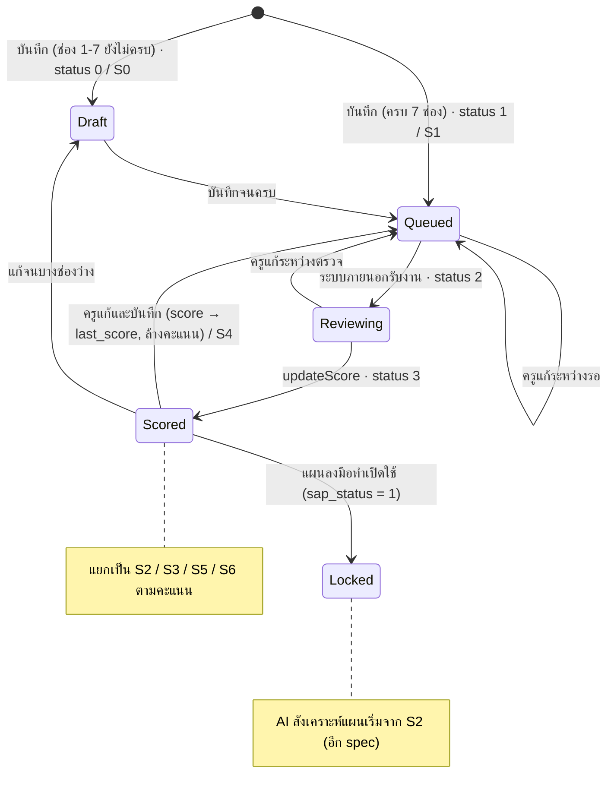

# Canvas (Unlock Hidden Potential Canvas)

- **ระดับใน MVP:** Must (หัวข้อ 8 ของ `docs/sila5school-study.md` ข้อ #7 Canvas และ #8 AI feedback ต่อ Canvas)
- **โค้ดอ้างอิง:** path ตาม repo เดิม · สำเนาในเครื่องอยู่ที่ `reference/sila5school/` path เดียวกัน
  - `module/console/controller/canvasController.php` — หน้า Canvas Pool, ฟอร์ม, บันทึก, ลบ, ป้ายสถานะ · **ส่วน AI สังเคราะห์แผนเริ่มที่ `:473` ถึง `:1078` อยู่ใน spec อีกไฟล์**
  - `library/module/console.php:952-1150` — ขอบเขต, CRUD, sync สถานะคะแนน, ค่าเกณฑ์, `resolveCanvasState` · `:1667-1677` แตกช่อง 7 เป็นสัญญาณ · `:2144-2148` ตรวจการล็อก · `:2476-2532` Canvas ที่อยู่ในแผน
  - `public_html/console/js/console-canvas.js` — filter, เลือกใบ, ยืนยันก่อนบันทึก, นับตัวอักษร
  - `public_html/console/guide/canvas-guide.html` — คู่มือเขียน Canvas สำหรับครู (static)
  - `docs/schema/sila5school.sql:1798-1829` (`school_canvas`), `:611-615` (`canvas_scope`)
  - `docs/schema/migrations/2026-07-10_school_canvas_last_score.sql`, `2026-07-18_school_canvas_score_c1_c7.sql`, `2026-07-25_school_canvas_score_status_shift.sql`, `2026-08-20_school_canvas_reset_incomplete_criteria_scores.sql`
  - อ่านประกอบ: `module/console/controller/planController.php:556-570`, `actionPlanController.php:2020-2036` (ด่านสถานะ Canvas ตอนทำแผน)
- **อ่านประกอบ:** study 3.1, 3.4, 3.6, 6.1, 6.3, 7 (แถว `school_canvas`), 7.1 ข้อ 4 และ 6, 9 ข้อ 1 และ 3 · Context ข้อ 7, 9, 12, 13, 14, 31, 45, 47, 53, 60.2, 60.10.4 ข้อ 1–2 และ 4

## 1. ฟีเจอร์นี้ทำอะไร

- Canvas เป็น thinking framework ของครู ไม่ใช่ฟอร์มกรอกแล้วจบ (Context 7, 53)
- ครูเริ่มจาก**ประเด็นท้าทาย** (ใคร เกิดอะไรขึ้น ส่งผลอย่างไร) เลือก**ขอบเขต** (รายบุคคล / กลุ่ม / ห้อง) แล้วคิดต่อใน 7 ช่อง:

| ช่อง | ชื่อในฟอร์ม | field | คำถามหลัก | เต็ม (Sila5School) |
|---|---|---|---|---|
| 1 | ศักยภาพที่ต้องการปลดล็อก | `sc_potential` | เด็กต้องพัฒนาความสามารถอะไรจึงตอบสนองแบบใหม่ได้ | 2 |
| 2 | ทำไมจึงเลือกศักยภาพนี้ | `sc_why` | ถ้ามีศักยภาพนี้ เรื่องจะคลี่คลายอย่างไร | 1.5 |
| 3 | ภาพปลายทาง | `sc_outcome` | อยากเห็นเด็กคิด พูด ทำอย่างไร | 1 |
| 4 | ทักษะด้านอุปนิสัย | `sc_character` | ใช้ **7 กิจวัตร**ข้อใดฝึก | 1.5 |
| 5 | นั่งร้านการเรียนรู้ | `sc_scaffolding` | ครูและกระบวนการกลุ่มพยุงอย่างไร | 1.5 |
| 6 | เวทีแห่งโอกาส | `sc_opportunity` | เด็กได้ใช้ศักยภาพจริงที่ไหน | 1.5 |
| 7 | สัญญาณแห่งความสำเร็จ | `sc_kpi` | รู้ได้อย่างไรว่าเริ่มเกิดขึ้น | 1 |

(`canvasController.php:1266-1296`; `console.php:1105`)

- ฟอร์มมี "เช็คความเชื่อมโยง 3 เส้น": ประเด็น → ช่อง 1 → 2 · ช่อง 1 ↔ 3 → 7 · ช่อง 4 → 5 → 6 (`canvasController.php:1300-1304`; `canvas-guide.html:562`)
- คู่มือสอนแนวคิด "มุมมองจัดการปัญหา → มุมมองปลดล็อกศักยภาพ", แยก "ทุนเดิม" ออกจาก "ศักยภาพที่ต้องพัฒนา" และมีกรณีตัวอย่าง 10 กรณี (`canvas-guide.html:187-193, 247-256, 561`)
- Canvas ทุกใบของโรงเรียนอยู่ใน **Canvas Pool** · ใบที่กรอกครบ 7 ช่องจะเข้าคิวให้**ระบบภายนอก**ให้คะแนน (รวม /10 + รายช่อง) · ใบที่ "พร้อมใช้ทำแผน" ถูกเลือกไปให้ AI สังเคราะห์เป็นแผน (spec อีกไฟล์)

## 2. ผู้ใช้และสิทธิ์ในระบบเดิม

- ทุก action ต้อง login และเป็นครูในโครงการ · ครู type 3 ผ่าน whitelist ได้แค่ `index`, `previewAi`, `getByoaPrompt` (`canvasController.php:55-61`; `console.php:110`)
- **สร้าง:** ครู type 1 และ 2 (`canvasController.php:1083-1088, 1327-1330`)
- **แก้/ลบ:** เจ้าของ (`sc_create_person_id`) เท่านั้น ผู้ประสานงานหลักก็แก้ใบของคนอื่นไม่ได้ (`:1372-1375, 1486-1489`)
- **ดู:** ครูทุกคนในโรงเรียน รวม type 3 เห็นทุกใบพร้อมชื่อผู้เขียน และเปิดดูใบของคนอื่นแบบอ่านอย่างเดียว (`console.php:1014-1031`; `canvasController.php:1134-1138, 1158`)
- ทุก action ที่อ้าง id ตรวจว่าแถวเป็นของโรงเรียนและปีเดียวกัน (`:1127-1132, 1369-1371, 1483-1485`)
- **เลือกใบไปให้ AI:** ผู้ประสานงานหลักเท่านั้น (`:109`)

## 3. ข้อมูลในระบบเดิม

**`school_canvas`** (`sila5school.sql:1798-1829`) — แถวเดียวเก็บทั้งเนื้อหาและคะแนน

| กลุ่ม | คอลัมน์ |
|---|---|
| เจ้าของ | `sc_project_id`, `sc_school_id`, `sc_create_person_id`, `sc_lastmodified_person_id` |
| หัวเรื่อง | `sc_title` varchar 255 (ประเด็นท้าทาย) · `sc_target` varchar 120 (กลุ่มเป้าหมาย ข้อความอิสระ ไม่บังคับ) · `sc_scope_id` FK → `canvas_scope` |
| 7 ช่อง | varchar 800 ต่อช่อง |
| คะแนน | `sc_score` decimal(4,1) · `sc_score_c1`–`sc_score_c7` decimal(2,1) ขั้นละ 0.5 · `sc_last_score` |
| สถานะคิว | `sc_score_status` 0 รอเขียนให้เสร็จ / 1 รอผลวิเคราะห์ / 2 กำลังวิเคราะห์ / 3 วิเคราะห์แล้ว (`2026-07-25_...status_shift.sql:2-7`) |

- `canvas_scope` เป็นตาราง lookup (id 1–3) แต่ไอคอนและการแปลงเป็น `individual/group/classroom` hard-code ตาม id (`console.php:971-979`; `canvasController.php:949`)
- FK มีแค่ไป `canvas_scope` ไม่มี FK ไปโรงเรียน ผู้เขียน หรือแผน (study 1.2)
- ระบบภายนอกคุยผ่าน DB ด้วย 3 API: `pendingScore` ดึงใบสถานะ 1 · `reviewing` ตั้ง 2 · `updateScore` ตั้ง 3 พร้อมคะแนน โดยคะแนนรายช่องเป็น optional (`2026-07-25_...:5-7`; `2026-08-20_...:4-6`) — โค้ดอยู่นอก repo
- **ป้ายสถานะการ์ด S0–S6** คำนวณจากคอลัมน์ข้างบน (`console.php:1107-1139`):

| ป้าย | เงื่อนไข | ข้อความบนการ์ด |
|---|---|---|
| S0 | status 0 | รอเขียนให้เสร็จ (บอกเลขช่องที่ว่าง) |
| S1 | status 1–2 และไม่มี `sc_last_score` | รอผลการวิเคราะห์ (ภายใน 2 วัน) |
| S4 | status 1–2 และมี `sc_last_score` | รอผลตรวจฉบับแก้ (แสดงคะแนนเดิม) |
| S3 | status 3, รวม < 7 | ปรับอีกนิด |
| S6 | status 3, รวม ≥ 7 แต่คะแนนรายช่องไม่ครบ | ต้องตรวจใหม่ |
| S5 | status 3, รวม ≥ 7, ช่อง 1 < เกณฑ์ | เกือบพร้อมใช้ทำแผน |
| S2 | status 3, รวม ≥ 7, ครบทุกช่อง, ช่อง 1 ≥ เกณฑ์ | พร้อมใช้ทำแผน |

## 4. Flow และลำดับสถานะ

- **ล็อกเป็นระดับโรงเรียน:** เมื่อแผนลงมือทำเปิดใช้ ทุกใบทุกสถานะถูกล็อก รวมใบร่างที่ไม่ได้อยู่ในแผน (`console.php:2144-2148`; `canvasController.php:103`)
- ลบได้ทุกสถานะก่อนล็อก (hard delete)
- ใบในแผนพัฒนาที่ "รอตรวจ" หรือ "ผ่าน" ถ้าถูกแก้หรือลบ ระบบดึงสถานะแผนกลับเอง (ข้อ 11 ด้านล่าง)

## 5. Business rule

1. ประเด็นท้าทายบังคับกรอก ตัดที่ 255 ตัวอักษร (`canvasController.php:1335-1339, 1346`)
2. ขอบเขตต้องเป็น id ที่มีใน `canvas_scope` (`:1340-1343`)
3. 7 ช่องไม่บังคับตอนบันทึก เก็บเป็นฉบับร่างได้ (`:1349-1355`)
4. สถานะคำนวณจากแถวจริงหลังบันทึก: ครบ 7 ช่อง (trim แล้วไม่ว่าง) = 1 เข้าคิว · ไม่ครบ = 0 (`console.php:1066-1091`)
5. แก้ไขทุกครั้ง: ล้างคะแนนรวมและรายช่อง ถ้าสถานะเดิมเป็น 3 ย้ายคะแนนรวมไป `sc_last_score` แล้วคำนวณสถานะใหม่ (`console.php:1051-1058, 1077-1083`)
6. คะแนนเต็มรายช่อง 2 / 1.5 / 1 / 1.5 / 1.5 / 1.5 / 1 รวม 10 (`console.php:1105`) — **ค่าเฉพาะ Sila5School**
7. พร้อมใช้ทำแผน = รวม ≥ 7 **และ** มีคะแนนครบ 7 ช่อง **และ** ช่อง 1 ≥ `canvas.convert_min_c1` (ค่าเริ่มต้น 1.5 ตั้งใน config ได้) (`console.php:1099-1102, 1115-1139`)
8. backend ตรวจข้อ 7 ซ้ำก่อนส่งให้ AI (`canvasController.php:290-304`) และระบบภายนอกตรวจอีกชั้น ถ้าไม่ผ่านตอบ 403 `convert_gate_failed` โดยไม่ตัดโควตา (`:755-758`)
9. ตอนส่งแผนตรวจและตอนแปลงเป็นแผนลงมือทำ ทุกใบในแผนต้องเป็น S2 (`planController.php:566`; `actionPlanController.php:2031`)
10. ช่องเลือก "ทำแผน" แสดงเฉพาะใบ S2 และเลือกได้ไม่เกิน 5 ใบ (`canvasController.php:8, 368-374`; `console-canvas.js:6, 41-45`)
11. แก้หรือลบใบที่อยู่ในแผนพัฒนา: แผน "รอตรวจ" → ยกเลิกการส่ง · "ผ่าน" → "ไม่ผ่าน" พร้อมเขียน note ให้ฝั่งแอดมิน (`canvasController.php:1391-1435`)
12. ก่อนบันทึกใบที่มีคะแนนแล้ว (S2/S3/S6) หรือใบที่อยู่ในแผน ต้องยืนยันว่าคะแนนเดิมจะถูกแทนและผลต่อแผน (`:1197-1198, 1216-1225`; `console-canvas.js:400-412`)
13. **ล็อก** เมื่อแผนลงมือทำเปิดใช้ (`sap_status` = 1) เพิ่ม แก้ ลบ และให้ AI สรุปใหม่ไม่ได้ (`console.php:2144-2148`; `canvasController.php:103-104, 1089-1091, 1331-1333, 1490-1492`)
14. ช่อง 7 ถูกแตกเป็น "สัญญาณ" ตามบรรทัดหรือ " · " สูงสุด 6 บรรทัด บรรทัดละ ≤ 80 ตัว ใช้เป็นตัวเลือกตอนบันทึกรายสัปดาห์ (`console.php:1667-1677`)
15. Pool เรียงตามแก้ไขล่าสุด และกรองตามขอบเขตได้ (`console.php:1020`; `console-canvas.js:21-33`)
16. **เฉพาะ Sila5School:** ช่อง 4 ผูกกับ 7 กิจวัตร (`canvasController.php:1279-1282, 583`) และคอมเมนต์คอลัมน์ `sc_score_c4` เรียกว่า "กิจวัตรความดี"

## 6. การตรวจข้อมูลขาเข้า (validation)

| ข้อมูล | server ตรวจ | หมายเหตุ |
|---|---|---|
| `title` | ไม่ว่าง, ตัดที่ 255 | client นับตัวอักษรและกันการวางเกิน (`console-canvas.js:361-389`) |
| `scope_id` | อยู่ในรายการ | |
| `target` | ตัดที่ 120 | ดู edge case เรื่อง JS ไม่ส่งค่า |
| 7 ช่อง | trim อย่างเดียว | **ไม่ตรวจความยาวที่ server** พึ่ง `maxlength="800"` (`canvasController.php:1192`) และ varchar(800) |
| id ใน URL | HMAC + โรงเรียน/ปีเดียวกัน + เจ้าของ + ยังไม่ล็อก | |
| คะแนนจากระบบภายนอก | ไม่ตรวจใน repo | ไม่ตรวจช่วงค่า และไม่ตรวจว่าคะแนนรวมเท่ากับผลรวมรายช่อง |

## 7. Edge case และพฤติกรรมที่ควรรู้

- **บันทึกโดยไม่แก้อะไรก็ล้างคะแนนและเข้าคิวใหม่** ป้าย S6 ใช้ข้อนี้เป็นวิธีให้ครูส่งตรวจใหม่ (`canvasController.php:451`)
- **แก้ระหว่างระบบภายนอกกำลังตรวจ (status 2):** สถานะกลับเป็น 1/0 ทันที แต่ไม่มี version ของเนื้อหา ใน repo จึงไม่มีอะไรกันคะแนนของฉบับเก่าที่เขียนกลับมาทีหลัง (ฝั่งตัวให้คะแนนอยู่นอก repo ไม่ได้ยืนยัน)
- `sc_last_score` เปลี่ยนเฉพาะเมื่อสถานะเดิมเป็น 3 แก้ซ้ำระหว่างรอจึงยังเห็นคะแนนเดิมของรอบที่ตรวจล่าสุด
- เกณฑ์ ≥ 7 ใช้ `sc_score` (คะแนนรวมที่ระบบภายนอกส่งมา) ไม่ได้คำนวณจากผลรวมรายช่อง
- ระบบภายนอกเคยส่งแค่คะแนนรวม ทำให้มีใบ "ตรวจแล้ว" ที่ใช้ทำแผนไม่ได้ จึงเพิ่มป้าย S6 และ migration ส่งใบเหล่านั้นกลับเข้าคิว (`2026-08-20_...:21-48`)
- **`sc_target`:** ฟอร์มมีช่องกรอก (`canvasController.php:1254-1259`) แต่ JS ตอน submit ไม่ได้ส่ง `target` (`console-canvas.js:413-423`) ขณะที่ server ตั้ง `sc_target` จาก POST ทุกครั้ง (`canvasController.php:1347`) ค่านี้จึงน่าจะถูกบันทึกเป็นค่าว่างเสมอ (ตัว `postForm` ไม่อยู่ในชุดไฟล์ที่คัดมา จึงยังไม่ได้ยืนยัน) ซึ่งตรงกับข้อมูลจริงที่ยังไม่มีใบไหนมีค่านี้ (study 3.1)
- ล็อกเฉพาะเมื่อแผนลงมือทำ "เปิดใช้" ถ้าแผนลงมือทำยังเป็นร่าง (`sap_status` = 0) ยังแก้ Canvas ได้
- ลบแบบ hard delete แผนอ้าง Canvas ผ่าน JSON `sad_canvas_ids` ไม่มี FK ระบบรู้ว่ามีใบหายจากการนับจำนวน (`console.php:2515-2532`)
- คำแนะนำรายช่องไม่ได้เก็บใน repo มีแค่ตัวเลข ครูอ่าน feedback ฉบับเต็มทางอีเมลจากระบบภายนอก (`canvasController.php:431, 439, 445`)
- หน้า Pool ว่าง: ปุ่ม "เริ่มใบแรก" แสดงเฉพาะผู้ประสานงานหลัก ทั้งที่ครู type 2 สร้างได้ (`:240-244`)
- ข้อความ "ทราบผลภายใน 2 วัน" hard-code (`:14`) เพราะระบบภายนอกตรวจเป็นรอบตอนกลางคืน (Context 60.10.4)

## 8. สิ่งที่ห้ามทำตาม

- **เขียนทับเนื้อหาโดยไม่มีประวัติ:** เก็บไว้แค่คะแนนรวมรอบก่อน ทั้งที่ 57% ของ Canvas ถูกแก้หลังได้คะแนน (study 3.1, 7.1 ข้อ 4)
- **7 ช่องและคะแนน 7 ช่องเป็นคอลัมน์ตายตัว** คะแนนเต็มอยู่ในค่าคงที่ และเลข 7 / 5 ซ้ำใน JS (`console.php:1105`; `console-canvas.js:6-7`; `canvasController.php:8`) — ขัดข้อ 45, 47
- **ผูกช่อง 4 กับ 7 กิจวัตร** ทั้งคำถามในฟอร์มและป้ายที่ส่งให้ AI — ขัดข้อ 9, 53
- **การให้คะแนนทั้งหมดอยู่นอกระบบ** (batch กลางคืน, AI ตัวที่สองตรวจซ้ำ, คนตรวจในเครื่องมือภายนอก, อีเมล) และเปลี่ยนความหมายของสถานะต้อง deploy สองระบบพร้อมกัน (`2026-07-25_...:9-10`) — ขัดข้อ 60.10.4 ข้อ 2
- **ผูกนักเรียนด้วยข้อความ:** `sc_target` เป็น free text และรายงานหานักเรียนด้วย substring (study 3.6)
- **ชวนให้พิมพ์ชื่อเด็กใน free text:** placeholder ใช้ชื่อเด็ก (`canvasController.php:1251, 1257`) แล้วข้อความทั้งหมดถูกส่งไปตัวให้คะแนนและ AI โดยไม่ pseudonymize พร้อมชื่อจริงของครู (`:954-955, 962-981`) — ขัดข้อ 60.2
- **ลิงก์ออกไป AI ภายนอก:** ปุ่ม "โค้ช Canvas (AI)" ไปที่ custom GPT ภายนอก (`:146`) และ endpoint สร้าง prompt ให้ copy ไปวาง AI อื่น ยังเรียกได้แม้ซ่อน UI (`:122, 1006-1078`)
- **แก้ Canvas แล้วไปเปลี่ยนสถานะแผนบนแถว `school_training`** เป็น side effect (`:1419-1435`) แทนการผูก plan version กับ canvas revision
- ไม่ตรวจความยาว 7 ช่องที่ server

## 9. แนวทางใน SkillWise

**ตารางใหม่และ mapping**

| ระบบเดิม | SkillWise |
|---|---|
| นิยาม 7 ช่อง, ความยาว 800, คะแนนเต็ม, คำถามนำ | `tools` → `tool_versions` → `tool_fields` (label, prompt, ลำดับ, max_length, max_score) |
| เกณฑ์ 7 และช่อง 1 ≥ 1.5 | config ของ `tool_versions` (คะแนนรวมขั้นต่ำ, ขั้นต่ำรายช่อง) · จะใช้เป็นด่านหรือไม่ยัง OPEN |
| `sc_title` + `sc_scope_id` (+ `canvas_scope`) | `cases` (ประเด็นท้าทาย + scope ที่เป็นข้อมูล รองรับ scope อื่นในอนาคต ข้อ 13) |
| `sc_target` (ข้อความ) | `case_targets` (relation ไป `students` หรือ `org_units`) ไม่บังคับ |
| `sc_project_id`, `sc_school_id`, `sc_create_person_id` | `canvases` (owner user, organization ว่างได้สำหรับครูอิสระ ข้อ 34) |
| 7 คอลัมน์เนื้อหา + `sc_lastmodified*` | `canvas_revisions` (ทุกการแก้ = revision ใหม่ แก้ไม่ได้) + `canvas_field_values` |
| `sc_score`, `sc_score_c1`–`c7` | `canvas_feedbacks` (source ai / coach / self ต่อ revision) + `canvas_feedback_items` (คะแนน + คอมเมนต์รายช่อง) |
| `sc_last_score` | ไม่ต้องมี ใช้ feedback ของ revision ก่อนหน้า |
| `sc_score_status` | คำนวณจากความครบของ revision + สถานะ `ai_jobs` ที่ผูกผ่าน `ai_job_canvas_revisions` |
| `canvasSignalLines` | `success_signals` (หนึ่งแถวต่อสัญญาณ ผูกกับ revision) |
| ล็อกด้วย `sap_status` | `development_plan_canvases` อ้าง `canvas_revision_id` → `action_plans` snapshot · revision ที่ถูกอ้างแก้ไม่ได้อยู่แล้ว |

**Permission ที่ endpoint ต้องประกาศ**

- สร้าง/แก้/ลบ/ดู Canvas ของตัวเอง: `self.tools.use` + ตรวจเจ้าของที่ server + entitlement ของ feature
- ขอ AI feedback: `self.ai.request` + บันทึก `usage_ledger` (งานล้มเหลวไม่หักเครดิต)
- โค้ช: `coach.cases.view_assigned` (เห็นเฉพาะ case ที่ได้รับมอบหมาย) · `coach.feedback.write` (เขียน `canvas_feedbacks` source = coach)
- ผู้บริหารองค์กร: `org.dashboard.view_aggregate` เห็นแค่ตัวเลขรวม ไม่เห็นเนื้อหา Canvas (ข้อ 31, 60.3)
- แอดมิน: ดูเนื้อหาที่มีข้อมูลนักเรียนด้วย `admin.sensitive.student.view` + `audit_logs` · ดูงาน AI ด้วย `admin.ai_jobs.view`
- การเห็น Canvas ของครูคนอื่นในองค์กร (Pool) รอผลข้อ 3 ในหัวข้อ 10

**สิ่งที่ต้องเปลี่ยนจากระบบเดิม**

- **ช่องเป็นข้อมูล:** ชื่อช่อง 4 ใช้คำกลาง "Routine / Practice" (ข้อ 7) และ 7 กิจวัตรเป็นแค่ practice set ชุดหนึ่งที่เลือกได้ (ข้อ 9)
- **ทุกการแก้เป็น revision ใหม่** feedback ผูกกับ revision จึงไม่มีปัญหาคะแนนของฉบับเก่าไปติดฉบับใหม่ และเห็นพัฒนาการของ Canvas ได้ (ข้อ 12)
- **AI feedback ทำในระบบผ่าน `ai_jobs` (BullMQ)** ไม่ผ่านเครื่องมือภายนอก · input เป็น snapshot ที่ pseudonymize แล้ว · ตรวจผล AI ก่อนแสดง เช่น คะแนนไม่เกินคะแนนเต็มรายช่อง และรวมแล้วตรงกับคะแนนรวม (ข้อ 60.10.4 ข้อ 2)
- **คอมเมนต์รายช่องเก็บใน `canvas_feedback_items`** แสดงในระบบ ไม่ส่งทางอีเมลอย่างเดียว
- **AI เป็นผู้ช่วย:** แสดงผลเป็น feedback ให้ครูตัดสินเอง (ข้อ 12) · การใช้คะแนนเป็นด่านก่อนทำแผนยัง OPEN ระบบต้องเปิด/ปิดด่านได้จาก config
- **ตัดชื่อจริงก่อนส่ง AI ทุกครั้ง** ทั้งชื่อนักเรียนใน `case_targets` และชื่อที่พิมพ์ปนใน free text รวมถึงชื่อครู แล้วแปลงกลับตอนแสดงผล (ข้อ 60.2) · placeholder ห้ามชวนให้ใส่ชื่อเด็ก
- **ผูกนักเรียนด้วย relation และไม่บังคับ** สร้าง Canvas ได้โดยยังไม่มีรายชื่อนักเรียน (study 7.1 ข้อ 6)
- ตรวจข้อมูลด้วย Zod ใน `packages/shared` ทั้งสองฝั่ง ความยาวและช่องบังคับอ่านจาก `tool_fields`
- ไม่ลิงก์ไป AI ภายนอก และไม่มี endpoint ที่สร้าง prompt พร้อมข้อมูลจริงให้ copy ออกไป
- จำนวน Canvas สูงสุดต่อการสังเคราะห์แผน (5) เป็น config ไม่ hard-code (ข้อ 13) — รายละเอียดอยู่ใน spec AI สังเคราะห์แผน
- ลบแบบ soft delete และห้ามลบ revision ที่แผนอ้างอยู่

## 10. คำถามที่ยัง OPEN

1. คะแนน AI เป็นเงื่อนไขบังคับก่อนทำแผน หรือเป็นแค่ feedback และถ้าบังคับ ใช้น้ำหนัก 2/1.5/1/1.5/1.5/1.5/1 กับเกณฑ์ 7 + ช่อง 1 ≥ 1.5 เดิมหรือไม่ (Context 60.10.4 ข้อ 2, 60.10.10 · study 9 ข้อ 1)
2. ต้องมีคนตรวจผล AI ซ้ำก่อนแสดงครูหรือไม่ (Context 60.10.4 ข้อ 2)
3. Canvas Pool ให้ทั้งองค์กรเห็นเป็นค่าเริ่มต้น หรือเป็นของส่วนตัวแล้วครูเลือกแชร์ (study 9 ข้อ 3, Context 31)
4. หลังแปลงเป็นแผนลงมือทำ ครูยังสร้าง revision ใหม่ของ Canvas เพื่อรอบถัดไปได้หรือไม่ (ล็อกตาม Context 60.10.4 ข้อ 4 เทียบ Revision → Next Cycle ข้อ 14)
5. rubric ที่ AI ใช้ให้คะแนนและคอมเมนต์ (ฉบับเต็มอยู่ในระบบ "rgt" ที่ยังไม่ได้เข้าถึง · study 9 ข้อ 9)
6. บันทึกโดยเนื้อหาไม่เปลี่ยน ควรสร้าง revision ใหม่และขอ feedback ใหม่หรือไม่
7. ขอ AI feedback อัตโนมัติเมื่อกรอกครบ (แบบเดิม) หรือให้ครูกดขอเอง และคิดเครดิตต่อครั้งหรือไม่ (Context 50 ข้อ 5, 60.10.4 ข้อ 3)
8. Phase 1 มีโค้ชเขียน feedback ต่อ Canvas หรือไม่ (รูปแบบ coaching ยัง OPEN ข้อ 50 ข้อ 7)
9. ยังต้องมีชื่อย่อของ Canvas (แบบ `sc_target`) สำหรับแสดงในแผนลงมือทำหรือไม่
