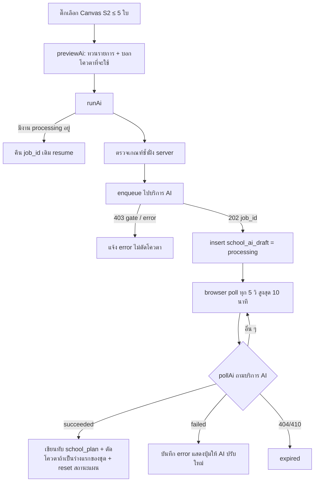
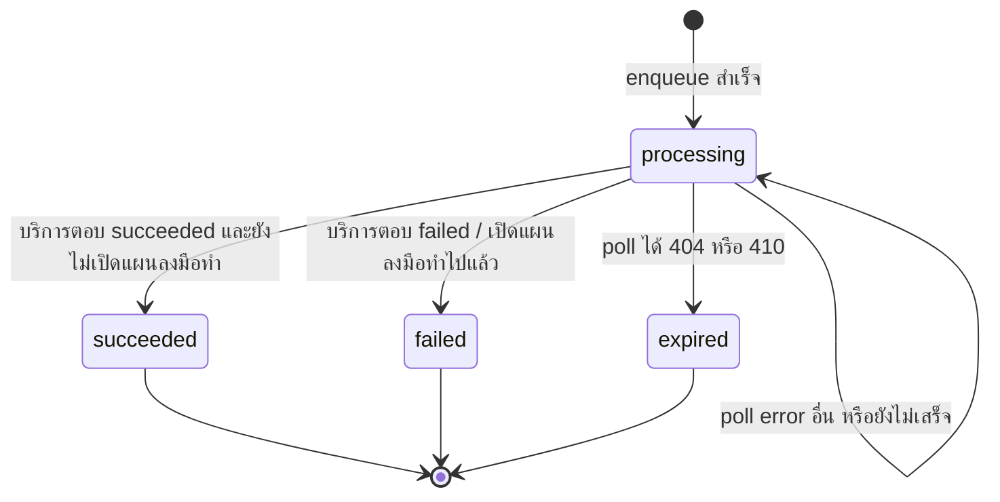

# AI สังเคราะห์ Canvas เป็นร่างแผนพัฒนา

- **ระดับใน MVP:** Must (หัวข้อ 8 ข้อ #9 ของ `docs/sila5school-study.md`)
- **โค้ดอ้างอิง:** (path ตาม repo เดิม · สำเนาในเครื่องอยู่ที่ `reference/sila5school/` path เดียวกัน)
  - `module/console/controller/canvasController.php` — ส่วน AI (`:474-986`), prompt สำรอง (`:1006-1078`), ผลต่อสถานะแผน (`:1438-1469`)
  - `library/rgt/integrations/sila5AiClient.php` — client เรียกบริการ AI ภายนอก (HMAC + poll)
  - `library/module/console.php` — ฟังก์ชัน `*SchoolAiDraft*`, `resolveCanvasState`, `READ_ACTIONS`
  - `public_html/console/js/console-canvas.js` — เลือก Canvas, ทวนรายการ, poll สถานะ
  - `module/console/controller/planController.php` — `hasAiDraft`, `renderAiWarnings`
  - `docs/schema/sila5school.sql` — ตาราง `school_ai_draft`, คอลัมน์ `school_training.st_ai_token`
- **อ่านประกอบ:** study 3.2, 6.1, 6.3, 7 (แถว `school_ai_draft`), 7.1 ข้อ 3, 9 ข้อ 1 และ 3 · Context ข้อ 12, 13, 32, 34, 36, 50, 60.2, 60.5, 60.7, 60.10.4 ข้อ 2–3, 60.10.8 · spec ต่อเนื่อง: `06-development-plan.md`

## 1. ฟีเจอร์นี้ทำอะไร

- ผู้ประสานงานหลักติ๊กเลือก Canvas ที่ "พร้อมใช้ทำแผน" ได้ไม่เกิน 5 ใบ → เปิดหน้าทวนรายการ → ยืนยัน → ระบบส่งงานไปบริการ AI ภายนอกแบบ async แล้วได้ `job_id` กลับมา
- หน้าเว็บ poll สถานะทุก 5 วินาที เมื่อสำเร็จ ระบบเขียนร่างลงแผนพัฒนาของโรงเรียน (`school_plan`) **ทับของเดิม** แล้วพาไปหน้าแผน (ดู spec 06)
- AI มีหน้าที่ "ร้อยเรียง" ข้อความที่ครูเขียน ไม่แต่งข้อเท็จจริงเพิ่ม ไม่สร้างตัวเลข และเว้นช่องให้ครูเติมค่าเป้าหมายเอง (ข้อความบนหน้าจอ `canvasController.php:488-490`)
- ผลลัพธ์ 5 ส่วน: p1 บริบท · p2 เป้าหมาย · p3 วิธีดำเนินงาน · p4 ผลลัพธ์ (แยกเชิงคุณภาพ / เชิงปริมาณ) · p5 จุดที่ครูต้องทบทวน พร้อม warnings และรายการ Canvas ที่ AI ใช้จริง
- มี "ให้ AI ปรับใหม่" ด้วย Canvas ชุดเดิมได้อีก 2 ครั้งโดยไม่ตัดโควตา
- โควตา 2 ครั้งต่อโรงเรียนต่อปีการศึกษา ใช้ร่วมกันทั้งโรงเรียน
- มีโหมด "ใช้ AI ภายนอกแทน" (copy prompt ไปวางเอง) แต่ซ่อนไว้ (`canvasController.php:122`)

## 2. ผู้ใช้และสิทธิ์ในระบบเดิม

ทุก action ต้อง login (`canvasController.php:55-57`) และ context (ปีโครงการ, โรงเรียน) มาจาก session ไม่ได้มาจาก request

| การกระทำ | ใครทำได้ | ที่มา |
|---|---|---|
| เห็นกล่อง AI และ checkbox เลือก Canvas | ผู้ประสานงานหลัก (type 1) ที่ไม่ใช่ readonly และโรงเรียนยังไม่เปิดแผนลงมือทำ | `canvasController.php:109, 118-123` |
| checkbox ขึ้นเฉพาะการ์ดสถานะ S2 (พร้อมใช้ทำแผน) | — | `canvasController.php:367-374` |
| ทวนรายการ / สั่งงาน / ปรับใหม่ / poll | type 1 เท่านั้น (ตรวจใน action) | `canvasController.php:534-536, 639-641, 685-687, 797-799` |
| เลือก Canvas ของใครก็ได้ในโรงเรียนเดียวกัน | type 1 | `canvasController.php:728-742` |
| ขอ prompt สำรอง (BYOA) | **ไม่ตรวจ type** และอยู่ใน whitelist ของ readonly → ครูทุกประเภทในโรงเรียนขอได้ | `canvasController.php:1006-1034`, `library/module/console.php:110` |

## 3. ข้อมูลในระบบเดิม

**`school_ai_draft`** (1 แถวต่องาน · `docs/schema/sila5school.sql:1753-1773`)

| คอลัมน์ | ความหมาย |
|---|---|
| `sad_project_id`, `sad_school_id` | ปีโครงการ + โรงเรียน (ไม่มี FK) |
| `sad_job_id` | id งานที่บริการ AI ตอบกลับ |
| `sad_idem_key` | UUID v4 ที่สร้างใหม่ทุกครั้งที่กดสั่ง |
| `sad_status` | enum `processing` / `succeeded` / `failed` / `expired` |
| `sad_canvas_ids` | JSON array ของ `sc_id` เรียงน้อยไปมาก ใช้ระบุ "ชุด Canvas เดิม" |
| `sad_form_draft`, `sad_warnings`, `sad_used_canvas_refs` | ผลลัพธ์ดิบ, คำเตือน, Canvas ที่ AI อ้างจริง |
| `sad_error_code`, `sad_error_message` | รหัสและข้อความ error |
| `sad_create_person_id`, `sad_create_datetime`, `sad_completed_datetime` | ผู้สั่งและเวลา |

- index มีแค่ (project, school, status) และ job_id (`:1771-1772`) **ไม่มี unique constraint** กันงาน processing ซ้อน
- **โควตา:** `school_training.st_ai_token` tinyint ค่าเริ่มต้น 2 (`sila5school.sql:2240`) เป็นตัวนับคงเหลือ ไม่มี ledger
- **ข้อมูลที่ส่งให้ AI** (`canvasController.php:926-986`):
  - `school`: ชื่อเต็มโรงเรียน, ตำบล/อำเภอ/จังหวัด, ปีการศึกษา, จำนวนนักเรียนและครูในโครงการ (`:937-946`)
  - ต่อ Canvas: id, ขอบเขต (individual / group / classroom), `class_level` (ที่จริงคือชื่อขอบเขต `:966`), จำนวนนักเรียน, ประเด็นท้าทาย, **ชื่อ-นามสกุลจริงของครูผู้เขียน** (`:954-955, 969`), คะแนนรวม + รายช่อง c1–c7 และข้อความ 7 ช่องแบบดิบ (`:973-981`)
- **ผลลัพธ์ที่อ่าน** (`canvasController.php:855-870`): `plan_draft.p1_context`, `p2_goals`, `p3_method`, `p4_qualitative`, `p4_quantitative`, `p5_review_notes` → map ลงคอลัมน์ `sp_rationale`, `sp_objective`, `sp_plan`, `sp_result_qualitative`, `sp_result_quantitative`, `sp_note` · `quality_checks.warnings` · `metadata.canvas_refs`
- **รหัส error** (`sila5AiClient.php:92-101` + controller):

| รหัส | เกิดเมื่อ | ข้อความถึงครู |
|---|---|---|
| `convert_gate_failed` (HTTP 403 ตอนสั่ง) | บริการภายนอกตรวจซ้ำแล้วพบใบไม่ผ่านเกณฑ์ | ชื่อใบ + เหตุผล, "โควตายังไม่ถูกตัด" (`canvasController.php:307-326, 756-758`) |
| `quality_check_failed` | AI สร้างร่างที่ผ่านการตรวจคุณภาพไม่ได้ | ลองใหม่หรือติดต่อแอดมิน |
| provider overloaded / timeout | ผู้ให้บริการโมเดลหนาแน่นหรือหมดเวลา | ลองใหม่ใน 1–2 นาที |
| `poison_pill` | งานพังซ้ำจนบริการตัดทิ้ง | ติดต่อแอดมิน |
| `action_plan_locked` (ภายใน) | AI เสร็จหลังโรงเรียนแปลงเป็นแผนลงมือทำแล้ว | ไม่นำร่างมาใช้ (`canvasController.php:844-853`) |
| อื่น ๆ เช่น `synthesis_failed` | — | ข้อความกลาง "เกิดข้อผิดพลาดในระบบ" |

## 4. Flow และลำดับสถานะ





- สถานะเปลี่ยนเฉพาะตอนที่มีคน poll เท่านั้น ไม่มี worker ฝั่ง server ถ้าไม่มีใครเปิดหน้า งานค้าง `processing` ไปเรื่อย ๆ จนกว่าจะกลับมาเปิดหน้า (`console-canvas.js:328-333`)

## 5. Business rule

1. Canvas ต่องานไม่เกิน 5 ใบ hard-code ทั้งฝั่ง server และ JS — `canvasController.php:8, 548-550, 665-667`; `console-canvas.js:6, 41-45`
2. ทุกใบต้องเป็นของโรงเรียน/ปีเดียวกัน ใบที่ไม่ใช่จะถูกตัดทิ้งเงียบ ๆ — `canvasController.php:728-742`
3. ทุกใบต้องอยู่สถานะ S2 (รวม ≥ 7 และช่อง 1 ≥ `canvas.convert_min_c1` ค่าเริ่ม 1.5) และมีคะแนนรายช่องครบ c1–c7 — `canvasController.php:290-304`; `library/module/console.php:1098-1139`
4. บริการภายนอกตรวจเกณฑ์ซ้ำอีกชั้น ถ้าไม่ผ่านตอบ 403 และไม่ตัดโควตา — `canvasController.php:755-758`
5. สั่งงานใหม่ได้เมื่อโควตา > 0 (ตรวจทั้ง preview และ run) — `canvasController.php:540-542, 645-647`
6. รันได้ทีละ 1 งานต่อโรงเรียน: ถ้ามีงาน processing ให้คืน job เดิมแทน — `canvasController.php:649-659`
7. โรงเรียนที่เปิดแผนลงมือทำแล้ว ห้ามสั่ง/ปรับใหม่ และผลที่เสร็จทีหลังถูกทิ้ง — `canvasController.php:642-644, 688-690, 844-853`
8. ตัดโควตาเมื่อสำเร็จเท่านั้น และตัดเฉพาะเมื่อไม่มีร่างที่ "ไม่ใช่ failed" ของชุด Canvas เดียวกันมาก่อน — `canvasController.php:873-882`; `library/module/console.php:1201-1220`
9. ให้ AI ปรับใหม่: ใช้ชุด Canvas จากร่างล่าสุด, ห้ามถ้างานล่าสุดยัง processing, รวมได้ไม่เกินร่างแรก + 2 ครั้ง — `canvasController.php:692-709, 11`
10. ร่างใหม่ที่สำเร็จ **เขียนทับ** แผนทั้ง 6 ฟิลด์ รวมข้อความที่ครูแก้ไว้ — `canvasController.php:862-871`
11. ร่างใหม่ที่สำเร็จดึงสถานะแผนกลับ: ยังไม่เริ่ม/ดำเนินการ → ดำเนินการ, รอตรวจ/ผ่าน → ดำเนินการ + note อัตโนมัติ, ไม่ผ่าน คงเดิม — `canvasController.php:1453-1469`
12. ถ้าแผนรอตรวจหรือผ่านแล้ว ต้องเตือนก่อนสั่งว่าแผนจะต้องส่งตรวจใหม่ — `canvasController.php:1438-1447, 595-600`; `console-canvas.js:262-264`
13. หน้าแผนแสดงเฉพาะ warning ระดับเหลือง (ครูตรวจเองได้) ระดับแดงถือว่าบริการต้นทางสร้างใหม่ให้แล้ว — `planController.php:219-258`
14. แผนพัฒนาแก้หรือส่งตรวจได้เฉพาะเมื่อมีร่าง AI ที่สำเร็จแล้ว — `planController.php:135-138`
15. ข้อความ error ที่แสดงแปลงจากรหัส ไม่แสดง error ดิบในครั้งแรก — `canvasController.php:909`; `sila5AiClient.php:92-101`

**การเรียกบริการภายนอก** (`sila5AiClient.php:119-164`) — ลงนามทุก request แบบนี้ (pseudo-code):

```
canonical = "v1\n" + METHOD + "\n" + PATH + "\n" + unixTs + "\n" + rawBody
signature = hex(HMAC_SHA256(signingSecret, canonical))
headers   = Bearer token, X-Sila5-Timestamp: ts, X-Sila5-Signature: "v1=" + signature,
            X-School-Id, Idempotency-Key (เฉพาะ POST)
```

- enqueue: `POST /api/ai/jobs` สำเร็จเมื่อ 200/202 (มี flag `replay`) · error อ่าน `Retry-After` และ body เต็ม (`:27-57`)
- poll: `GET /api/ai/jobs/:id` · 410 ถือเป็น expired (`:63-87`)
- timeout 15 วินาที, connect 8 วินาที, curl error คืน http 0 (`:14, 138-139, 145-151`)
- base URL, token และ signing secret อ่านจาก config ฝั่ง server (`:18-20`)

**Prompt สำรองใน repo** (`canvasController.php:1041-1072`, ใช้กับโหมด BYOA ที่ซ่อนไว้ · prompt หลักอยู่ที่บริการภายนอก): กำหนดบทบาท AI เป็น "ผู้ร้อยเรียง" ที่จัดข้อความของครูให้เป็นแผนภาษาทางการ ใช้ได้เฉพาะสิ่งที่ครูเขียน ห้ามเติมข้อเท็จจริง ถ้าช่องสัญญาณความสำเร็จไม่มีตัวเลขให้ใส่ตัวแทนช่องว่างให้ครูระบุค่าเป้าหมายเอง จัดผลเป็น 4 หัวข้อ (เหตุผล/บริบท, วัตถุประสงค์, แผนดำเนินงาน, ผลที่คาดและตัวชี้วัดเชิงคุณภาพ+ปริมาณ) และอ้างแต่ละ Canvas ด้วยเลขข้อ

## 6. การตรวจข้อมูลขาเข้า (validation)

- `ids`: รับได้ทั้ง array และ CSV → แปลงเป็น int, ตัดซ้ำ, ตัด 0, เรียงน้อยไปมาก (`canvasController.php:717-725`) · ว่าง = error · เกิน 5 = error
- โหลดทีละใบแล้วกรองตามโรงเรียน/ปี ถ้าเหลือ 0 ใบ = error "ไม่พบ Canvas" (`:728-742`)
- ตรวจ S2 + คะแนนรายช่องครบทุกใบซ้ำฝั่ง server ก่อนเรียก AI (`:290-304`) ไม่เชื่อปุ่มหน้าเว็บ
- `job_id` ตอน poll: ต้องไม่ว่าง และต้องเป็นงานของ (ปีโครงการ, โรงเรียน) ใน session (`:801-809`; `library/module/console.php:1188-1195`)
- ไม่ validate โครงสร้าง output ของ AI นอกจากอ่านคีย์ด้วยค่าเริ่มต้นเป็นสตริงว่าง (`canvasController.php:857-870`)

## 7. Edge case และพฤติกรรมที่ควรรู้

- **งาน `expired` นับเป็นร่างเดิม** เพราะตัวนับตัดเฉพาะ `failed` (`library/module/console.php:1206`) ผลคือ ถ้าครั้งแรกหมดอายุแล้วสั่งชุดเดิมใหม่จนสำเร็จ จะไม่ถูกตัดโควตา และงานที่หมดอายุกินสิทธิ์ "ปรับใหม่" ไปด้วย
- **ปรับใหม่ไม่ตรวจโควตา** (`canvasController.php:678-714`) และถ้าร่างก่อนหน้าของชุดนั้นล้มเหลวทั้งหมด งานปรับใหม่ที่สำเร็จจะนับเป็นร่างแรกและตัดโควตา ทั้งที่ข้อความบอกว่า "ไม่ตัดโควตา" (`:777-779`)
- **ปรับใหม่หลังลบ Canvas:** ใบที่ถูกลบหายจาก payload แต่ `sad_canvas_ids` ยังเก็บ id เดิม (`:700, 711, 774`) แผนจึงถูกมองว่า Canvas เปลี่ยนตลอด (ดู spec 06)
- **enqueue ก่อน insert** (`:753` ก่อน `:768`): ถ้าบันทึก DB ล้มหลังบริการรับงานแล้ว งานจะลอยอยู่ที่บริการ · กดซ้ำพร้อมกัน 2 request ผ่านการตรวจงานค้างได้ทั้งคู่ เพราะไม่มี lock หรือ unique key
- **Idempotency-Key สร้างใหม่ทุกครั้ง** (`:751`) จึงกันได้แค่การยิงซ้ำระดับ HTTP ไม่ได้ผูกกับเจตนาของผู้ใช้ และ flag `replay` ที่ได้กลับมาไม่ถูกใช้
- **poll error อื่นนอกจาก 404/410** (เช่น 500, เน็ตหลุด) ตอบ `running` ไปเรื่อย ๆ ไม่มีเพดาน (`:836`) · หน้าเว็บเลิก poll เองหลัง 10 นาทีแล้วบอกให้กลับมาใหม่ (`console-canvas.js:175-185`)
- **ข้อความ error ไม่คงที่:** ครั้งแรกแสดงข้อความที่แปลงจากรหัส (`:909`) แต่ครั้งต่อไปแสดง `sad_error_message` ที่อาจเป็นข้อความดิบจากบริการ (`:819-821, 902-907`)
- **ผลลัพธ์หายถ้าไม่มีใครกลับมา poll** ก่อนบริการลบงาน → กลายเป็น expired ทั้งที่ AI ทำเสร็จแล้ว (ข้อมูลจริง: หมดอายุ 8 งาน · study 3.2)
- **ตัดโควตาแบบ read-modify-write:** อ่าน `st_ai_token` ตอนต้น request แล้วเขียน `token - 1` กลับ ไม่ใช่ decrement แบบ atomic (`:878-881`)
- **ข้อความหน้าจอขัดกับ backend:** กล่องเตือน "มีใบต่ำกว่าเกณฑ์ ใช้ทำแผนต่อได้เลย" (`:507-510`; `console-canvas.js:63-69`) ไม่มีทางขึ้น เพราะ checkbox มีเฉพาะ S2 และ server บล็อกใบที่ไม่ใช่ S2
- เวลาที่บอกครู "อย่างน้อย 5 นาที" (`:519-521, 592`) ไม่ตรงข้อมูลจริงเฉลี่ยราว 2 นาที (study 3.2)
- `student_count` ของขอบเขตกลุ่ม/ห้องใช้จำนวนนักเรียนทั้งโครงการ ไม่ใช่ขนาดกลุ่มจริง (`:952`)
- ปีการศึกษาที่ส่งคำนวณจากปี ค.ศ. ปัจจุบัน + 543 ไม่ได้มาจากปีโครงการ (`:931`)

## 8. สิ่งที่ห้ามทำตาม

- **ส่งชื่อจริงของครู ชื่อโรงเรียน ที่ตั้ง และข้อความดิบที่อาจมีชื่อเด็ก** ให้ AI โดยไม่ pseudonymize (`canvasController.php:937-981`) — ขัด Context 60.2 (study 6.1)
- hard-code จำนวน 5 ใบ (`:8`), โควตา "/ 2 ครั้ง" ในข้อความหน้าจอ (`:493, 592`), ปรับใหม่ 2 ครั้ง (`:11`), เกณฑ์ ≥ 7 ใน JS (`console-canvas.js:7`) — Context 13, 47
- hard-code ขอบเขต 1/2/3 → individual/group/classroom (`:949`) และป้ายช่อง 4 ที่ผูก "7 กิจวัตร" ใน prompt (`:1059`) — Context 9, 53
- โควตาผูกกับ (โรงเรียน, ปี) และเก็บเป็นตัวนับในแถวเดียวกับ flag อื่น (study 6.3)
- AI เขียนทับแผนโดยไม่มี version และไม่มี FK ระหว่าง Canvas กับแผน (study 6.3)
- ให้ browser เป็นตัวขับ poll งาน AI แทน worker ฝั่ง server
- ตรวจสิทธิ์ด้วยเลข type ในแต่ละ action และ endpoint BYOA ที่ไม่ตรวจสิทธิ์เลย (`:1006-1034`)
- ใช้ emoji เป็นระดับความรุนแรงของ warning (`planController.php:238`)
- ข้อความ error ที่ระบุชื่อผู้ให้บริการโมเดล (AI Provider ยัง OPEN)

## 9. แนวทางใน SkillWise

**ตารางใหม่และ mapping**

| ระบบเดิม | SkillWise | หมายเหตุ |
|---|---|---|
| `school_ai_draft` | `ai_jobs` (type = plan synthesis) | status, attempts, input snapshot ที่ pseudonymize แล้ว, output, error_code + ข้อความสำหรับผู้ใช้, model/cost, prompt version |
| `sad_canvas_ids` (JSON) | `ai_job_canvas_revisions` | อ้าง **canvas_revisions** ไม่ใช่ canvas เพื่อรู้ว่า AI เห็นฉบับไหน |
| `sad_form_draft` → เขียนทับ `school_plan` | `development_plan_versions` (source = ai, อ้าง ai_job) + `development_plan_sections` + `development_plan_canvases` | ไม่เขียนทับ ครูเลือก version เอง (spec 06) |
| `sad_warnings` (ข้อความขึ้นต้น emoji) | ใน output ของ `ai_jobs` แบบมี level | |
| `st_ai_token` | `products` / `product_features` (ค่า quota) + `entitlements` + `usage_ledger` | หักเมื่อสำเร็จเท่านั้น และ idempotent ต่อ job |
| ชื่อครู / ชื่อเด็กใน free text | `students.pseudonym_key` + ตัวแทนของครูในงาน | map กลับตอนแสดงผล |
| `canvas_scope` + scopeMap | `case_targets` | ขอบเขตเป็น relation |
| (ไม่มี) | `audit_logs` | แอดมินเปิดดู input/output ของงานที่มีข้อมูลนักเรียน |

**Permission ที่ endpoint ควรประกาศ** (ค่าเริ่มต้นปฏิเสธ ตรวจที่ guard)

| Endpoint (ร่าง) | Permission + เงื่อนไข |
|---|---|
| สร้างงานสังเคราะห์ | `self.ai.request` + `self.tools.use` + มีสิทธิ์อ่านทุก Canvas ที่เลือก + entitlement/เครดิตพอ |
| ดูสถานะงาน / ปรับใหม่ / retry | `self.ai.request` + เป็นผู้สั่งงาน (ownership) |
| ดูงาน AI ในหน้าแอดมิน | `admin.ai_jobs.view` · ถ้าจะเห็นชื่อจริงที่ map กลับ ต้องมี `admin.sensitive.student.view` และบันทึก `audit_logs` |
| ให้เครดิตเพิ่มด้วยมือ | `admin.seats.grant` (บันทึกใน `usage_ledger` + `audit_logs`) |

**สิ่งที่ต้องเปลี่ยนจากระบบเดิม**

1. **Pseudonymize ทุกครั้ง** (Context 60.2, CLAUDE.md): แทนชื่อนักเรียนที่ผูกกับ Case ด้วยรหัสจาก `pseudonym_key`, ไม่ส่งชื่อครู (ใช้ป้ายเช่น "ครูคนที่ 1"), ไม่ส่งชื่อโรงเรียนและที่ตั้ง · เก็บ snapshot ที่ส่งจริงไว้ใน `ai_jobs` · แปลงรหัสกลับเป็นชื่อเฉพาะตอนแสดงให้ผู้มีสิทธิ์
2. **จำนวน Canvas ต่องานตั้งค่าได้** (Context 13) เช่นเก็บใน config ของ tool_version หรือ product_feature ห้าม hard-code 5
3. **เครดิตแทนโควตาโรงเรียน** (Context 60.10.4 ข้อ 3 [DIRECTION]): ลองฟรี 1 ครั้ง แล้วใช้ quota ของแพ็กเกจหรือเติมเครดิต ตัวเลขทั้งหมด OPEN · ครูอิสระต้องใช้ได้โดยไม่ต้องมีองค์กร (Context 34)
4. **ไม่หักเครดิตเมื่อล้มเหลว** และหักแบบ atomic: เขียน `usage_ledger` ใน transaction เดียวกับการเปลี่ยนสถานะงานเป็นสำเร็จ ใช้ ai_job id เป็น key กันหักซ้ำ (study 7.1 ข้อ 3, 6.3)
5. **Worker ฝั่ง API** (BullMQ · Context 60.5): job เป็นตัวเรียก AI และ retry ข้อผิดพลาดชั่วคราวแบบ backoff มีเพดาน attempts และเวลา · browser แค่ถามสถานะจาก API ของเรา ผลจึงไม่หายแม้ครูปิดหน้า
6. **กันงานซ้อนด้วยฐานข้อมูล** เช่น unique partial index ต่อ (ผู้สั่ง, ประเภท) ที่สถานะยังไม่จบ และ idempotency key ที่ผูกกับการกดครั้งนั้น
7. **ตรวจผล AI ก่อนแสดง** (Context 60.10.4 ข้อ 2): validate โครงสร้างด้วย Zod, ตรวจว่าไม่มีตัวเลขที่ไม่อยู่ใน input, ตรวจว่ารหัสแทนชื่อที่ได้กลับมาเป็นรหัสที่ส่งไปจริง · ถ้าไม่ผ่านให้ retry หรือจบเป็น failed ที่ไม่หักเครดิต
8. **ผลเป็น version ใหม่ ไม่เขียนทับ** (Context 12) ครูเป็นผู้ตัดสินว่าจะใช้ version ไหน
9. **ข้อความ error เข้าใจง่ายและคงที่** แยกรหัสภายในกับข้อความที่แสดง ไม่บอกชื่อผู้ให้บริการ
10. **Prompt อยู่ใน repo เป็น template ที่มี version** และบันทึก version ลงงาน (prompt สำรองของระบบเดิมเป็นแค่ต้นแบบแนวคิด ห้าม copy)
11. **AI Provider ยัง OPEN:** ทำเป็น adapter · ถ้าเรียกบริการภายนอกแบบระบบเดิม ใช้แนวคิดลงนาม HMAC + timestamp + idempotency key ได้ และ secret อยู่ใน API เท่านั้น
12. สิทธิ์สั่งงานผูกกับ permission ไม่ใช่ตำแหน่ง "ผู้ประสานงานหลัก" (Context 32)

## 10. คำถามที่ยัง OPEN

1. ตัวเลขเครดิต: ลองฟรีกี่ครั้ง, quota ต่อแพ็กเกจ, ราคาเติม (Context 36, 50 #5, 60.10.10)
2. จำนวน Canvas สูงสุดต่องาน (Context 13)
3. คะแนน AI ของ Canvas เป็นเงื่อนไขบังคับก่อนสังเคราะห์หรือไม่ (study 9 ข้อ 1, Context 60.10.4 ข้อ 2) — ระบบควรรองรับทั้งสองแบบด้วย policy
4. ในองค์กร ใครสั่ง AI ได้ และเลือก Canvas ของครูคนอื่นได้หรือไม่ (ขึ้นกับ study 9 ข้อ 3 เรื่อง Canvas pool)
5. "ปรับใหม่" ฟรีกี่ครั้ง และนับต่อชุด Canvas หรือต่อแผน
6. AI Provider / Model และจะเรียกตรงหรือผ่านบริการกลางแบบระบบเดิม (Context 50 #28–29)
7. ต้องส่งบริบทองค์กร (ขนาด, จำนวนนักเรียน) ให้ AI หรือไม่ ถ้าส่งต้องหยาบแค่ไหน
8. วิธีจัดการชื่อเด็กใน free text ที่ไม่อยู่ในรายชื่อนักเรียน (เช่นชื่อเล่น) — ตรวจจับอัตโนมัติ, เตือนครู หรือทั้งสองอย่าง
9. ระยะเวลาเก็บ input snapshot และ output ของ `ai_jobs`
10. ยังต้องมีคนตรวจผล AI ก่อนถึงครูหรือไม่ (Context 60.10.4 ข้อ 2)
