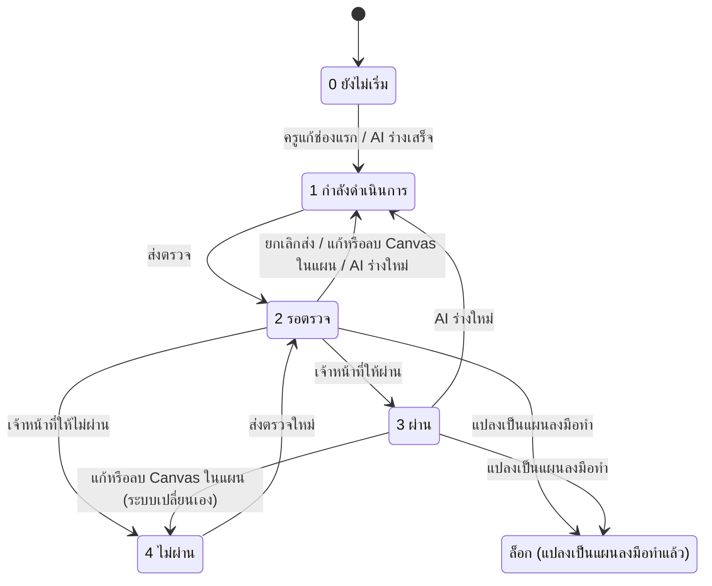

# แผนพัฒนาศักยภาพ (Development Plan)

- **ระดับใน MVP:** Must สำหรับแผนที่มี version และครูแก้ได้ (หัวข้อ 8 ข้อ #9 ของ `docs/sila5school-study.md`) · Export PDF เป็น Should (ข้อ #17)
- **โค้ดอ้างอิง:** (path ตาม repo เดิม · สำเนาในเครื่องอยู่ที่ `reference/sila5school/` path เดียวกัน)
  - `module/console/controller/planController.php` — หน้าแผน, แก้ข้อความ, ส่งตรวจ/ยกเลิก, PDF
  - `library/rgt/integrations/mpdf.php` — wrapper ของ mPDF (ฟอนต์ไทย, โหลดรูปแบบขนาน, ด่านกัน SSRF)
  - `public_html/console/js/console-plan.js` — เปิด/ปิดปุ่มส่งตรวจตามความครบ
  - `library/module/console.php` — CRUD `school_plan`, `planStatus`, `READ_ACTIONS`, `querySchoolCanvasInPlan`, `isPlanCanvasChanged`, `hasSchoolActionPlan`
  - `module/console/controller/canvasController.php` — ดึงสถานะแผนกลับเมื่อแก้ Canvas / AI ร่างใหม่ (`:1391-1469`)
  - `module/console/controller/actionPlanController.php` — เงื่อนไขแปลงเป็นแผนลงมือทำ (`:2013-2042`)
  - `docs/schema/sila5school.sql` — ตาราง `school_plan`, คอลัมน์ `school_training.st_action_plan*`
- **อ่านประกอบ:** study 3.3, 3.4, 6.3, 7 (แถว `school_plan`, `school_action_plan`), 7.1 ข้อ 8, 9 ข้อ 2, 3, 7 · Context ข้อ 12, 14, 31, 32, 34, 54, 60.3, 60.5, 60.7, 60.10.4 ข้อ 3–4, 60.10.5 · spec ก่อนหน้า: `05-ai-plan-synthesis.md`

## 1. ฟีเจอร์นี้ทำอะไร

- แผนพัฒนาศักยภาพ **1 ฉบับต่อโรงเรียนต่อปีโครงการ** ที่เนื้อหาตั้งต้นมาจากร่าง AI เท่านั้น (spec 05)
- มี 4 หัวข้อ (หัวข้อ 4 แยกเชิงคุณภาพ / เชิงปริมาณ) และกล่อง "หมายเหตุและจุดที่ทีมครูต้องทบทวน" จาก AI ที่อ่านได้อย่างเดียว
- ผู้ประสานงานหลักแก้ข้อความได้ (บันทึกอัตโนมัติรายช่อง) และเติมค่าเป้าหมายในช่องว่าง `______` ที่ AI เว้นไว้ โดยมี badge นับจำนวนช่องที่เหลือ
- ส่งตรวจ / ยกเลิกการส่ง → เจ้าหน้าที่ในระบบแอดมิน (นอก repo) ตัดสินผ่าน / ไม่ผ่าน
- ระบบดึงสถานะกลับเองเมื่อแก้หรือลบ Canvas ที่อยู่ในแผน และเมื่อ AI ร่างใหม่
- พรีวิวและดาวน์โหลด PDF ด้วย mPDF
- เมื่อแปลงเป็นแผนลงมือทำแล้ว แผนถูกล็อกถาวร

## 2. ผู้ใช้และสิทธิ์ในระบบเดิม

| การกระทำ | ใครทำได้ | ที่มา |
|---|---|---|
| เปิดดูแผน | ครูทุกประเภทในโรงเรียน (type 3 readonly ผ่าน whitelist) · type ≠ 1 เห็นแบบอ่านอย่างเดียว | `library/module/console.php:117`; `planController.php:109-111` |
| แก้ข้อความ | type 1 เท่านั้น | `planController.php:695-699` |
| ส่งตรวจ / ยกเลิกการส่ง | type 1 เท่านั้น | `planController.php:746-750, 793-797` |
| พรีวิว / ดาวน์โหลด PDF | ทุกคนในโรงเรียน **ไม่ตรวจ type** | `planController.php:610-618`; `library/module/console.php:117` |
| ตัดสินผ่าน / ไม่ผ่าน + เขียน note | เจ้าหน้าที่ในระบบแอดมิน (ไม่อยู่ใน repo) | study 3.3 |
| แก้/ลบ Canvas (กระทบสถานะแผน) | เจ้าของ Canvas ที่เป็น type 1 หรือ 2 | `canvasController.php:1328-1330, 1372-1375` |

- context (ปีโครงการ, โรงเรียน) มาจาก session ทุก action จึงทำได้แค่กับแผนของโรงเรียนตัวเอง

## 3. ข้อมูลในระบบเดิม

**`school_plan`** (`docs/schema/sila5school.sql:2099-2114`) — PK (`sp_project_id`, `sp_school_id`) และ FK ไป `school_training` จึงมีได้ 1 แถวต่อโรงเรียนต่อปี

| หัวข้อในหน้าจอ | คอลัมน์ | มาจาก AI | ครูแก้ได้ | ต้องไม่ว่างก่อนส่ง |
|---|---|---|---|---|
| 1 บริบทและประเด็นท้าทาย | `sp_rationale` | `p1_context` | ✓ | ✓ |
| 2 เป้าหมายการพัฒนา | `sp_objective` | `p2_goals` | ✓ | ✓ |
| 3 วิธีดำเนินงาน | `sp_plan` | `p3_method` | ✓ | ✓ |
| 4 ผลลัพธ์ · เชิงคุณภาพ | `sp_result_qualitative` | `p4_qualitative` | ✓ | ✓ |
| 4 ผลลัพธ์ · เชิงปริมาณ (มี badge `______`) | `sp_result_quantitative` | `p4_quantitative` | ✓ | ✓ |
| ? หมายเหตุ / จุดที่ต้องทบทวน | `sp_note` | `p5_review_notes` | ✗ | ✗ |

- คอลัมน์อื่น: `sp_create_*`, `sp_lastmodified` (timestamp ON UPDATE) + `sp_lastmodified_person_id`
- **สถานะแผน** ไม่ได้อยู่ใน `school_plan` แต่อยู่ที่ `school_training.st_action_plan` (`sila5school.sql:2241`) · ป้าย: 0 `-` / 1 กำลังดำเนินการ / 2 รอตรวจ / 3 ผ่าน / 4 ไม่ผ่าน (`library/module/console.php:29-35`)
- `school_training.st_action_plan_note` varchar(500) (`sila5school.sql:2242`) ระบบเขียนเมื่อเปลี่ยนสถานะเอง แอดมินล้างเมื่อตัดสินใหม่
- **Canvas ↔ แผน ไม่มี FK:** อนุมานจาก `sad_canvas_ids` ของร่าง AI สำเร็จล่าสุด (`library/module/console.php:2476-2508`)
- **ล็อก:** มีแถว `school_action_plan` ที่ `sap_status = 1` (`library/module/console.php:2144-2148`)

## 4. Flow และลำดับสถานะ

ลำดับการเลือกหน้าจอ (`planController.php:82-132`):
1. แปลงแล้ว → หน้าล็อก อ่านอย่างเดียว + PDF (`:92-94, 144-169`)
2. ยังไม่มีร่าง AI ที่สำเร็จ → อ่านอย่างเดียว + ป้ายให้ไปทำจาก Canvas (`:97-99, 175-217`)
3. ไม่ใช่ type 1 → มุมมองอ่านอย่างเดียว (`:109-111`)
4. สถานะ 0/1 → ฟอร์มแก้ไข + warning จาก AI (`:113-114`) · สถานะ 4 → ฟอร์มแก้ไข + กล่องไม่ผ่านพร้อม note (`:115-120`)
5. สถานะ 2 → อ่านอย่างเดียว + ปุ่มยกเลิกส่ง (`:121-125`) · สถานะ 3 → อ่านอย่างเดียว + กล่องผ่าน (`:126-130`)

## 5. Business rule

1. 1 แผนต่อ (ปีโครงการ, โรงเรียน) — `sila5school.sql:2112`
2. แก้หรือส่งตรวจได้เฉพาะเมื่อมีร่าง AI สำเร็จแล้ว — `planController.php:135-138, 713-717, 758-762`
3. ข้อความที่พิมพ์เองก่อนมีระบบ Canvas แสดงแบบอ่านอย่างเดียว และจะถูกแทนเมื่อ AI ร่างเสร็จ — `planController.php:187-193`
4. แก้ได้เฉพาะสถานะ 0, 1, 4 (รอตรวจต้องยกเลิกส่งก่อน · ผ่านแล้วแก้ไม่ได้) — `planController.php:701-712`
5. แก้ได้เฉพาะ 5 ฟิลด์ใน whitelist · `sp_note` จาก AI แก้ไม่ได้ — `planController.php:719-725, 434-441`
6. บันทึกอัตโนมัติรายช่องเมื่อค่าเปลี่ยน — `planController.php:397-406, 473`
7. แก้ครั้งแรกเปลี่ยน 0 → 1 — `planController.php:729-733`
8. ส่งตรวจต้องผ่านทุกข้อ: type 1, ยังไม่ล็อก, สถานะไม่ใช่ 2/3, มีร่าง AI, Canvas ในแผนทุกใบอยู่ S2, 5 ฟิลด์ไม่ว่าง — `planController.php:746-779`
9. ช่องว่างให้ครูเติม = ขีดล่างติดกัน ≥ 4 ตัว นับเฉพาะช่องเชิงปริมาณ และ**ไม่บล็อกการส่งตรวจ** — `planController.php:380-383, 409-413`
10. ยกเลิกการส่งได้เฉพาะจากสถานะ 2 → 1 — `planController.php:799-806`
11. แก้หรือลบ Canvas ที่อยู่ในแผน: 2 → 1 และ 3 → 4 พร้อม note อัตโนมัติ · สถานะอื่นไม่แตะ — `canvasController.php:1391-1435` (เรียกจาก `:1378, 1495`)
12. ก่อนบันทึก Canvas ที่อยู่ในแผนรอตรวจ/ผ่าน ฟอร์ม Canvas ขึ้นคำเตือนผลต่อแผน — `canvasController.php:1222-1235, 1402-1411`
13. AI ร่างใหม่สำเร็จ: 0/1 → 1, 2/3 → 1 พร้อม note, 4 คงเดิม (เก็บ note ของแอดมินไว้) — `canvasController.php:1449-1469`
14. ป้ายแดง: Canvas ในแผนไม่อยู่ S2 → ซ่อนปุ่มส่งตรวจ · ป้ายเหลือง: Canvas ถูกแก้หลังแผนบันทึกล่าสุด → ยังส่งได้ — `planController.php:556-596`; `library/module/console.php:2515-2532`
15. warning จาก AI แสดงเฉพาะตอนสถานะ ≤ 1 — `planController.php:101-102`
16. แปลงเป็นแผนลงมือทำได้จากสถานะ 2 หรือ 3 (ไม่ต้องรอผล), Canvas ทุกใบ S2 และแผนบันทึกหลัง Canvas แก้ครั้งล่าสุด · ผลตรวจที่ออกภายหลังไม่กระทบแผนลงมือทำ — `actionPlanController.php:2013-2042`
17. หลังแปลง ปฏิเสธการแก้ / ส่ง / ยกเลิกส่งทุกทาง แม้ยิง URL ตรง — `planController.php:92-94, 812-819`
18. PDF: A4 ขอบ 18 มม., หัวกระดาษชื่อแผน + โรงเรียน + โครงการ, 4 หัวข้อ, วันที่พิมพ์ · **ไม่รวม** `sp_note` · โหมด I = พรีวิว, D = ดาวน์โหลด — `planController.php:610-687`
19. ข้อความแผนรองรับ markdown แค่ตาราง `| a | b |` และตัวหนา `**x**` ทั้งเว็บและ PDF (PDF ใช้ inline style เพราะ mPDF ไม่โหลด CSS ของหน้าเว็บ) — `planController.php:297-377`

## 6. การตรวจข้อมูลขาเข้า (validation)

- ชื่อฟิลด์มาจาก path ที่ server encode ไว้ (`plan_field`) แล้วตรวจ whitelist ซ้ำ — `planController.php:691, 720-725`
- ค่า: `trim` อย่างเดียว ไม่จำกัดความยาว (คอลัมน์ `text`) · escape ตอนแสดงผล — `planController.php:692, 308-311`
- ความครบตอนส่ง: 5 ฟิลด์ต้องไม่ว่างหลัง trim — `planController.php:769-779` · JS ตรวจแบบเดียวกันเพื่อเปิด/ปิดปุ่ม (`console-plan.js:1-15`) แต่ server ตรวจซ้ำเสมอ
- เปลี่ยนสถานะตรวจจากค่าปัจจุบันก่อนเขียน (`:753-757, 799-803`) แต่ไม่มี transaction หรือ version check

## 7. Edge case และพฤติกรรมที่ควรรู้

- AI ร่างใหม่ **เขียนทับข้อความที่ครูแก้ทั้งหมด** ไม่มีประวัติให้ย้อน (`canvasController.php:871`)
- "ผ่าน → ไม่ผ่าน" ที่ระบบเปลี่ยนเองดูเหมือนผลจากผู้ตรวจ แยกได้จาก note เท่านั้น (`canvasController.php:1413-1416`) · ข้อมูลจริง: ยังไม่มีแผนไหนผ่าน ไม่ผ่าน 31 แผน (study 3.3) ซึ่งปนกันระหว่างสองแหล่งนี้
- แก้ Canvas ระหว่างสถานะ 1 หรือ 4 ไม่เปลี่ยนสถานะ แค่ขึ้นป้ายเหลือง
- ป้าย "Canvas ถูกแก้" หายทันทีที่แผนถูกบันทึก แม้แก้แค่ช่องที่ไม่เกี่ยว เพราะเทียบเวลาแก้ล่าสุดของแผนกับ Canvas (`library/module/console.php:2510-2531`)
- **ลบ Canvas ที่อยู่ในแผน** → ถือว่า "Canvas เปลี่ยน" ถาวร (`library/module/console.php:2518-2520`) และ "ให้ AI ปรับใหม่" แก้ไม่ได้เพราะยังเก็บ id เดิม (spec 05 หัวข้อ 7) → ส่งตรวจได้ (ใบที่ถูกลบไม่นับเป็น "ยังไม่พร้อม") แต่**แปลงเป็นแผนลงมือทำไม่ได้** จนกว่าจะเลือก Canvas ชุดใหม่ซึ่งต้องใช้โควตา
- บันทึกอัตโนมัติรายช่องไม่มีการกันการเขียนชน: เปิด 2 แท็บแก้พร้อมกัน ค่าที่บันทึกทีหลังชนะ
- PDF เปิดได้ทุกสถานะ รวมแผนที่ยังไม่มีร่าง AI ถ้ามีข้อความ (`planController.php:208-210`) · ชื่อไฟล์ใช้ id โรงเรียน (`:644`) · ไม่มี audit log
- PDF ไม่มีผู้จัดทำ ลายเซ็น หรือรูปแบบหน่วยงาน จึงยังไม่ใช่ "แผนรูปแบบราชการ" ตาม study 8 ข้อ #17
- note อัตโนมัติเก็บชื่อจริงครูผู้แก้ลงข้อความ (`canvasController.php:1426-1430`)
- **บทเรียนจาก wrapper ของ mPDF:** HTML ที่มีข้อความผู้ใช้ + ตัวแปลง PDF ที่โหลด resource เอง = ช่องโหว่ SSRF ระบบเดิมจึงต้องเพิ่มด่าน: ยอมเฉพาะ host storage ของระบบหรือ IP สาธารณะ, pin IP กัน DNS rebinding, ตาม redirect เองไม่เกิน 3 ครั้ง, ตรวจว่าไฟล์ที่ได้เป็นรูปจริง และลบไฟล์ชั่วคราวเสมอ (`library/rgt/integrations/mpdf.php:36-37, 143-164, 166-268, 277-307`)
- ฟอนต์ไทยต้องประกาศเองนอก vendor ไม่งั้นหายเมื่ออัปเดต library (`mpdf.php:39-66`)

## 8. สิ่งที่ห้ามทำตาม

- 1 แผนต่อ (โรงเรียน, ปี) และให้แผนเป็นของโรงเรียนทั้งหมด — ขัด Context 33, 34 และ "Assume School owns all teacher history" (ข้อ 53)
- เก็บสถานะแผนเป็น flag ในแถว `school_training` ร่วมกับเมนูอื่น (study 6.3)
- ไม่มี version, AI เขียนทับ, ไม่มี FK Canvas ↔ แผน (study 6.3)
- ระบบเปลี่ยนผลตรวจ "ผ่าน" เป็น "ไม่ผ่าน" เอง — ปนการตัดสินของคนกับเหตุการณ์ของระบบ
- หัวข้อแผนเป็นคอลัมน์ตายตัว + คำอธิบายหัวข้อ 3 ผูก "7 กิจวัตร" (`planController.php:428`) + ตัวอย่าง "ทำสมุดบันทึก" (`:418`) — Context 9, 47, 53
- สิทธิ์ด้วยเลข type · PDF ไม่ตรวจสิทธิ์และไม่บันทึก audit
- ล็อกถาวรหลังแปลง (study 7 เสนอใช้ snapshot เพื่อรองรับ Revision → Next Cycle ตาม Context 14)
- ใส่ชื่อจริงลงข้อความ note ที่แอดมินเห็น
- ตัวแปลง PDF ที่โหลด URL จากเนื้อหาผู้ใช้โดยไม่มีด่าน

## 9. แนวทางใน SkillWise

**ตารางใหม่และ mapping**

| ระบบเดิม | SkillWise | หมายเหตุ |
|---|---|---|
| `school_plan` (1 แถว/โรงเรียน/ปี) | `development_plans` | เจ้าของคือครู · องค์กรเป็น optional (ครูอิสระใช้ได้) · ผูก Case/รอบตามที่ทีมตัดสิน |
| 6 คอลัมน์ข้อความ | `development_plan_versions` + `development_plan_sections` | หัวข้อเป็นข้อมูล (key, ลำดับ, ชื่อ, แก้ได้หรือไม่) จาก template ของ tool_version ไม่ใช่คอลัมน์ |
| AI เขียนทับ / ครูแก้ทับ | version ที่ source = ai (อ้าง `ai_jobs`) หรือ teacher (อ้าง version ต้นทาง) | ครูเลือก version ปัจจุบันเอง (Context 12) |
| `sad_canvas_ids` ของร่างล่าสุด | `development_plan_canvases` (version × canvas_revision) | "Canvas เปลี่ยน" = Canvas มี revision ใหม่กว่าที่ version อ้าง |
| `st_action_plan` 2/3/4 + `st_action_plan_note` | `plan_reviews` (optional) | มีหรือไม่ยัง OPEN · แยก decision ของผู้ตรวจออกจากเหตุการณ์ระบบ |
| PDF สร้างสดด้วย mPDF | `generated_documents` + `files` | Playwright ฝั่ง API · ไฟล์ private |
| ล็อกเมื่อมี `school_action_plan` | `action_plans` เก็บ snapshot ของ version | version ที่ถูก snapshot แก้ไม่ได้ แต่สร้าง version ใหม่สำหรับรอบถัดไปได้ |
| (ไม่มี) | `audit_logs`, `share_grants` | การเปิดดูโดยแอดมิน / การที่ครูแชร์ให้ผู้อื่น |

**Permission ที่ endpoint ควรประกาศ** (ค่าเริ่มต้นปฏิเสธ ตรวจที่ guard)

| การกระทำ | Permission + เงื่อนไข |
|---|---|
| ดู / แก้ / สร้าง version / เลือก version ปัจจุบัน | `self.tools.use` + เป็นเจ้าของแผน |
| ให้ AI ร่าง version ใหม่ | `self.ai.request` (spec 05) |
| ส่งตรวจ / ยกเลิกการส่ง (ถ้ามี review) | `self.tools.use` + เจ้าของ |
| Export PDF | `self.tools.use` + เจ้าของ หรือผู้ที่ได้ `share_grants` |
| โค้ชดูแผนและให้ feedback | `coach.cases.view_assigned`, `coach.feedback.write` (เฉพาะ case ที่ดูแล) |
| ผู้บริหารองค์กร | `org.dashboard.view_aggregate` — เห็นเฉพาะตัวเลขรวม เช่นจำนวนแผนตามสถานะ · เนื้อหาเห็นเมื่อครูแชร์เท่านั้น (Context 31, 60.3) |
| แอดมินไล่ดูแผน | `admin.users.view` / `admin.organizations.view` · เนื้อหาที่มีชื่อนักเรียนต้องมี `admin.sensitive.student.view` และบันทึก `audit_logs` (Context 60.7) |
| ตัดสินผล review (ถ้ามี) | ยังไม่มี code ในร่าง — ต้องเพิ่มเมื่อทีมตัดสิน (หัวข้อ 10) |

**สิ่งที่ต้องเปลี่ยนจากระบบเดิม**

1. **มี version ทุกครั้ง** (Context 12, study 7): ผล AI = version ใหม่ · ครูแก้ = บันทึกลง version ร่างของครูที่ยังไม่ถูกส่งหรือ snapshot และแช่แข็งเมื่อส่งตรวจหรือถูกนำไปทำแผนลงมือทำ เพื่อไม่ให้ autosave สร้าง version ทุกตัวอักษร
2. **หัวข้อแผนเป็นข้อมูล** ไม่ hard-code 4 หัวข้อหรือคำอธิบายที่ผูก 7 กิจวัตร · ส่วน "จุดที่ต้องทบทวน" เป็น section ที่ติดป้ายอ่านอย่างเดียว
3. **ช่องว่างให้ครูเติม** ใช้ตัวแทนที่กำหนดชัด (ไม่พึ่งขีดล่างที่ครูอาจพิมพ์เอง) และนับทุก section · จะบังคับเติมก่อนส่งหรือไม่ = OPEN
4. **Canvas เปลี่ยน** คำนวณจาก FK ไป canvas_revision ไม่ใช่เทียบเวลา · การลบ Canvas ต้องไม่ทำให้แผนติดค้าง (revision ที่ถูกอ้างยังอยู่ ใช้ soft delete)
5. **ไม่เปลี่ยนผลตรวจเอง:** ถ้ามี review ให้ระบบติดป้าย "review นี้อาจล้าสมัย" ที่ตัว review หรือ version แทนการเปลี่ยนเป็นไม่ผ่าน · เหตุการณ์ระบบเก็บเป็นข้อมูลมีโครงสร้าง (ใคร/อะไร/เมื่อไร เป็น id) ไม่ใช่ข้อความที่มีชื่อจริง
6. **ออกแบบให้ review เปิด/ปิดได้** (study 9 ข้อ 2, 7.1 ข้อ 8): สถานะของแผน (ร่าง / พร้อมใช้) แยกจากสถานะ review (ส่งแล้ว / ผ่าน / ต้องปรับ) ใน `plan_reviews` ถ้าทีมเลือกใช้ Coach Feedback แทน ก็ไม่ต้องรื้อแผน
7. **แปลงเป็นแผนลงมือทำด้วย snapshot** แทนการล็อกถาวร (Context 14) · เงื่อนไขก่อนแปลงขึ้นกับว่ามี review หรือไม่ (OPEN)
8. **PDF ด้วย Playwright ฝั่ง API** (Context 60.5): render จาก template ฝั่ง server, escape ข้อความผู้ใช้ทั้งหมด, แปลง markdown ชุดเล็กด้วยตัวแปลงที่ปลอดภัย, **บล็อก network request ทั้งหมด** ยกเว้นฟอนต์และ asset ที่ฝังมากับระบบ (บทเรียน SSRF ของ mPDF), ใช้ฟอนต์ไทยที่ bundle ไว้ · เก็บผลใน `generated_documents` + `files` แบบ private และตั้งธง `contains_student_data` เมื่อแปลงรหัสกลับเป็นชื่อเด็ก · ดาวน์โหลดผ่าน API ที่ตรวจสิทธิ์
9. **แผนไม่ผูกกับปีการศึกษาของโรงเรียน:** ผูกกับครูและ Case/รอบการพัฒนา (study 9 ข้อ 7) และครูหนึ่งคนมีหลายแผนได้
10. **กันการเขียนชน** ด้วยเลข version ของ section หรือ updated_at (optimistic concurrency) และเปลี่ยนสถานะใน transaction
11. แสดงชื่อนักเรียนในแผนได้เฉพาะผู้มีสิทธิ์เห็นข้อมูลนักเรียน (Context 60.2) โดยแปลงรหัสจาก AI กลับตอนแสดง

## 10. คำถามที่ยัง OPEN

1. แผนยังต้องมีการตรวจผ่าน/ไม่ผ่านหรือใช้ Coach Feedback แทน และถ้ามี ใครเป็นผู้ตรวจ (study 9 ข้อ 2) — กำหนดว่าต้องมี `plan_reviews` และ permission code ใหม่หรือไม่
2. ใครในองค์กรเห็นเนื้อหาแผนได้โดยไม่ต้องแชร์ (Context 31, study 9 ข้อ 3)
3. ช่องว่างค่าเป้าหมายต้องเติมครบก่อนส่งตรวจหรือก่อนแปลงเป็นแผนลงมือทำหรือไม่
4. ชุดหัวข้อมาตรฐานของแผน (Context 60.10.4 ข้อ 3 พูดว่า "4 หัวข้อ เช่น") และรูปแบบ PDF "แบบราชการ" (Context 60.10.5)
5. แผนผูกกับ Case เดียว หลาย Case หรือรอบการพัฒนา (study 9 ข้อ 7)
6. แผนเป็นงานคนเดียวหรือทีมครูแก้ร่วมกันได้ (ระบบเดิมแก้ได้คนเดียวคือผู้ประสานงานหลัก)
7. แก้ Canvas หลังแปลงเป็นแผนลงมือทำแล้วจะทำอย่างไร — เริ่มรอบใหม่จาก snapshot หรือแก้แผนที่ใช้อยู่ (Context 14)
8. PDF เอกสารราชการคิดเป็นเครดิต/ราคาแยกหรือไม่ (Context 60.10.5)
