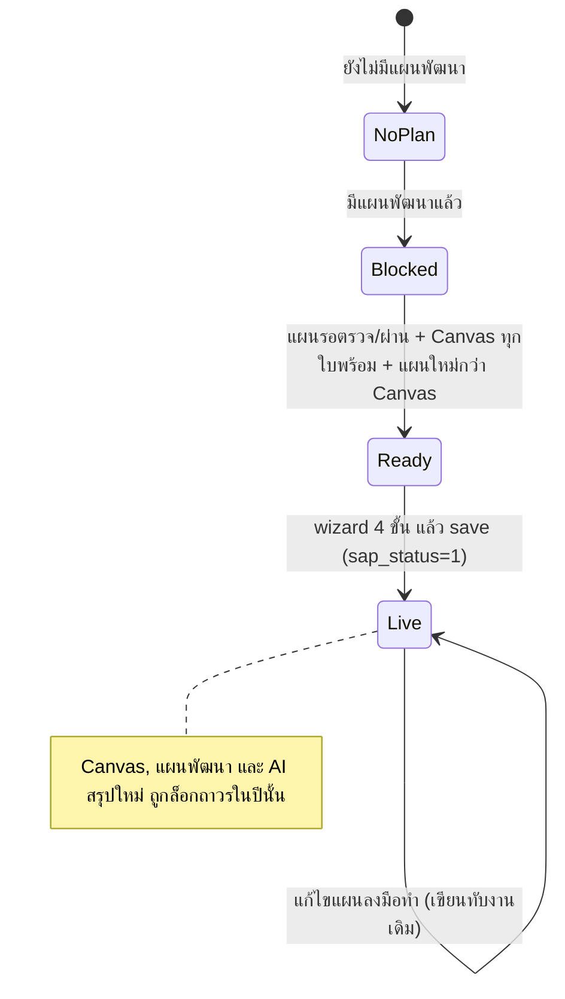
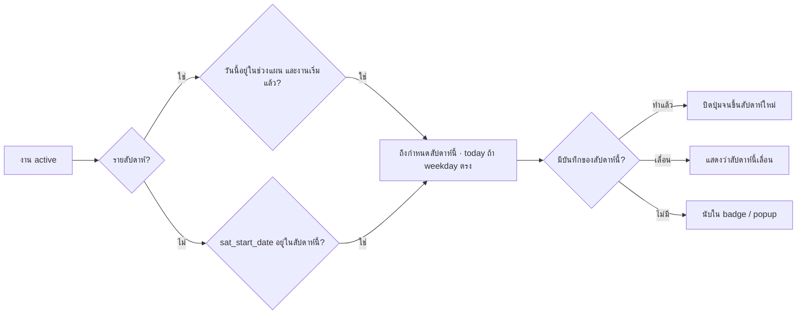

# แผนลงมือทำ (Action Plan)

- **ระดับใน MVP:** Must — `docs/sila5school-study.md` หัวข้อ 8 ข้อ #10 · การเตือนที่ส่งจริงเป็น Should (ข้อ #18) · ตอบกลับทาง LINE แล้วบันทึกเป็นหลักฐานเป็น Later (ข้อ #18b)
- **โค้ดอ้างอิง:** (path ตาม repo เดิม · สำเนาในเครื่องอยู่ที่ `reference/sila5school/` path เดียวกัน)
  - `module/console/controller/actionPlanController.php` — ส่วนแผนและงาน (ส่วนบันทึกผลอยู่ใน `08-practice-log-story.md`)
  - `public_html/console/js/console-actionPlan.js` — wizard 4 ขั้นฝั่ง browser
  - `library/module/console.php` — query ของแผน/งาน, การนับสัปดาห์, Canvas ต้นทาง, `guardReadonly`
  - `docs/schema/migrations/2026-09-02_school_action_plan.sql` และ `docs/schema/sila5school.sql:1695-1749`
  - จุดล็อกหลังแปลง: `module/console/controller/canvasController.php`, `module/console/controller/planController.php`
- **อ่านประกอบ:** study หัวข้อ 3.3, 3.4, 5.1, 6.3, 7, 7.1, 8, 9 · Context ข้อ 9, 12, 13, 14, 32, 34, 35, 47, 53, 60.2, 60.10.4 ข้อ 4, 60.10.6

## 1. ฟีเจอร์นี้ทำอะไร

- แปลง "แผนพัฒนาศักยภาพ" (ผลจาก Canvas → AI) ให้เป็นงานที่ทำได้จริง: ใครทำ ทำกับห้องไหน วันไหน เวลาไหน ทำครั้งเดียวหรือทุกสัปดาห์
- งานมี 3 ประเภท: (1) ภารกิจหลักที่โครงการกำหนด (2) กิจกรรมเสริมที่ยกข้อความจาก Canvas ช่อง 4/5/6 (3) กิจกรรมที่ครูคิดเอง
- เปิดใช้แล้วระบบคำนวณ to-do รายสัปดาห์ (แท็บ "ของฉัน" / "ทั้งโรงเรียน"), ขึ้น popup เตือนครั้งแรกของ session, มีปุ่ม ＋ ลอยทุกหน้า และให้ครูกด "ทำแล้ว" / "เลื่อน"
- แนวคิด "แผนคือคำสัญญา" (Context 60.10.4 ข้อ 4): ไม่เขียนแผนใหม่ และ**ระบบไม่ใช้ AI เสนอกิจกรรม** ยกคำที่ครูเขียนไว้มาใช้เท่านั้น (`actionPlanController.php:788`)

## 2. ผู้ใช้และสิทธิ์ในระบบเดิม

| บทบาท (`stk_type_id`) | ทำอะไรได้ | อ้างอิง |
|---|---|---|
| 1 ผู้ประสานงานหลัก | แปลงและแก้แผน (wizard/save) · อัปเดตสถานะได้ทุกงาน · งาน Academy นับเป็นงานของคนนี้ | `actionPlanController.php:173-176, 186-202` |
| 2 ครูผู้ช่วย | ดูทั้งแผน · อัปเดตสถานะเฉพาะงานที่มีชื่อตัวเองใน `sat_teacher_ids` | `:186-202` |
| 3 ครูร่วมกิจกรรม | ดูอย่างเดียว (action `index`, `memberScore`) | `library/module/console.php:118` |

- ตรวจสิทธิ์ใน constructor ทุก request (`actionPlanController.php:125-127`) ด้วย whitelist แบบ default-deny (`console.php:106-141`)
- สิทธิ์ผูกกับตำแหน่งในโครงการ ไม่ใช่ permission ที่ตั้งชื่อ (ขัด Context 32)
- "ผู้รับผิดชอบหลัก" และ "ครูผู้ช่วยในแผน" เป็นข้อมูลแสดงผลเท่านั้น ไม่ได้ใช้ตรวจสิทธิ์หรือส่งเตือน (อ่าน/เขียนแค่ `:616-617, 996-997`)

## 3. ข้อมูลในระบบเดิม (ตาราง / คอลัมน์สำคัญ / ค่าสถานะ)

**`school_action_plan`** — 1 แถวต่อ (โครงการ, โรงเรียน) (`docs/schema/sila5school.sql:1695-1711`)
- `sap_draft_id` เก็บ id ร่าง AI ตอน save (`actionPlanController.php:993`) แต่ไม่มีโค้ดอ่านกลับ · Canvas ต้นทางหาจากร่าง AI ล่าสุดที่สำเร็จเสมอ (`sad_canvas_ids` เป็น JSON ไม่ใช่ FK) (`console.php:2476-2501`)
- `sap_start_date` / `sap_end_date` · `sap_owner_person_id` · `sap_assistant_ids` (CSV)
- `sap_status`: 0 ร่าง / 1 เปิดใช้ — โค้ดเขียน 1 ทุกครั้งที่ save (`actionPlanController.php:998`) จึงไม่มี flow ใน repo ที่สร้างสถานะ 0 (wizard อยู่ฝั่ง browser ทั้งหมด) · แต่ข้อมูลจริงมี 3 แผน เปิดใช้ 2 (study 1.1) ที่มาของแผนที่เหลือยังไม่ได้ตรวจ
- `sap_confirm_datetime` / `sap_confirm_person_id` — "ทีมครูอ่านแผนแล้ว" บันทึกครั้งแรกครั้งเดียว (`:1000-1003`)

**`school_action_task`** (`sila5school.sql:1715-1749`)
- `sat_type`: 1 ภารกิจหลัก / 2 กิจกรรมเสริมจาก Canvas / 3 ครูคิดเอง · `sat_core_key`: `diary_check` | `happy_hour` | `academy_follow`
- `sat_canvas_id`, `sat_canvas_channel` (ช่อง 4/5/6 ที่ยกข้อความมา)
- `sat_name`, `sat_detail` (≤800), `sat_potential_link` (≤800 "ช่วยฝึกศักยภาพช่อง 1 อย่างไร")
- `sat_stc_ids` (ห้อง, CSV), `sat_teacher_ids` (ครู, CSV)
- `sat_repeat_type`: 0 ครั้งเดียว / 1 ทุกสัปดาห์ / 2 ทุก 2 สัปดาห์ · `sat_weekday` 0=อาทิตย์…6 · `sat_start_date` · `sat_time` · `sat_time_end` · `sat_target_date` (เฉพาะ Academy)
- `sat_remind_day` (0 = เช้าวันนั้น), `sat_notify` (0 ไม่ระบุ / 1 ผู้ประสานงาน / 2 ครูทุกคน) — **เก็บแต่ไม่ส่งจริง** (`sila5school.sql:1733-1734`)
- `sat_material`, `sat_ref_url`, `sat_expect_result`, `sat_expect_signal` · `sat_status`: 0 ใช้งาน / 9 ลบ (soft delete เพราะบันทึกอ้างถึง `console.php:2232-2236`)
- ไม่มี FK ระหว่างแผน ↔ งาน ↔ บันทึก ↔ Canvas (study 1.2)
- migration เดียวกันเพิ่ม `school_canvas.sc_target` ไว้ใช้เป็นป้ายชื่อ Canvas (`2026-09-02_school_action_plan.sql:14-16`) แต่ยังไม่มีใครกรอก (study 3.1)

## 4. Flow และลำดับสถานะ

Wizard (`actionPlanController.php:595-828`, `console-actionPlan.js:9-78`)
1. **ช่วงดำเนินงาน:** วันเริ่ม–สิ้นสุด, ผู้รับผิดชอบหลัก, ครูผู้ช่วย, ติ๊ก "ทีมครูอ่านแผนแล้ว" (ปุ่มถัดไปปิดจนกว่าจะติ๊ก)
2. **กิจวัตรหลัก:** ตรวจสมุด / ชั่วโมงสุขจริงหนอ ตั้งได้หลายชุด (ห้อง+ครู+วัน+เวลา+เตือน) · Academy ชุดเดียว (ความถี่ + วันเป้าหมาย + ผู้รับแจ้ง)
3. **กิจกรรมเสริม:** ไม่บังคับ · ลากคลุมข้อความ Canvas ช่อง 4/5/6 หรือกด "ใช้ทั้งช่อง" (ยกมาแค่บรรทัดแรก ≤255 ตัวอักษร `console-actionPlan.js:107-111`) เพื่อสร้างการ์ด หรือเพิ่มเอง
4. **ตรวจและเปิดใช้:** สรุปแล้วส่งทั้งก้อนใน request เดียว

To-do รายสัปดาห์ (คำนวณทุกครั้งที่เปิดหน้า ไม่ได้เก็บเป็นแถว)

## 5. Business rule

- แปลงได้เฉพาะผู้ประสานงานหลัก ทั้งตอนเปิด wizard และตอน save (`actionPlanController.php:563, 907`)
- ต้องมีแผนพัฒนา (มีข้อความ objective หรือ plan) และ Canvas ชุดที่ AI ใช้ร่าง (`:2004-2011`)
- เงื่อนไขแปลง (ตรวจเฉพาะครั้งแรกที่ยังไม่ live): แผนพัฒนาสถานะรอตรวจ (2) หรือผ่าน (3) ไม่ต้องรอผล · ไม่ผ่าน (4) แปลงไม่ได้ (`:2023-2028`)
- Canvas ทุกใบในแผนต้องสถานะ S2 "พร้อมใช้ทำแผน" (`:2029-2037`; `console.php:1115-1139`)
- แผนพัฒนาต้องบันทึกหลัง Canvas แก้ครั้งล่าสุด และไม่มีใบไหนถูกลบ (`actionPlanController.php:2038-2040`; `console.php:2515-2532`)
- ก่อนแปลงขึ้นคำเตือนว่าจะล็อก Canvas แผนพัฒนา และการให้ AI สรุปใหม่ (`actionPlanController.php:54, 271`)
- หลัง live: Canvas แก้/ลบ/เพิ่มไม่ได้ (`canvasController.php:103-104, 1089, 1331, 1490`) · AI สรุปใหม่ไม่ได้ (`:537, 642, 688`) · แผนพัฒนาดูอย่างเดียว (`planController.php:92, 812-819`)
- ผลตรวจแผนพัฒนาที่ออกภายหลัง (แม้ไม่ผ่าน) ไม่กระทบแผนลงมือทำที่ live แล้ว (`actionPlanController.php:2016`)
- ช่วงดำเนินงานต้องอยู่ในปีการศึกษาของโครงการ และยาว ≥ 56 วันนับรวมวันแรก-วันสุดท้าย (`:34, 1920-1931`)
- ค่าเริ่มต้น: วันเริ่ม = max(วันนี้, วันเปิดปี) · วันสิ้นสุด = เริ่ม + 55 วัน แต่ไม่เกินวันปิดปี (`:606-615`)
- ต้องติ๊กยืนยันการอ่าน ไม่งั้น save ไม่ผ่าน (`:919-921`) · เป็นการยืนยันครั้งเดียวโดยคนที่กด save ไม่ใช่ครูแต่ละคน (`:1000-1003`)
- ตรวจสมุดและสุขจริงหนอต้องมีอย่างน้อย 1 ชุด และทุกชุดต้องเลือกห้องและครู (`:944-970`; `console-actionPlan.js:182-208, 237-245`)
- ภารกิจหลักเป็นรายสัปดาห์เสมอ เริ่มวันเดียวกับแผน ชื่อมาจากค่าคงที่ (`actionPlanController.php:1026-1039`)
- ช่วงเวลา (เริ่ม–จบ) มีเฉพาะชั่วโมงสุขจริงหนอ (`:24, 1035`)
- กิจกรรมเสริมที่มีชื่อต้องกรอก "เชื่อมกับศักยภาพช่อง 1 อย่างไร" (`:978-980`) · หน้าเว็บทักเมื่อสั้นกว่า 20 ตัวอักษรแต่ไม่บล็อก และไม่ใช้ AI (`console-actionPlan.js:292-305`)
- วันเริ่มของกิจกรรมเสริมต้องอยู่ในช่วงแผน (`actionPlanController.php:981-984`)
- ประเภท 2 หรือ 3 ตัดสินจากการผูก Canvas · ถ้า Canvas ไม่อยู่ในชุดของแผน ระบบตัดเป็นไม่ผูก (= ประเภท 3) (`:1097-1102`)
- กิจกรรมเสริมเลือกห้องได้ 1 ห้อง (หรือไม่ระบุ) และผู้รับผิดชอบ 1 คน แม้คอลัมน์เป็น CSV · การ์ดใหม่เลือกครูคนแรกในรายชื่อไว้ให้ (เรียงตามบทบาท ผู้ประสานงานขึ้นก่อน `console.php:904`) ส่วน server ใช้ `owner_id` เฉพาะเมื่อไม่มีค่าส่งมา (`actionPlanController.php:845-855, 1107-1108, 2186-2190`)
- กิจกรรมเสริมทำซ้ำได้แค่ "ครั้งเดียว" หรือ "ทุกสัปดาห์" (`:1109`)
- เขียนแผนและงานทั้งหมดใน transaction เดียว ผิดพลาดจุดไหน rollback ทั้งก้อน (`:987-990, 1142, 1148-1156`)
- งานที่หายจากฟอร์มตอน save ถูก soft delete (สถานะ 9) บันทึกเดิมยังอยู่ (`:1080-1085, 1135-1140`)
- แก้แผนที่ live ได้ตลอดผ่าน wizard เดิม ข้ามด่านเงื่อนไขแปลง (`:574, 939-942`)
- สัปดาห์ของแผนนับจันทร์–อาทิตย์ จากสัปดาห์ที่มีวันเริ่มถึงสัปดาห์ที่มีวันสิ้นสุด (`console.php:2345-2367`)
- งานที่เพิ่มกลางแผนนับตั้งแต่สัปดาห์ที่สร้าง (หรือวันเริ่มของกิจกรรมถ้าช้ากว่า) ไม่นับย้อนหลัง (`console.php:2404-2415`)
- งานรายสัปดาห์ถึงกำหนดเฉพาะช่วงแผน · "วันนี้" = weekday ตรงกับวันนี้ · งานครั้งเดียวถึงกำหนดในสัปดาห์ของ `sat_start_date` (`actionPlanController.php:2091-2110`)
- Academy เป็นงานติดตามคะแนน ไม่ใช่งาน "ทำแล้ว/เลื่อน" ไม่นับใน to-do (`:2093-2095`; `console.php:2339-2342`)
- เลื่อนงานรายสัปดาห์ = บันทึกว่าสัปดาห์นี้เลื่อน ไม่แตะตัวงาน (`actionPlanController.php:1611-1623`)
- เลื่อนงานครั้งเดียว = ย้ายวันและเวลาของตัวงานไปวันใหม่ (`:1639-1644`)
- popup เตือนขึ้นครั้งแรกของ session เมื่อมีงานค้างสัปดาห์นี้ · แสดง 3 งานแรก งานวันนี้ขึ้นก่อน (`:1682-1688, 1734-1737, 1750`)
- ปุ่ม ＋ ลอยแสดง badge = งานสัปดาห์นี้ของฉันที่ยังไม่บันทึก (`:1656-1690`; `public_html/global/js/global-post.js:197-211`)
- ตัวเลือกเตือนล่วงหน้า 0/1/2 วัน (server รับ 0–7) แสดงเป็นป้ายบนหน้าเท่านั้น (`actionPlanController.php:43, 478-480, 1036`)

## 6. การตรวจข้อมูลขาเข้า (validation)

- `start_date`, `end_date` required + date · `owner_id` required + integer (`actionPlanController.php:911-917`)
- วันสิ้นสุดต้องไม่ก่อนวันเริ่ม · อยู่ในปีการศึกษา · ≥ 56 วัน (`:922-927`) · ฝั่ง browser ตรวจซ้ำ (`console-actionPlan.js:153-179`)
- ห้อง/ครูของทุกชุดกรองให้เหลือเฉพาะ id ที่มีจริงของโรงเรียน (`actionPlanController.php:945-946, 2170-2176`)
- weekday ของภารกิจหลัก clamp 0–6 (`:1033`) · เวลา regex HH:MM (`:2210-2217`) · วันที่ regex `YYYY-MM-DD` ไม่ผ่านใช้ค่า fallback (`:2219-2223`)
- ตัดความยาว: ชื่อ 255, รายละเอียด 800, ลิงก์ศักยภาพ 800, สื่อ 255, URL 500, ผลที่คาดหวัง/สัญญาณ 255 (`:1105-1117`)
- `sat_ref_url` ไม่ได้ตรวจว่าเป็น URL ที่ปลอดภัย · `assistant_ids` และ `owner_id` ไม่ได้ตรวจว่าเป็นครูของโรงเรียน (`:996-997, 2178-2183`)
- ความถี่และผู้รับแจ้งของ Academy ต้องอยู่ในตัวเลือก ไม่งั้นใช้ 1 (`:1060, 1064`)
- เลื่อนงานครั้งเดียว: ตรวจแค่รูปแบบวันที่ ไม่ตรวจว่าอยู่ในช่วงแผนหรือเป็นอดีต (`:1625-1627`)

## 7. Edge case และพฤติกรรมที่ควรรู้

- แผนมีได้ 1 แผนต่อโรงเรียนต่อปี (PK) จึงทำหลายรอบในปีเดียวไม่ได้ (`sila5school.sql:1710`)
- แปลงแล้วไม่มีทางปลดล็อก Canvas และแผนพัฒนาในปีนั้น · ปรับ Canvas ตาม feedback ระหว่างทางไม่ได้
- แก้แผนที่ live = update แถวงานเดิมในที่ ไม่มีประวัติว่าเคยตั้งวัน/เวลา/ห้องอะไร (`actionPlanController.php:1041-1044, 1121-1124`)
- ย่นวันสิ้นสุดแผนได้โดยไม่ตรวจบันทึกที่อยู่นอกช่วงใหม่
- server ไม่ตรวจว่าวันเริ่มต้องไม่ก่อนวันนี้ (ช่องวันที่เลือกย้อนได้ถึงวันเปิดปี `:645, 1920-1931`) ถ้าปีการศึกษาเหลือน้อยกว่า 56 วัน ครูต้องตั้งวันเริ่มย้อนไปในอดีตจึงจะ save ได้
- จำกัด จันทร์–ศุกร์ ของภารกิจหลักมีแค่ใน dropdown (`:40, 1961`) server รับ 0–6 (`:1033`)
- `sat_repeat_type` = 2 มีใน schema แต่กิจกรรมเสริมตั้งไม่ได้ · Academy ใช้คอลัมน์เดียวกันเก็บความถี่ (1 ทุกจันทร์ / 2 ทุก 2 สัปดาห์) คนละความหมาย (`:46, 1060`)
- เลื่อนงานครั้งเดียวเขียนทับวันเดิมของงาน วันเดิมเหลือแค่ในบันทึก "เลื่อน" (`:1629-1644`)
- เลื่อนงานรายสัปดาห์ไม่ได้ระบุวันใหม่ ถ้าช่วงแผนไม่พอให้ไปขยายวันสิ้นสุดเอง (`:1584`)
- "วันนี้" และ "สัปดาห์นี้" ใช้เวลาของ server (`date()`) ไม่มี timezone ต่อองค์กรหรือผู้ใช้
- popup หลัง login ผูกกับ session flag ถ้า session หมดจะขึ้นใหม่ (`:1683-1684`)
- ปุ่ม ＋ ลอยเรียก action `fab` ซึ่งไม่อยู่ใน whitelist ของครู type 3 (`console.php:118`) · `fabAction` เองก็คืน badge 0 ให้ type 3 (`actionPlanController.php:1659-1661`) · script ทำงานเมื่อ layout ตั้ง `POST_CFG` ซึ่ง comment บอกว่าตั้งเฉพาะผู้มีสิทธิ์ (`global-post.js:4`) ส่วนที่ตั้งค่านี้ไม่อยู่ในสำเนา
- กิจวัตรที่ Canvas เน้น อ่านจากข้อความช่อง 4 ด้วย regex "ข้อ N" (`actionPlanController.php:656-664, 1902-1907`) ข้อความรูปแบบอื่นจะไม่ถูกจับ
- หมุดปฏิทิน Happy Hour เลือกจาก `activity_type_id` 4/15 ตามระดับชั้นของโรงเรียน (`console.php:2599-2635`)
- ป้ายชื่อ Canvas ใช้ `sc_target` ถ้าว่างใช้ชื่อขอบเขต + ประเด็นท้าทายแบบตัดสั้น (`actionPlanController.php:1991-1998`)
- ข้อมูลจริง: เปิดใช้ 2 แผน งาน 10 งานเป็นกิจวัตรหลักทั้งหมด ยังไม่มีกิจกรรมเสริม (study 3.4) flow กิจกรรมเสริมจึงยังไม่ถูกพิสูจน์กับผู้ใช้จริง (study 7.1 ข้อ 5)

## 8. สิ่งที่ห้ามทำตาม

- **Hard-code เฉพาะ Sila5School:** ภารกิจหลัก 3 หมวด (`actionPlanController.php:8-31`), 7 กิจวัตร (`console.php:96`), ติดตาม Academy/Kahoot (`actionPlanController.php:1772-1897`), หมุด Happy Hour ด้วย `activity_type_id` 4/15 (`console.php:2599-2635`), ข้อความหน้าแรกที่ระบุชื่อกิจวัตร (`actionPlanController.php:297-303`) — ห้ามนำมาเป็นโค้ด (Context 9, 53)
- **Hard-code โครงสร้างโรงเรียน:** วันเรียน จันทร์–ศุกร์ (`:40`), ปีการศึกษาเป็นขอบเขตแผน (`:1910-1917`), ชั้น ป./ม. แยกด้วยเลข 6 (`console.php:2609-2613`) (Context 35, 47)
- **ค่าคงที่ที่ควรตั้งค่าได้:** 56 วัน (`actionPlanController.php:34`), ตัวเลือกเตือน (`:43`), เหตุผลการเลื่อน (`:1575`)
- **เก็บ id หลายค่าเป็น CSV:** `sap_assistant_ids`, `sat_stc_ids`, `sat_teacher_ids` (study 6.3)
- **ล็อก Canvas และแผนถาวร** แทนการ snapshot (ขัด Context 14 Revision → Next Cycle)
- **แผนเดียวต่อ (โครงการ, โรงเรียน):** ผูกครูกับโรงเรียน ขัด Context 34 (ครูอิสระ) และ 33
- **เก็บค่าเตือนที่ไม่ส่งจริงแต่แสดงบนหน้าว่า "เตือนล่วงหน้า N วัน"** ทำให้ครูเข้าใจผิด (`:478-480`)
- **สิทธิ์ผูกกับตำแหน่ง** (`stk_type_id` = 1) และไม่ตรวจว่า owner/assistant เป็นครูของโรงเรียน (`:996-997`)
- **ตรวจกฎที่ฝั่ง UI อย่างเดียว** (จันทร์–ศุกร์) · server ต้องเป็นผู้บังคับกฎทุกข้อ
- **ผูก Canvas กับแผนผ่าน JSON ในร่าง AI ล่าสุด** แทน FK ที่มี version (`console.php:2476-2501`)
- **render HTML ใน controller และนับ to-do ใหม่ทุก request** โดยไม่มีแถวของแต่ละครั้งที่ต้องทำ

## 9. แนวทางใน SkillWise

**ตารางใหม่และ mapping**

| ระบบเดิม | SkillWise | หมายเหตุ |
|---|---|---|
| `school_action_plan` | `action_plans` | snapshot ของ `development_plan_versions` 1 version (`plan_version_id`) · canvas revision ที่ใช้มาจาก `development_plan_canvases` ของ version นั้น (FK) แทน `sap_draft_id` · มีหลายรอบต่อครูได้ |
| `sap_owner_person_id`, `sap_assistant_ids`, `sap_confirm_*` | `action_plan_members` (`member_role` = `owner` / `co_teacher`, `acknowledged_at`) | ยืนยันการอ่านรายคน ไม่ใช่ติ๊กเดียวแทนทั้งทีม |
| `school_action_task` | `action_items` (`item_type`: `routine` / `from_canvas` / `custom`) | `routine` อ้าง `practice_templates` · `from_canvas` อ้าง `canvases` (`source_canvas_id`) + `tool_fields` (`source_tool_field_id` ช่องที่ยกมา) |
| `sat_core_key` + `CORE_TASKS` | `practice_sets` + `practice_templates` | ชุดกิจวัตรเป็นข้อมูล ตั้งค่าได้ต่อองค์กร (`practice_sets.organization_id` null = ชุดกลาง) · template มี `default_recurrence_rule` · การผูกกับแพ็กเกจ และค่าเริ่มต้นเวลา/ช่วงเวลาต่อ template ยังไม่มีใน schema MVP |
| `sat_stc_ids` | `action_item_org_units` | ห้อง/กลุ่มเป็น relation ไปที่ `org_units` |
| `sat_teacher_ids` | `action_item_assignees` | ผู้รับผิดชอบต้องเป็นสมาชิกของแผน (ตรวจที่ API · schema ไม่มี constraint) |
| `sat_repeat_type` + `sat_weekday` + `sat_time(_end)` + `sat_start_date` | `recurrence_rule` (RRULE) + `time_of_day` + `duration_minutes` ใน `action_items` · timezone อยู่ที่ `action_plans.timezone` | ทุกสัปดาห์ / ทุก 2 สัปดาห์ใช้ RRULE · ครั้งเดียวใช้ `starts_on` โดยไม่มี RRULE (CHECK บังคับ) · `action_items.starts_on` / `ends_on` (null = ตามช่วงของแผน) ใช้กับกิจกรรมที่เพิ่มกลางแผนด้วย |
| to-do ที่คำนวณสด | `practice_sessions` | 1 แถวต่อครั้งที่ต้องทำ · เลื่อน = ย้าย session (เก็บวันเดิม) ไม่แก้ตัว item |
| `sat_expect_signal` | ยังไม่มีใน schema MVP (มีแค่ `action_items.expected_result` เป็นข้อความ) | ถ้าจะผูกสัญญาณที่คาดหวังกับ `success_signals` ต้องเพิ่มตารางเชื่อม · ตอนบันทึกผลผูกได้แล้วผ่าน `practice_log_signals` |
| `sat_remind_day`, `sat_notify` | `action_items.reminder_offset_minutes` → `notification_jobs` + `notification_templates` | ส่งจริงผ่าน BullMQ (Should #18) · LINE เป็นช่องทางหลัก (Context 60.10.6) · กันส่งซ้ำด้วย `dedupe_key` · การเลือกผู้รับเตือน (แทน `sat_notify`) ยังไม่มีคอลัมน์ใน schema MVP |
| (ไม่มี) | `audit_logs` | บันทึกการแปลง การแก้แผน และการเปิดดูข้อมูลอ่อนไหวโดยแอดมิน |

**Permission ที่ endpoint น่าจะต้องประกาศ** (ทุก endpoint ตรวจด้วย guard · ค่าเริ่มต้นปฏิเสธ)
- สร้าง/แก้/เปิดใช้แผนลงมือทำ: `self.tools.use` + ตรวจว่าเป็นเจ้าของ development plan หรือ owner ใน `action_plan_members`
- ยืนยันการอ่าน, ดูแผน, ดู to-do ของตัวเอง: `self.tools.use` + เป็นสมาชิกของแผน
- เลือกห้อง/ครูในองค์กร: เป็นสมาชิกองค์กรเดียวกัน (`memberships`) · ถ้าต้องเห็นรายชื่อนักเรียนในห้องใช้ `org.students.view`
- โค้ชดูแผนของ case ที่ดูแล: `coach.cases.view_assigned` · ให้ feedback: `coach.feedback.write`
- ผู้บริหารเห็นแค่ตัวเลขรวม (เช่น อัตราทำตามแผน): `org.dashboard.view_aggregate`
- แอดมินไล่ดู: `admin.organizations.view` / `admin.users.view` · เห็นชื่อนักเรียนต้องมี `admin.sensitive.student.view` และบันทึก audit log
- งานส่งเตือน (worker) เรียกผ่าน service ภายใน ไม่เปิดเป็น endpoint สาธารณะ

**สิ่งที่ต้องเปลี่ยนจากระบบเดิมตาม Context**
- **Snapshot แทนการล็อก:** `action_plans` ผูก version ที่แน่นอนของแผนและ Canvas · ครูแก้ Canvas ต่อได้ (เกิด revision ใหม่) แล้วนำไปทำแผนรอบถัดไป (Context 14, study 7) — Context 60.10.4 ข้อ 4 [REFERENCE] บรรยายว่าระบบเดิมล็อก จึงต้องให้ทีมยืนยันแนวทางนี้ (ข้อ 10)
- **ไม่ hard-code กิจวัตร:** ภารกิจหลักทุกอย่างมาจาก `practice_templates` ที่ตั้งค่าได้ · ห้ามมี enum `diary_check` / `happy_hour` / `academy_follow` ในโค้ด (Context 9, 47, 53)
- **ครูทำคนเดียวได้ครบ:** แผนต้องใช้ได้โดยไม่มีครูร่วม และไม่ต้องสังกัดองค์กร (Context 34, study 7.1 ข้อ 1) · ห้อง (`org_units`) จึงเป็นค่าไม่บังคับสำหรับครูอิสระ
- **ด่านก่อนแปลงไม่ fix:** เงื่อนไข "แผนต้องส่งตรวจ" และ "Canvas ต้องได้คะแนนผ่าน" เป็น OPEN · ออกแบบเป็น policy ที่เปิด/ปิดได้ ไม่เขียนเป็นเงื่อนไขตายตัว
- **ระยะเวลาขั้นต่ำและวันทำงานตั้งค่าได้:** ค่าเริ่มต้น 56 วัน (Context 60.10.4 ข้อ 4) ตรวจที่ API (schema บังคับแค่ `ends_on > starts_on`) · วันทำงานมาจากการตั้งค่าองค์กร (ยังไม่มีใน schema MVP)
- **เตือนจริง:** ใช้ `notification_jobs` ตามเวลาของ session และ timezone ของแผน (`action_plans.timezone`) · ถ้ายังไม่ส่งจริง ห้ามแสดงว่า "จะเตือน"
- **กฎทุกข้ออยู่ที่ API:** schema ตรวจข้อมูลใน `packages/shared` (Zod) ใช้ทั้งสองฝั่ง · server ตรวจห้อง/ครู/วัน/ช่วงแผนเอง
- **เลื่อนได้ตลอดแต่มีร่องรอย:** เลื่อน session เก็บ `original_planned_at` · เหตุผลและผู้เลื่อนเก็บเป็น `practice_logs` (`outcome` = `postponed`, `author_user_id`, `note`) · ประวัติการแก้ item ระหว่างรอบยังไม่มีใน schema MVP (Context 60.10.5 กำหนดเรื่องประวัติไว้ที่บันทึก)
- **AI ไม่เสนอกิจกรรมใน Phase นี้:** ตามระบบเดิม (`actionPlanController.php:788`) · ถ้าจะเพิ่ม "AI แนะนำ Routine" (Context 12) ต้องตัดชื่อเด็กก่อนส่งทุกครั้ง และเป็นงานที่ต้องตกลงแยก

## 10. คำถามที่ยัง OPEN

1. เปลี่ยนจาก "ล็อกถาวรหลังแปลง" เป็น snapshot ตาม Context 14 ใช่หรือไม่ และแก้ Canvas ระหว่างรอบแล้วจะแจ้งครูอย่างไรว่าแผนที่ใช้อยู่อิงข้อมูลเก่า
2. ด่านก่อนแปลง: ต้องผ่านการตรวจแผน (study 9 ข้อ 2) และคะแนน AI ของ Canvas (study 9 ข้อ 1, Context 60.10.4 ข้อ 2) หรือไม่
3. ใครเป็นคนกดแปลงเมื่อแผนมาจาก Canvas ของหลายครู (ระบบเดิมคือผู้ประสานงานหลัก) · ใช้ permission อะไร
4. ต้องให้ครูร่วมทุกคน acknowledge ก่อนเปิดใช้ หรือเปิดใช้ได้เลยแล้วเก็บสถานะรายคน
5. แผนลงมือทำผูกกับ "รอบการพัฒนา" แบบไหน (ปีการศึกษา / รอบ subscription — study 9 ข้อ 7) และขอบเขตวันสิ้นสุดมาจากอะไร
6. ระยะเวลาขั้นต่ำ 8 สัปดาห์เป็นค่าตายตัวของ product หรือให้องค์กร/แพ็กเกจตั้งได้
7. ชุดกิจวัตรเริ่มต้น (`practice_sets`) ของ SkillWise มีอะไร และองค์กรเพิ่ม/ปิดเองได้หรือไม่ (7 กิจวัตรเป็นแค่หนึ่งชุด — Context 9)
8. งานแบบ "ติดตาม" (เช่น ติดตามผลสอบของนักเรียน) ต้องมีใน SkillWise หรือไม่ ถ้ามีเป็น item kind ใหม่ ไม่ใช่ `academy_follow`
9. ช่องทาง ความถี่ และผู้รับการเตือน (LINE / email / ในระบบ) · n8n หรือ workflow ในระบบ (Context 60.10.6, 60.10.10)
10. ผู้บริหารเห็นตารางความสม่ำเสมอรายครูได้หรือไม่ หรือเห็นเฉพาะข้อมูลรวม (Context 31, 60.3 — ระวังกลายเป็นการประเมินครู Context 54)
