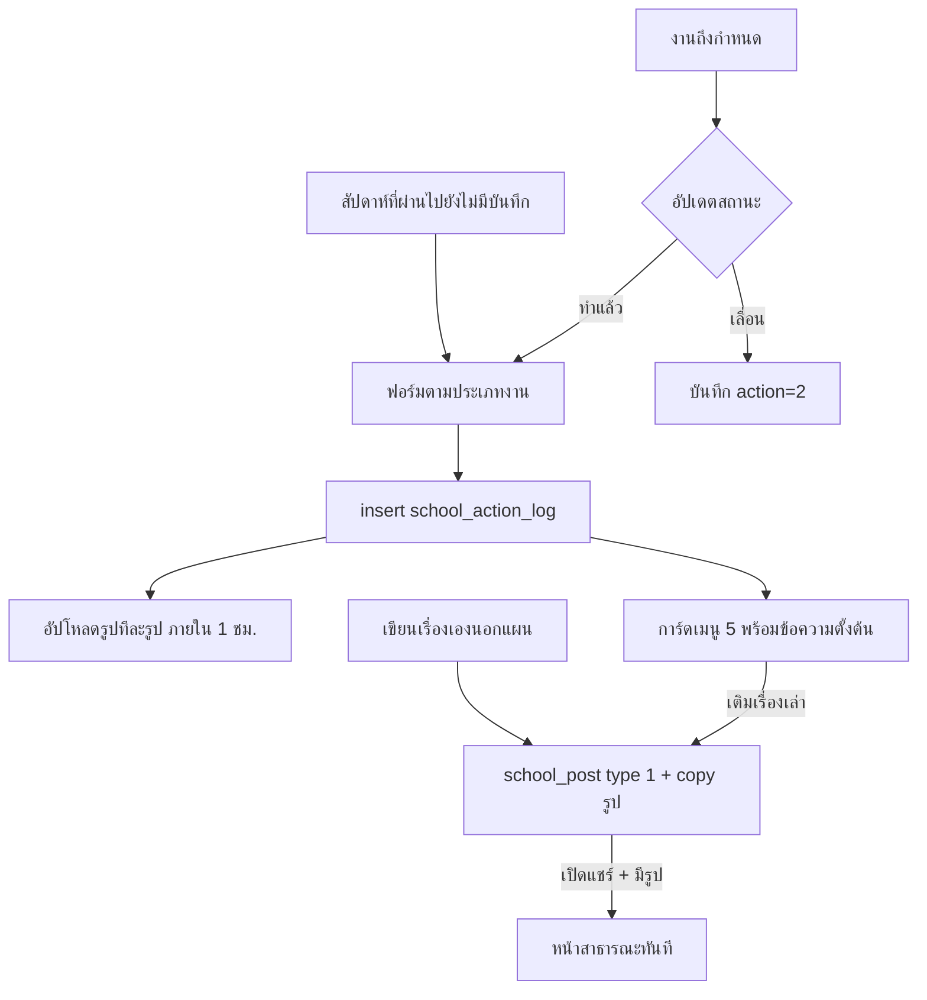
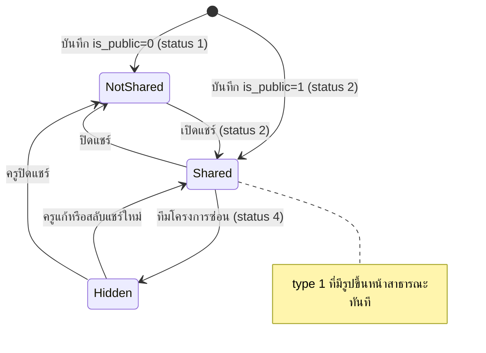

# บันทึกการลงมือทำและเรื่องราว (Practice Log & Story)

- **ระดับใน MVP:** บันทึกรายสัปดาห์ Must — `docs/sila5school-study.md` หัวข้อ 8 ข้อ #11 · เรื่องเล่าและ Reflection ที่เป็นส่วนตัวเกี่ยวกับข้อ #12 · **การแชร์ออกนอกองค์กร/สาธารณะเป็น Later (ข้อ #19)** · บันทึกผ่าน LINE เป็น Later (ข้อ #18b)
- **โค้ดอ้างอิง:** (path ตาม repo เดิม · สำเนาในเครื่องอยู่ที่ `reference/sila5school/` path เดียวกัน)
  - `module/console/controller/actionPlanController.php` — ส่วนบันทึกผล (ทำแล้ว / เลื่อน / ย้อนหลัง / รูป)
  - `module/console/controller/storyController.php` — หน้าเมนู 5
  - `module/console/controller/postController.php` — สร้าง/แก้/ลบ/แชร์เรื่องราว (`school_post` type 1)
  - `library/module/community.php` — พื้นที่แลกเปลี่ยนเรียนรู้ (หน้าสาธารณะ)
  - `library/module/console.php` — feed เมนู 5, ข้อความตั้งต้น, สัปดาห์ของบันทึก
  - `public_html/global/js/global-post.js`, `public_html/console/js/console-actionPlan.js` (ส่วนบันทึกผล), `public_html/console/js/console-story.js` (ไฟล์ว่าง)
  - `library/rgt/core/file.php` (URL ของรูป) · `library/module/global-master.php` (ย่อรูป)
  - `docs/schema/migrations/2026-06-06_school_post.sql`, `2026-06-23_school_post_activity.sql`, `2026-09-02_school_action_plan.sql` · `docs/schema/sila5school.sql:1648-1691, 2118-2199`
- **อ่านประกอบ:** study หัวข้อ 3.5, 5.3, 5.4, 6.1, 6.2, 6.3, 7, 8, 9 ข้อ 4 · Context ข้อ 5, 15, 31, 60.2, 60.3, 60.7, 60.10.4 ข้อ 5, 60.10.5, 60.10.6 · ฟีเจอร์ต้นทาง `07-action-plan.md`

## 1. ฟีเจอร์นี้ทำอะไร

- ครูบันทึกผลของงานในแผนลงมือทำ: **ทำแล้ว** (โน้ต + ช่องตามประเภทงาน เช่น สัญญาณที่เห็นของกิจกรรมเสริม + นักเรียนที่ประทับใจถ้างานมีห้อง + ครูที่ร่วมทำ + รูปไม่เกิน 3) หรือ **เลื่อน**
- งานรายสัปดาห์ที่สัปดาห์ก่อนยังไม่มีบันทึก ใช้ **บันทึกย้อนหลัง** ได้
- บันทึก "ทำแล้ว" ไหลเข้า **เมนู 5 เรื่องราว** เป็นข้อความตั้งต้น ครูเลือกเติมเป็นเรื่องเล่า (`school_post` type 1) หรือเขียนเรื่องเองนอกแผนก็ได้
- ครูเปิด **แชร์** เรื่องราวได้ ถ้ามีรูปจะขึ้นหน้าสาธารณะ "พื้นที่แลกเปลี่ยนเรียนรู้" **ทันทีโดยไม่ต้องอนุมัติ**
- เมนู 6 (timeline รายเด็ก) และเมนู 7 (ตารางความสม่ำเสมอ) อ่านข้อมูลชุดนี้ต่อ (อยู่นอกขอบเขตไฟล์นี้)

## 2. ผู้ใช้และสิทธิ์ในระบบเดิม

| ผู้ใช้ | ทำอะไรได้ | อ้างอิง |
|---|---|---|
| ผู้ประสานงานหลัก (type 1) | บันทึก/เลื่อน/ย้อนหลังได้ทุกงาน · เขียน แก้ ลบ แชร์เรื่องราวได้ทุกเรื่องในโรงเรียน | `actionPlanController.php:196-209`; `postController.php:56-67` |
| ครูผู้ช่วย (type 2) | บันทึกเฉพาะงานที่มีชื่อตัวเอง · เขียน แก้ ลบ แชร์เรื่องราว**ของใครก็ได้**ในโรงเรียน (ไม่ตรวจเจ้าของ) | เดียวกัน |
| ครูร่วมกิจกรรม (type 3) | ดู feed เมนู 5 (มีชื่อนักเรียน) และหน้า detail · เขียนไม่ได้ | `library/module/console.php:119, 122` |
| ผู้บันทึก | แนบรูปได้เฉพาะบันทึกของตัวเอง ภายใน 1 ชั่วโมง | `actionPlanController.php:1520-1524` |
| ทีมโครงการ (ระบบแอดมินนอก repo) | ซ่อนเรื่องราว (status 4) · อนุมัติสรุปพัฒนาการ (status 3) | `console.php:1814-1834` |
| บุคคลทั่วไป (ไม่ login) | ดูเรื่องราวที่แชร์ + รูป + ชื่อครู + ชื่อและที่อยู่โรงเรียน | `library/module/community.php:28-57` |

## 3. ข้อมูลในระบบเดิม (ตาราง / คอลัมน์สำคัญ / ค่าสถานะ)

**`school_action_log`** (`docs/schema/sila5school.sql:1648-1676`)
- `sal_task_id` · `sal_action`: 1 ทำแล้ว / 2 เลื่อน
- เวลา 2 ค่า: `sal_datetime` = ที่ครูระบุว่าทำจริง (เลื่อนงานครั้งเดียว = วันใหม่ · เลื่อนรายสัปดาห์ = เวลาที่กด) และ `sal_create_datetime` + `sal_create_person_id` ที่ระบบเติม (`console.php:2306-2312`)
- ช่องทั่วไป: `sal_note`, `sal_signal` (ต่อด้วย `|`), `sal_expect_met` (0 ไม่ตอบ / 1 ยังไม่เห็น / 2 เริ่มเห็น / 3 เห็นแล้ว), `sal_reason` (เหตุผลการเลื่อน)
- ช่องเฉพาะ Sila5School: `sal_pages`, `sal_topic` (ตรวจสมุด) · `sal_observe` (ต่อด้วย `|`) · `sal_habit` 1–7 · `sal_learning` (สุขจริงหนอ)
- `sal_member_id` + `sal_member_reason` — นักเรียนที่ประทับใจได้ **1 คน** · `sal_with_person_ids` — ครูที่ร่วมทำ (CSV)
- `sal_story_running` ไม่มีโค้ดเขียนค่า (ใช้ `spo_action_log_id` แทน) · migration ในสำเนามีแค่คอลัมน์ชุดแรก (`2026-09-02_school_action_plan.sql:81-99`) คอลัมน์ที่เหลือพบเฉพาะในไฟล์ schema

**`school_action_log_picture`** (`sila5school.sql:1680-1691`) — FK ไปที่บันทึก (CASCADE) · ชื่อไฟล์ / thumbnail / ขนาด / ลำดับ · เก็บที่ prefix `school_action_log/` และ `school_action_log_thumbnail/`

**`school_post`** (`sila5school.sql:2118-2153`)
- `spo_type`: 1 เรื่องราว (เมนู 5) / 2 สรุปพัฒนาการ (เมนู 6)
- `spo_action_log_id` (0 = เขียนเองนอกแผน) — 1 บันทึกมีได้ 1 เรื่องเล่า บังคับด้วยโค้ด ไม่ใช่ unique index (`postController.php:623-632`)
- `spo_event_id` → `school_post_event` (seed 7 เหตุการณ์ของ Sila5School `2026-06-06_school_post.sql:82-89`) · `spo_activity_id` ใช้กับเหตุการณ์ 3 (`2026-06-23_school_post_activity.sql:7-10`)
- `spo_caption`, `spo_learning`, `spo_with_person_ids` (CSV เฉพาะเรื่องที่เขียนเอง) · `spo_deleted` (soft delete)
- `spo_is_public` + `spo_status` ตามโค้ด: 1 ไม่แชร์ / 2 แชร์ / 3 อนุมัติ / 4 ซ่อนโดยทีมโครงการ (`postController.php:69-74`) — comment ใน schema ยังเป็นความหมายเก่า "1 กำลังดำเนินการ / 2 รอตรวจ" (`sila5school.sql:2134`)
- `school_post_picture` (`:2188-2199`) ไม่จำกัดจำนวน · `school_post_category` + map: ความประทับใจ / แชร์เทคนิค / ความท้าทาย (`2026-06-06_school_post.sql:92-95`)
- สถานะรวมระดับโรงเรียนเก็บที่ `school_training.st_story` (`console.php:1510-1536`)

## 4. Flow และลำดับสถานะ

## 5. Business rule

**บันทึกผล**
- งาน Academy ไม่มีปุ่มทำแล้ว/เลื่อน (`actionPlanController.php:527-530`)
- งานรายสัปดาห์กดทำแล้ว/เลื่อนได้เฉพาะระหว่างช่วงแผน (`:2113-2126`) · บันทึกย้อนหลังทำได้แม้แผนสิ้นสุดแล้ว แต่วันที่ทำต้องอยู่ในช่วงแผน (`:535, 1400-1405, 1424-1427`)
- วันที่ทำจริงต้องไม่เกินวันนี้และไม่ก่อนวันเริ่มแผน (`:1414-1423`)
- งานรายสัปดาห์ต้องลงวันในสัปดาห์นี้ (จันทร์–อาทิตย์) และไม่เกินวันสิ้นสุดแผน · สัปดาห์ก่อนต้องใช้ย้อนหลัง (`:1424-1431`)
- งานครั้งเดียวลงวันได้ตั้งแต่วันเริ่มแผนถึงวันนี้ (`:1190-1198`)
- ย้อนหลังได้เฉพาะงานรายสัปดาห์ และเฉพาะสัปดาห์ก่อนสัปดาห์นี้ที่ยังไม่มี "ทำแล้ว" นับตั้งแต่สัปดาห์แรกของงาน รวมสัปดาห์ที่เคยเลื่อน (`:1203-1242, 1432-1444, 2055-2072`)
- สถานะของสัปดาห์: "ทำแล้ว" นับตาม `sal_datetime` · "เลื่อน" นับตาม `sal_create_datetime` · ทำแล้วชนะเลื่อน (`console.php:2383-2401`)
- งานรายสัปดาห์ที่ทำแล้วปิดปุ่มจนขึ้นสัปดาห์ใหม่ · งานครั้งเดียวที่ทำแล้วถือว่าจบ (`actionPlanController.php:504-509, 517-522`)
- ฟอร์มแยก 3 แบบตาม `sat_core_key`: ตรวจสมุด / สุขจริงหนอ / กิจกรรมเสริม (`console.php:1585-1594`; `actionPlanController.php:1313-1342`)
- ตัวเลือกสัญญาณ = บรรทัดของ Canvas ช่อง 7 (≤6 บรรทัด ≤80 ตัวอักษร) + "ยังไม่เห็นชัด" · ไม่ผูก Canvas ใช้รายการกลาง (`actionPlanController.php:1251-1261`; `console.php:1667-1677`)
- ถาม "ผลที่คาดหวัง" เฉพาะเมื่องานมี `sat_expect_result` (`actionPlanController.php:1338-1341, 1476`)
- นักเรียนที่ประทับใจเลือกได้เมื่องานระบุห้องที่มีรายชื่อ และต้องอยู่ในห้องของงาน + โรงเรียน/ปีเดียวกัน ไม่ผ่านจะทิ้งเงียบ (`:1280-1295, 1479-1491`)
- ครูที่ร่วมทำ = ครูทุกคนของโรงเรียนยกเว้นผู้บันทึก เลือกครูในงานไว้ให้ก่อน · "ทุกคนที่เลือกได้บันทึกนี้เป็นหลักฐานในแฟ้มของตัวเอง" (`:1365-1372, 1493-1496`)
- รูป: อัปโหลดหลังได้ `logId` ทีละรูป · เฉพาะบันทึก "ทำแล้ว" ของผู้บันทึกเอง ภายใน 3,600 วินาที · ไม่เกิน 3 รูป · jpeg/png · ย่อ ≤1600px + thumbnail 640px (`:1513-1565`; `console-actionPlan.js:463-482, 498-523`)
- ไม่มี endpoint แก้หรือลบบันทึก
- เลื่อนงานรายสัปดาห์ = บันทึก action 2 เวลาปัจจุบัน · งานครั้งเดียว = บันทึก + ย้ายวันของงาน · เหตุผลเลือกจาก 3 ข้อ ป้ายบอกว่าไม่บังคับ แต่ dropdown ไม่มีตัวเลือกว่างจึงส่งข้อแรกเสมอ · server รับข้อความใดก็ได้ ≤255 ไม่ตรวจกับรายการ (`actionPlanController.php:1575-1592, 1603-1647`)
- ตัวเลข "บันทึกผลแล้ว" นับเฉพาะงานที่ยัง active · "ของฉัน" = ผู้บันทึกหรือครูที่ร่วมทำ (`:354-365`)

**เรื่องราว (เมนู 5)**
- feed = บันทึก "ทำแล้ว" (ไม่รวม Academy) + โพสต์ type 1 เรียงตามวันที่ทำล่าสุด · ไม่มีส่งตรวจ (`console.php:1597-1625, 1837-1920`)
- การ์ดที่ยังไม่เติมเรื่องเล่าแสดงข้อความตั้งต้นที่ต่อจากช่องที่กรอก ไม่ใช้ AI (`console.php:1692-1746`)
- ข้อความตั้งต้นใส่ **ชื่อ-นามสกุลเต็มของนักเรียน** ที่ประทับใจ (`console.php:1741-1744`)
- ประเภทเรื่อง (ประทับใจ/เทคนิค/ท้าทาย) เดาด้วยกฎและ regex ครูแก้ได้ (`console.php:1749-1763`)
- เขียนเรื่องได้เฉพาะครู type 1/2 (`stk_type_id`) ที่ไม่ใช่โหมดดูอย่างเดียว (`postController.php:56-59, 89-97`)
- เติมเรื่องเล่าบนบันทึก: เหตุการณ์ตั้งตามประเภทงาน (`console.php:102`) · รูปของบันทึกเลือกเก็บได้ แล้ว copy ฝั่ง storage เป็นรูปของโพสต์เอง (`postController.php:358-381, 651-654`; `console.php:1776-1801`)
- ต้องเลือกเหตุการณ์และเล่าเรื่อง · เหตุการณ์ 3 (คอร์ส/กิจกรรม) มีช่องสิ่งที่ได้เรียนรู้และกิจกรรมที่เข้าร่วม (`postController.php:578-598`)
- แก้และลบได้ตลอด · ลบ = soft delete และการ์ดกลับเป็นข้อความตั้งต้น (`:763-785`)
- ทุกครั้งที่บันทึกหรือสลับแชร์ status ถูกตั้งใหม่เป็น 2 (แชร์) หรือ 1 (ไม่แชร์) (`:69-74, 589, 805`)
- หน้าสาธารณะแสดงเมื่อ `is_public = 1` และ (status 3 หรือ type 1 ที่ status ≠ 4) และไม่ถูกลบ และมีรูป ≥ 1 · ล่าสุด 48 รายการ (`community.php:28-57`) · หน้า detail ตรวจเงื่อนไขซ้ำ (`:60-81`)
- หน้าสาธารณะแสดงชื่อ-นามสกุลครู ชื่อและที่อยู่โรงเรียน (`community.php:31-37, 63-67`)
- สรุปพัฒนาการ (type 2) ต้องรอทีมโครงการอนุมัติ ต่างจากเรื่องราว (`postController.php:812-817`)

## 6. การตรวจข้อมูลขาเข้า (validation)

- `datetime` required + รูปแบบ datetime (แปลง `T` และเติมวินาทีก่อน) (`actionPlanController.php:1407-1412`)
- ความยาว: `pages` 50, `topic` 255, `observe`/`signal` 500, `member_reason` 500, `reason` 255 · `note` และ `learning` ไม่จำกัด (`:1455-1489, 1609`)
- ค่าแบบ chip รับเฉพาะค่าที่อยู่ในตัวเลือก ตัดซ้ำ (`:1389-1393`) · `habit` ต้องเป็น key ของ 7 กิจวัตร · `expect` ต้องเป็น 1–3 (`:1469-1476`)
- ชนิดรูปตรวจจาก MIME ที่ browser ส่งมา (`:1531-1533`) แล้วฟังก์ชันย่อรูปตรวจซ้ำด้วย `getimagesize` และเปิดได้เฉพาะ JPEG/PNG (`global-master.php:3063-3081`)
- เรื่องราว: `type` ∈ {1,2} · `caption` ไม่ว่าง · `event_id` > 0 แต่ไม่ตรวจกับรายการที่เปิดใช้ · `activity_id` ไม่ตรวจว่าโรงเรียนเข้าร่วมจริง (`postController.php:578-598`) · หมวดหมู่รับ id ใดก็ได้ > 0 (`console.php:1497-1507`)
- รูปของเรื่องราว: jpeg/png เท่านั้น ไม่จำกัดจำนวนทั้งฝั่ง server และ browser (`postController.php:670-727`; `global-post.js:132-144`)

## 7. Edge case และพฤติกรรมที่ควรรู้

- server ไม่กันบันทึก "ทำแล้ว" ซ้ำในสัปดาห์เดียวหรือซ้ำในงานครั้งเดียว มีแค่ UI ที่ซ่อนปุ่ม (`actionPlanController.php:1395-1510`)
- งานครั้งเดียวบันทึกได้แม้แผนสิ้นสุดแล้ว เพราะตรวจวันสิ้นสุดเฉพาะงานรายสัปดาห์ (`:1424-1427`)
- ช่วงวันที่ของย้อนหลัง = จันทร์–อาทิตย์ของสัปดาห์นั้นตัดด้วยช่วงแผน ค่าเริ่มต้นตามวันและเวลาของงาน (`:1219-1231`) · สัปดาห์ที่เลื่อนไว้ขึ้นเป็น "(เลื่อนไว้)" (`:1233`)
- บันทึกถูกเก็บก่อนรูป ถ้าอัปโหลดรูปพลาด บันทึกยังอยู่และแจ้งจำนวนรูปที่พลาด (`console-actionPlan.js:498-504`)
- แถวรูปถูก insert ก่อนประมวลผลไฟล์ ถ้าย่อรูปไม่สำเร็จจะได้แถวที่ชี้ไฟล์ที่ไม่มีอยู่ (`actionPlanController.php:1535-1562`)
- นับจำนวนรูปแล้วค่อย insert โดยไม่มี lock อัปโหลดพร้อมกันอาจเกิน 3 (`:1525-1540`)
- บันทึกของงานที่ถูก soft delete ยังโผล่ในเมนู 5 (query ไม่กรองสถานะงาน `console.php:1600-1609`) แต่ไม่ถูกนับใน "บันทึกผลแล้ว" (`actionPlanController.php:357`)
- ครู type 1/2 เขียนเรื่องเล่าบนบันทึกของครูคนอื่น และแก้/ลบ/แชร์เรื่องของคนอื่นได้ (`postController.php:61-67`)
- **เรื่องที่ทีมโครงการซ่อนแล้วกลับขึ้นหน้าสาธารณะได้** เมื่อครูกดบันทึกหรือสลับแชร์ใหม่ เพราะ status ถูกตั้งกลับเป็น 2 (`:69-74, 589, 805` + `community.php:43`)
- ลบรูปของเรื่องราวลบไฟล์ใน storage ทันที (`postController.php:729-760`) · รูปของบันทึกไม่มีทางลบ
- ทุกไฟล์ที่อัปโหลดตั้ง `Cache-Control: public` 1 ปี (`library/rgt/core/file.php:51, 923, 981`) · ถ้า bucket มีโดเมนสาธารณะ ระบบคืน URL ตรง ไม่งั้นใช้ presigned 6 ชม. (`:36, 594-610`) รูปเด็กที่ปิดแชร์หรือลบแล้วอาจยังค้างใน cache
- การย่อรูปวาดใหม่ด้วย GD จึงไม่มี EXIF ติดไป (`global-master.php:3082-3083`) เป็นผลข้างเคียง ไม่ใช่นโยบายตัด metadata ที่ตั้งใจ
- `console-story.js` เป็นไฟล์ว่าง logic ทั้งหมดอยู่ใน `global-post.js`
- ข้อมูลจริง: 12 บันทึก เป็น "ทำแล้ว" ทั้งหมด ย้อนหลังเกิน 1 วัน 3 รายการ ต่อเป็นเรื่องราว 7 · หน้าสาธารณะมี 65 โพสต์ ยังไม่ผ่านตรวจ 22 (study 3.5)

## 8. สิ่งที่ห้ามทำตาม

- **ขึ้นหน้าสาธารณะทันทีโดยไม่อนุมัติ** (`community.php:43`; `postController.php:344, 803-811`) — ขัดกฎ "ไม่มีอะไรขึ้นสาธารณะโดยไม่ผ่านการอนุมัติ" และ Context 60.10.4 ข้อ 5
- **ใส่ชื่อจริงของเด็กในข้อความตั้งต้น** แล้วข้อความนั้นถูกแชร์ได้ (`console.php:1741-1744`) · หน้าสาธารณะแสดงชื่อครูและโรงเรียนโดยครูไม่ได้เลือก (`community.php:31-37`) (study 6.1)
- **ซ่อนแล้วครูปลดซ่อนเองได้** และ**ไม่ตรวจเจ้าของ** ตอนแก้/ลบ/แชร์ (study 6.2)
- **รูปเด็กอยู่ bucket เดียวกับไฟล์สาธารณะ** คุมสิทธิ์ระดับ bucket และ cache สาธารณะยาว (study 5.4, 6.1)
- **Hard-code ฟอร์มของ Sila5School:** ตรวจสมุด/สุขจริงหนอ, 7 กิจวัตร, ตัวเลือกสิ่งที่สังเกตและบรรยากาศ, รายการสัญญาณกลาง (`actionPlanController.php:63-78`; `console.php:96-104`) · seed เหตุการณ์ (`2026-06-06_school_post.sql:82-89`) · เลข 3 = คอร์ส (`postController.php:389, 597`) · ชื่อเมนู "เรื่องราว 7 กิจวัตรความดี" (`storyController.php:59`) (Context 9, 53)
- **เก็บหลายค่าเป็น CSV หรือต่อด้วย `|`** (`sal_with_person_ids`, `spo_with_person_ids`, `sal_signal`, `sal_observe`) และเทียบสัญญาณด้วยข้อความ (`console.php:1663-1666`)
- **นักเรียนที่ประทับใจได้คนเดียว** และทิ้งค่าที่ไม่ผ่านโดยไม่แจ้ง
- **ห้ามแก้บันทึกเลย** (ขัดแนวทาง "แก้ได้แต่เก็บประวัติ" ข้อ 60.10.5) และ**ให้ครูตั้งวันที่ทำเองโดยไม่ติดป้ายว่าเป็นย้อนหลัง**
- **เชื่อ MIME จาก browser** · ไม่กันบันทึกซ้ำที่ server · นับรูปแบบไม่ atomic
- **flag สรุปสถานะเมนูบนแถว `school_training`** (`console.php:1510-1536`) และคอลัมน์ที่ไม่ได้ใช้ (`sal_story_running`) (study 6.3)

## 9. แนวทางใน SkillWise

**ตารางใหม่และ mapping**

| ระบบเดิม | SkillWise | หมายเหตุ |
|---|---|---|
| `school_action_log` | `practice_logs` | `outcome` `done` / `postponed` · `happened_on` (ครูระบุ) แยกจาก `recorded_at` (trigger ตั้ง client เขียนไม่ได้) · `is_backdated` เป็น generated column (บันทึกย้อนหลังเป็นแนวคิด Context 60.12) · ผูก `practice_session_id` · นัดหนึ่งครั้งมี "done" ได้แถวเดียว (unique index `practice_logs_one_done_per_session`) |
| (ไม่มีการแก้) | `practice_log_revisions` + `removed_at` ในตารางที่ผูกกับบันทึก | แก้ `outcome` / `happened_on` / `note` แล้ว trigger เก็บ snapshot + ผู้แก้ + เวลา · รายการที่ผูก (ครูร่วม, นักเรียน, ไฟล์แนบ, สัญญาณ) เอาออกด้วย `removed_at` / `removed_by` และแก้ทับไม่ได้ (trigger) ต้องเอาออกแล้วเพิ่มแถวใหม่ · การห้ามลบแถวตรวจที่ API ฐานข้อมูลไม่บล็อก เพื่อให้ลบตามคำขอลบข้อมูลส่วนบุคคลได้ (Context 60.10.5) |
| `sal_member_id` + `sal_member_reason` | `practice_log_students` (`observation`) | หลายคนได้ · ต้องมี `student_enrollments` ใน `org_units` ของ item ณ `happened_on` (ตรวจที่ API · schema ไม่มี constraint) |
| `school_action_log_picture` | `practice_log_attachments` → `files` | private, `contains_student_data = true` · ดาวน์โหลดผ่าน API ที่ตรวจสิทธิ์ · จำนวนสูงสุดตั้งค่าได้ (ค่าเริ่มต้น 3) |
| `sal_signal` | `practice_log_signals` → `success_signals` | ผูกด้วย id ไม่ใช่ข้อความ |
| `sal_pages`, `sal_topic`, `sal_observe`, `sal_habit` | ช่องที่ `practice_templates` กำหนด | ไม่เป็นคอลัมน์ตายตัว · schema MVP ยังไม่มีนิยามฟอร์มบันทึกราย template ใช้ `note` ไปก่อน แล้วเพิ่มเป็น config ของ template เมื่อทีมตัดสินว่าต้องเก็บช่องอะไร |
| `sal_learning` | `reflections` (ส่วนตัวโดยค่าเริ่มต้น) หรือช่องของบันทึก | OPEN (ข้อ 10) |
| `sal_with_person_ids` | `practice_log_participants` (บันทึก × ครูที่ร่วมทำ) | นับเป็นหลักฐานของครูทุกคนที่ร่วม |
| `school_post` type 1 (+ `spo_action_log_id`) | เรื่องเล่าของบันทึก — ไม่มีตารางใน MVP | การแชร์เป็น Later #19 · ใน MVP ใช้ `practice_logs.note` + `reflections` · เรื่องที่เขียนเองนอกแผน (`spo_action_log_id` = 0 และ `spo_with_person_ids`) เก็บเป็น `practice_logs` ไม่ได้เพราะ `action_item_id` บังคับ · ถ้าทำภายหลังให้แยก "เรื่องเล่า" จาก "คำขอเผยแพร่" (มีอนุมัติและตัดชื่อเด็ก) |
| `spo_is_public` / `spo_status` + `community.php` | `share_grants` (แชร์ในองค์กรรายชิ้น) · การเผยแพร่นอกองค์กร/สาธารณะยังไม่มีใน schema MVP (Later #19 · `docs/database/README.md` หัวข้อ 6) | ต้องอนุมัติ + ตัดชื่อเด็กก่อนเผยแพร่ |
| `school_post_event`, `school_post_category` | tag/หมวดที่ตั้งค่าได้ — ยังไม่มีใน schema MVP | ไม่ seed เหตุการณ์ของ Sila5School |
| `school_training.st_story` | คำนวณจากข้อมูลจริง | ไม่เก็บ flag |
| (ไม่มี) | `audit_logs` | บันทึกเมื่อแอดมินเปิดดูบันทึกที่มีชื่อนักเรียน และเมื่อมีการอนุมัติเผยแพร่ |

**Permission ที่ endpoint น่าจะต้องประกาศ** (guard ทุก endpoint · ค่าเริ่มต้นปฏิเสธ · ตรวจเจ้าของทุกการเขียน)
- บันทึก "ทำแล้ว" / เลื่อน / ย้อนหลัง (ถ้าทีมให้มี · Context 60.12): `self.tools.use` + เป็น assignee ของ `action_items` หรือ owner ของแผน
- แนบไฟล์ / แก้บันทึก / เขียนเรื่องเล่า: `self.tools.use` + เป็นผู้เขียนบันทึก
- เลือกนักเรียนที่ประทับใจ: เป็นบุคลากรในองค์กร + `org.students.view`
- โค้ชอ่านบันทึกของ case ที่ดูแล: `coach.cases.view_assigned` · ให้ feedback: `coach.feedback.write`
- ผู้บริหาร: `org.dashboard.view_aggregate` (ตัวเลขรวมเท่านั้น) · เห็นรายชิ้นเมื่อครูแชร์ผ่าน `share_grants` (Context 60.3)
- แอดมิน: เปิดดูชื่อนักเรียนต้องมี `admin.sensitive.student.view` · ส่วนที่เป็น reflection ต้องมี `admin.sensitive.reflection.view` · บันทึก audit log ทุกครั้ง
- อนุมัติเผยแพร่สาธารณะ (อนาคต): `admin.content.manage` [Should]

**สิ่งที่ต้องเปลี่ยนจากระบบเดิมตาม Context**
- **เวลาจากระบบ:** `recorded_at` มาจาก server เสมอ (Context 60.10.5)
- **บันทึกย้อนหลังเป็นแนวคิด ยังไม่ได้คุยรายละเอียด** (Context 60.12 [DIRECTION]):
  - ครูระบุวันที่ทำจริง (`happened_on`) ได้ ระบบติดป้าย `is_backdated` ให้อัตโนมัติ และแสดงคู่กับ `recorded_at`
  - ระยะที่ย้อนได้เป็นค่าตั้งใน API · ถ้าทีมเลือกไม่ให้ย้อนหลังเลย ให้ตั้งเป็น 0 วัน โดยไม่ต้องแก้ schema
  - รายละเอียดทั้งหมดยัง OPEN รวมถึงว่าข้อ 60.10.5 "ผู้ใช้ตั้งวันย้อนหลังเองไม่ได้" หมายถึงแบบไหน · ห้ามเขียนโค้ดที่ตัดสินเรื่องเหล่านี้แทนทีม
- **แก้ได้แต่มีประวัติ:** แก้บันทึกสร้าง `practice_log_revisions` ทุกครั้ง · ลบเป็น soft delete + audit (นโยบายลบเป็น OPEN · `practice_logs` ยังไม่มีคอลัมน์ soft delete ใน schema MVP)
- **ไม่มีอะไรขึ้นสาธารณะโดยไม่ผ่านการอนุมัติ:** Phase 1 ไม่มีหน้าสาธารณะของเรื่องราว · เมื่อทำ (Later #19) ต้องผ่านคำขอแชร์ → ตัดชื่อเด็กและข้อมูลระบุตัว → ผู้มีสิทธิ์อนุมัติ → เผยแพร่ · ครูถอนได้ และการซ่อนโดยผู้ดูแลต้องไม่ถูกครูปลดเอง
- **ข้อความตั้งต้นไม่ใส่ชื่อจริงของเด็ก:** อ้างนักเรียนด้วย relation แล้วแปลงเป็นชื่อเฉพาะตอนแสดงให้คนที่มีสิทธิ์ · ส่ง AI (เช่น ช่วยร่างเรื่องเล่าหรือสรุปก่อน/หลัง) ต้องใช้ `pseudonym_key` แล้วแปลงกลับตอนแสดงผล (Context 60.2)
- **ไฟล์ private โดยค่าเริ่มต้น:** แยก storage ของหลักฐานออกจากไฟล์สาธารณะ · URL อายุสั้นที่ออกหลังตรวจสิทธิ์ · ห้าม cache สาธารณะ · ตัด EXIF/GPS อย่างตั้งใจ · ตรวจชนิดไฟล์จากเนื้อไฟล์
- **Reflection ส่วนตัวโดยค่าเริ่มต้น:** ช่อง "ได้เรียนรู้อะไร / ครั้งหน้าจะปรับอย่างไร" ไม่ให้ผู้บริหารเห็นรายชิ้นโดยไม่ได้แชร์ (Context 31, 60.3)
- **ฟอร์มมาจาก template:** ช่องเฉพาะกิจวัตรกำหนดใน `practice_templates` (นิยามฟอร์มยังไม่มีใน schema MVP · `docs/database/README.md` หัวข้อ 6) · ตรวจด้วย Zod schema จาก `packages/shared` ที่สร้างตาม template
- **LINE (อนาคต):** ข้อความตอบกลับจากการเตือนต้องเข้า API เดียวกันและสร้าง `practice_logs` ด้วยกฎเดียวกัน (Context 60.10.6) · เก็บช่องทางที่บันทึกเข้ามาใน `practice_logs.channel` (`web` / `line`)

## 10. คำถามที่ยัง OPEN

1. รายละเอียดบันทึกย้อนหลังทั้งหมด เช่น อนุญาตหรือไม่, ย้อนได้นานเท่าไร, ผู้ตรวจ/โค้ชเห็นป้ายอย่างไร · รายการเต็มอยู่ใน Context 60.12 (study 9 ข้อ 4)
2. แก้บันทึกได้ภายในกี่วัน · ลบได้หรือไม่ · ใครเห็นประวัติการแก้
3. ช่วงแนบรูปหลังบันทึก (ระบบเดิม 1 ชั่วโมง) ยังต้องมีหรือไม่ ถ้าแก้ได้แบบมีประวัติแล้ว
4. ภายในองค์กรใครเห็นบันทึกรายชิ้นโดยค่าเริ่มต้น: เฉพาะผู้เขียน · ครูร่วมแผน · บุคลากรทั้งองค์กร (ระบบเดิมคือทั้งโรงเรียนรวมครูดูอย่างเดียว)
5. "เรื่องเล่า" เป็น entity แยกจากบันทึก หรือเป็นช่องของบันทึก · ส่วนไหนนับเป็น Reflection ที่ต้องเป็นส่วนตัว
6. ขอบเขตการแชร์: ในองค์กร / ข้ามองค์กรเฉพาะสมาชิก / สาธารณะ · ใครอนุมัติ · วิธีตัดชื่อเด็ก (ลบ / แทนด้วยรหัส / ให้ครูยืนยัน) · ยกเลิกแชร์แล้วต้องลบออกจากทุกที่หรือไม่ (Context 60.3)
7. ประเภทหลักฐานที่รับ (ข้อความ รูป วิดีโอ ไฟล์ ลิงก์) และขนาด/จำนวนสูงสุด (Context 15 [OPEN])
8. รูปที่เห็นหน้าเด็กต้องมีความยินยอมจากผู้ปกครอง/องค์กรก่อนเก็บหรือก่อนแชร์หรือไม่
9. ผู้ร่วมทำที่ถูกเลือกได้บันทึกนี้เป็นหลักฐานของตัวเองด้วยหรือไม่ (ระบบเดิมนับให้) และต้องยืนยันก่อนหรือไม่
10. ช่อง "ได้เรียนรู้อะไร" เก็บเป็น `reflections` แยก หรืออยู่ในบันทึก
