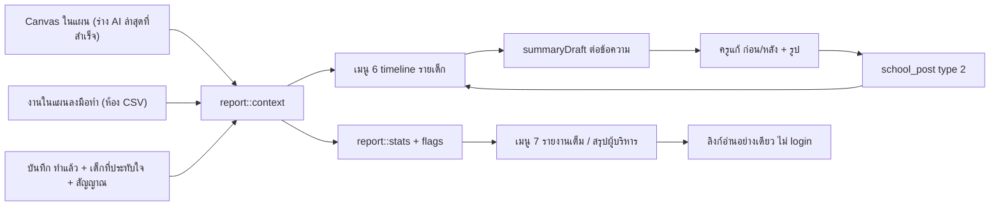
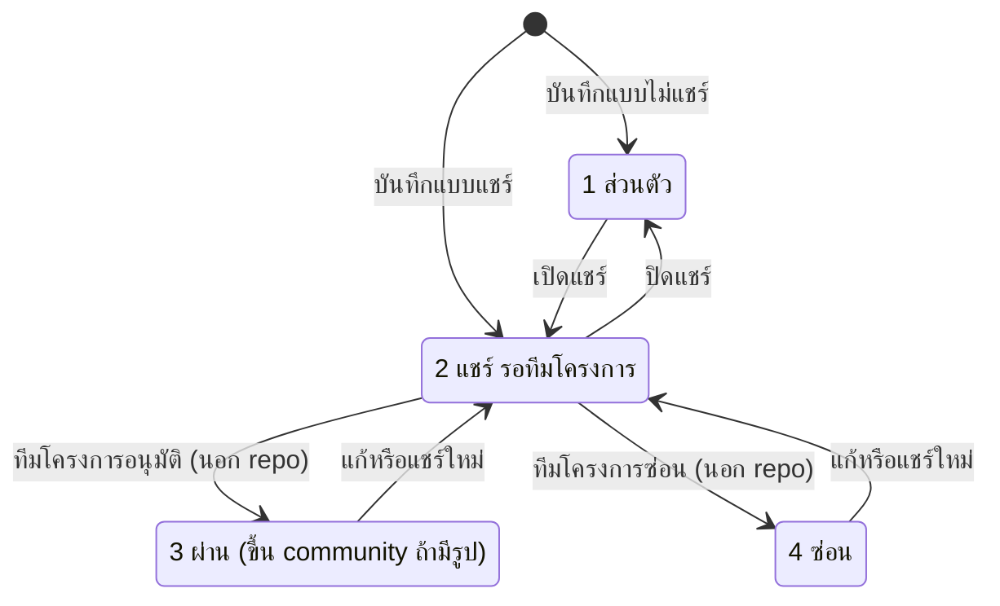

# ผลลัพธ์รายนักเรียน รายงานภาพรวม และ Dashboard

- **ระดับใน MVP:** Timeline รายเด็ก + สรุปก่อน/หลัง = **Should** (#14) · Dashboard = **Must** สำหรับครูและโค้ช / **Should** สำหรับองค์กร (#15) · ลิงก์แชร์รายงาน = **Later** (#19) — อ้างหัวข้อ 8 ของ `docs/sila5school-study.md`
- **โค้ดอ้างอิง:** (path ตาม repo เดิม · สำเนาในเครื่องอยู่ที่ `reference/sila5school/` path เดียวกัน)
  - `module/console/controller/outcomeController.php` — เมนู 6 รายงานผลลัพธ์ระดับบุคคล
  - `module/console/controller/conclusionController.php` + `module/console/views/conclusion/share.php` — เมนู 7 และลิงก์อ่านอย่างเดียว
  - `module/console/controller/dashboardController.php` — Dashboard ของ console
  - `library/module/report.php` — ข้อมูลกลางของเมนู 6/7 (timeline, สถิติ, ธงเหลือง)
  - `library/module/console.php` — สถานะ, guard สิทธิ์, ลิงก์แชร์, ตารางรายสัปดาห์
  - `public_html/console/js/console-outcome.js`, `public_html/console/js/console-conclusion.js` — UI ล้วน (กรอง เรียง แท็บ พิมพ์ คัดลอก)
  - ประกอบ: `module/console/controller/postController.php` (ฟอร์มสรุปพัฒนาการ), `library/module/community.php` (เงื่อนไขขึ้นสาธารณะ), `docs/schema/sila5school.sql`
- **อ่านประกอบ:** study หัวข้อ 3.5–3.7, 6.1, 6.3, 7, 7.1 · Context ข้อ 12, 26, 30, 31, 43, 53, 54, 60.2, 60.3, 60.7, 60.10.4, 60.10.5

## 1. ฟีเจอร์นี้ทำอะไร

- **เมนู 6 (ผลลัพธ์รายบุคคล):** รายชื่อนักเรียนทั้งโรงเรียน + timeline ต่อคน รวม (ก) Canvas เฉพาะตัวของเด็ก (ข) บันทึก "ทำแล้ว" ที่ครูเลือกเด็กเป็น "นักเรียนที่ประทับใจ" (ค) สรุปพัฒนาการก่อน/หลัง และแสดงว่าสัญญาณจาก Canvas ช่อง 7 "เห็นแล้ว" หรือยัง (`outcomeController.php:101-275`, `report.php:153-186`)
- **สรุปพัฒนาการ** (`school_post` type 2): ครูเขียน "ก่อน / หลัง" + รูป ระบบเติมร่างให้ด้วยการต่อข้อความจากบันทึก **ไม่ใช้ AI** (`report.php:188-213`, `postController.php:477-486`)
- **เมนู 7 (รายงานสรุปผลภาพรวม):** 3 แท็บ = รายงานเต็ม / สรุปสำหรับผู้บริหาร / ฟอร์มส่งรายงานรุ่นเก่า (`conclusionController.php:79-82, 357-371`) ทุกตัวเลขคำนวณสดจากบันทึกทุกครั้งที่เปิด (`report.php:276-447`) ประกอบด้วยเกณฑ์ M1, การร้อยเรียงแผน → ลงมือทำ → เรียนรู้, "สิ่งที่ยังขาด", ธงเหลือง 4 ข้อ, ตารางความสม่ำเสมอรายสัปดาห์, ตารางครูรายคน และร่างข้อความทางการ — ทั้งหมดเป็น logic ไม่ใช้ AI
- **ลิงก์อ่านอย่างเดียว** ของเมนู 7 เปิดได้โดยไม่ต้อง login จนถึงวันจบโครงการ (`conclusionController.php:90-119`)
- **Dashboard ของ console:** โปรไฟล์โรงเรียน, ข้อมูล ผอ., ระดับ M และดาว, จำนวนครู/นักเรียน, % สมุดและสอบ, ตารางภารกิจ 5 ดาว, เกียรติบัตร (`dashboardController.php:59-390`)
- เมนู 7 ถูกปิดใน sidebar (ป้าย "กำลังพัฒนา") แต่ route ยังเปิด (`console.php:449`)
- Context 60.10.4 บรรยายว่า "AI เติมสรุปก่อน/หลังให้" แต่โค้ดที่อ่านใช้การต่อข้อความ ไม่มีการเรียก AI

## 2. ผู้ใช้และสิทธิ์ในระบบเดิม

สิทธิ์มาจากประเภทครูในโครงการ (`stk_type_id` 1 ผู้ประสานงานหลัก / 2 ครูผู้ช่วย / 3 ครูร่วมกิจกรรม = อ่านอย่างเดียว) ทุกหน้าต้อง login ยกเว้นลิงก์แชร์

| การกระทำ | type 1 | type 2 | type 3 | ที่มา |
|---|---|---|---|---|
| เปิดเมนู 6 และ timeline ของนักเรียน**ทุกห้อง** | ✓ | ✓ | ✓ | `console.php:116`, `report.php:55-62` |
| เขียน/แก้สรุปพัฒนาการ | ✓ | ✓ | – | `outcomeController.php:91-94`, `postController.php:563-571` |
| เปิดเมนู 7 (รายงานเต็ม + สรุปผู้บริหาร) | ✓ | ✓ | ✓ | `console.php:111` |
| สร้าง / ยกเลิกลิงก์แชร์ | ✓ | – | – | `conclusionController.php:94-98` |
| ส่ง / ยกเลิกฟอร์มรายงานรุ่นเก่า | ✓ | ✓ | – | ไม่มีเช็ก type นอกจาก guard อ่านอย่างเดียว (`console.php:131-141`) |
| เปิด Dashboard | ✓ | ✓ | ✓ (ซ่อนปุ่มแก้) | `dashboardController.php:200-206` · แก้ห้องได้เฉพาะ type 1 (`:184-187`) |
| เปิดลิงก์แชร์ | ใครก็ได้ที่มี token | | | `conclusionController.php:46-49` |

- ผ่าน/ไม่ผ่าน (สถานะ 3/4) ของโพสต์และรายงาน ตัดสินโดยทีมโครงการใน `sila5-admin` (นอก repo) · ระบบในแอปไม่เขียนทับ 3/4 (`console.php:1515-1518`)
- ต่างจากหน้ารายชื่อนักเรียนที่กรองตามห้องที่ครูดูแล (`console.php:527-543`) เมนู 6/7 ดึงนักเรียนทั้งโรงเรียน และไม่มี audit log การเปิดดู

## 3. ข้อมูลในระบบเดิม (ตาราง / คอลัมน์สำคัญ / ค่าสถานะ)

| ตาราง | คอลัมน์สำคัญ / ค่าสถานะ |
|---|---|
| `school_post` type 2 (`sila5school.sql:2118-2153`) | `spo_member_id` นักเรียน 1 คน · `spo_before` = ก่อน · `spo_caption` = หลัง · `spo_outstanding` 1 เด่นชัด / 0 สม่ำเสมอ · `spo_is_public` · `spo_status` 1 ส่วนตัว / 2 แชร์-รอตรวจ / 3 ผ่าน / 4 ซ่อน + `spo_reject_reason` · `spo_deleted` (soft delete) |
| `school_post_picture` (`:2188-2199`) | รูปของโพสต์ เรียงด้วย `spp_sort` |
| `school_action_log` (`:1648-1676`) | `sal_member_id` นักเรียนที่ประทับใจได้**คนเดียว**ต่อบันทึก (`:1660`) · `sal_member_reason` · `sal_signal` ข้อความสัญญาณคั่นด้วย `|` (`:1656`) · `sal_datetime` (ครูระบุ) กับ `sal_create_datetime` (ระบบ) |
| `school_canvas` | `sc_kpi` ช่อง 7 เป็นข้อความยาว (`:1811`) · `sc_target` (`:1803`) · `sc_scope_id` 1 รายบุคคล |
| `school_member` | `sm_diary_score` คะแนนสมุดเต็ม 600 (`:1933`) · `sm_lastmodified` · คะแนน Academy ล่าสุดจาก `academy_kahoot_member_score` |
| `school_training` | flag ระดับโรงเรียน `st_story` / `st_personal_outcome` / `st_conclusion` (`:2245-2247`) ค่า 0 – / 1 ยังไม่ส่ง / 2 รอตรวจ / 3 ผ่าน / 4 ไม่ผ่าน (`console.php:43-65`) |
| `school_report_share` (`:2203-2215`) | `srs_token` 43 ตัว เก็บแบบ plaintext + UNIQUE · ผู้สร้าง/เวลา · ผู้ยกเลิก/เวลา · `srs_revoke_datetime` NULL = ใช้งานอยู่ |
| `school_conclusion` + `_picture` + `_picture_type` (`:1833-1875`) | ฟอร์มรุ่นเก่า: URL วิดีโอสรุป, ข้อความแนะนำโรงเรียน, URL วิดีโอแนะนำ, รูปตามประเภท |
| `report_archive*` (`docs/schema/migrations/2026-05-05-report-archive.sql:11-53`) | รายงานปีก่อนเก็บเป็น HTML + รูป · ไม่มีโค้ดอ่านในชุดไฟล์นี้ |

## 4. Flow และลำดับสถานะ

- **ลิงก์แชร์:** ไม่มี → ใช้งาน (สร้าง) → ยกเลิก (ผู้ประสานงาน) หรือ หมดอายุเมื่อเลย `project_end_date` · สร้างใหม่ = ยกเลิกของเดิมทันที
- **ฟอร์มรุ่นเก่า (`st_conclusion`):** 0 → 2 ส่ง → 3/4 โดยแอดมิน · ยกเลิก → 0

## 5. Business rule

**Timeline และสรุปพัฒนาการ**
1. ผูกเด็กกับ Canvas "เฉพาะตัว" เมื่อ Canvas ขอบเขตรายบุคคล และชื่อต้น (`sm_name` ≥ 2 ตัวอักษร) อยู่ในข้อความ `sc_title + sc_target` — `report.php:137-151`
2. Canvas "ของห้อง" = Canvas ที่มีงานในแผนลงมือทำผูกกับห้องของเด็ก — `report.php:100-109, 146-147`
3. Canvas ที่นับเป็น "ในแผน" อ่านจาก canvas ids ของร่าง AI ล่าสุดที่สำเร็จ — `console.php:2476-2486`
4. Timeline = Canvas เฉพาะตัว + บันทึกที่ `sal_member_id` = เด็ก + สรุปพัฒนาการ เรียงด้วยการเทียบวันที่แบบสตริง — `report.php:157-186`
5. วันที่ของบันทึกใช้ `sal_datetime` (วันที่ครูระบุ) ไม่ใช่เวลาระบบ — `report.php:174`
6. สัญญาณช่อง 7 = แยกบรรทัดหรือ " · ", ตัด bullet, เก็บบรรทัดยาว > 3 ตัว, ตัดที่ 80 ตัว, ไม่ซ้ำ, สูงสุด 6 บรรทัด — `console.php:1667-1677`
7. "เห็นแล้ว" = ข้อความใน `sal_signal` ตรงกับบรรทัดของ Canvas ทุกตัวอักษร และไม่นับ "ยังไม่เห็นชัด" — `report.php:113-119, 127-131`
8. สถานะสัญญาณรายเด็ก: "เห็นครั้งแรก" จากบันทึกของเด็กเอง ถ้าไม่มีใช้ "เห็นในห้อง" จากบันทึกของห้อง · แสดง Canvas ไม่เกิน 2 ใบ — `outcomeController.php:209-231`
9. ร่าง "ก่อน" = ชื่อ + ศักยภาพของ Canvas เฉพาะตัว (ไม่ใช้ Canvas ห้องเพราะอาจเขียนถึงเด็กคนอื่น) ถ้าไม่มีใช้เหตุผลของบันทึกแรก — `report.php:188-202`
10. ร่าง "หลัง" = เหตุผล/บันทึกทุกรายการเรียงวัน · เสนอ "เด่นชัด" ถ้ามีสัญญาณอย่างน้อย 1 ครั้ง — `report.php:203-212`
11. ร่างเติมเฉพาะตอนสร้างใหม่จาก timeline ครูแก้ได้ทุกช่อง — `postController.php:477-486`
12. แชร์ = สถานะ 2 รออนุมัติ · ไม่แชร์ = 1 — `postController.php:69-74`
13. type 2 ขึ้น community เมื่อสถานะ 3 และมีรูป (type 1 ขึ้นทันที) โดยไม่ดึงชื่อเด็กไปแสดง — `community.php:28-46`, `postController.php:344`
14. flag `st_personal_outcome`: ไม่มีโพสต์ 0 · มีโพสต์ 1 · มีโพสต์สถานะ ≥ 2 อย่างน้อย 1 เรื่อง → 2 · ไม่ทับ 3/4 — `console.php:1509-1536`

**เมนู 7**
15. สถิติทั้งหมดคำนวณครั้งเดียวต่อการเปิดหน้า ไม่มี snapshot — `report.php:276-447`
16. "ครูในแผน" = ครูที่มีชื่อในงานของแผน ถ้ายังไม่มีชื่อใช้ type 1 + 2 ทั้งหมด — `report.php:306-315`
17. ความสม่ำเสมอ: 1 ช่อง = 1 สัปดาห์ จันทร์–อาทิตย์ · ทำแล้วนับตามวันที่ทำจริง เลื่อนนับตามเวลากด · % = ทำแล้ว ÷ (ทำแล้ว + เลื่อน + ไม่มีบันทึก) · งานที่เพิ่มกลางแผนไม่นับย้อน — `console.php:2383-2473`
18. เกณฑ์ M1 ส่วนที่ 1 (4 ประตู): สมุด, สอบนักเรียน, ครูผ่าน FA ≥ 1 คน, ครูในแผนสอบผ่านทุกคน · จำนวนที่ต้องผ่านตามขนาด 60 / 50 / 40% + 1 คน — `report.php:268-274`, `conclusionController.php:238-261`
19. เกณฑ์ M1 ส่วนที่ 2: สุขจริงหนอ ≥ 6 สัปดาห์, ตรวจสมุด ≥ 8 สัปดาห์, สรุปพัฒนาการที่มีก่อน + หลัง + รูป ≥ 3 คน · "เขียว/เหลือง ไม่มีตก" — `conclusionController.php:262-275, 402`, `report.php:407-416`
20. "สิ่งที่ยังขาด", ร่างข้อความทางการ และสรุปสามบรรทัด ต่อข้อความจากตัวเลข ไม่ใช้ AI — `conclusionController.php:296-355, 559-563`
21. ธงเหลือง = ชวนโค้ชเข้าไปคุย ไม่ใช่ตัดสิทธิ์ · logic ล้วน — `report.php:449-455`, `conclusionController.php:426-431`
    - ธง 1: ห้องที่สมุดผ่าน ≥ 70% แต่ไม่มีบันทึกตรวจสมุดของห้องนั้น — `report.php:492-495`
    - ธง 2: ห้องที่มี ≥ 5 คน คะแนนสมุดเท่ากันทุกคนและไม่ใช่ 0 — `report.php:496-498`
    - ธง 3 (ระดับโรงเรียน): เด็กที่มีคะแนน ≥ 10 คน และ ≥ 80% ถูกแก้วันเดียวกัน (`sm_lastmodified`) ในวันที่ ≥ วันจบแผน − 14 วัน — `report.php:503-509`
    - ธง 4: ห้องที่สมุดผ่าน ≥ 70% และสอบ Academy ≥ 5 คน แต่ไม่ผ่านเลย — `report.php:499-501`
22. ภาคผนวกมาตรฐานเลือกตามสังกัดของโรงเรียน — `conclusionController.php:185-198, 552`

**ลิงก์แชร์**
23. โรงเรียนละ 1 ลิงก์ที่ใช้งานอยู่ · สร้างใหม่ = ยกเลิกอันเดิมก่อน — `console.php:2115-2127`
24. token = random 32 bytes แบบ base64url (43 ตัว) · ตรวจรูปแบบก่อน query — `console.php:2119`, `conclusionController.php:104`
25. ใช้ได้เมื่อยังไม่ยกเลิกและ `project_end_date` ≥ วันนี้ · ใช้ไม่ได้ตอบ 404 — `console.php:2094-2113`, `conclusionController.php:110-113`
26. หน้าแชร์ใส่ noindex ไม่มีแท็บฟอร์ม เปิดที่ "สรุปผู้บริหาร" แต่ยังมี "รายงานเต็ม" ครบ — `conclusionController.php:109, 360-370`
27. หน้าจัดการลิงก์เตือนว่ารายงานมีชื่อครูและชื่อนักเรียน — `conclusionController.php:167`

**Dashboard และฟอร์มรุ่นเก่า**
28. % สมุด/สอบใช้ตัวหาร max(จำนวนในเมนู 3, ยอดที่แจ้งต่อห้อง) เกณฑ์ 60% (ป้ายเขียน "> 60%" แต่โค้ดใช้ ≥) — `dashboardController.php:157-166` · เด็กสอบผ่าน = ครั้งล่าสุด ≥ 50% — `console.php:496-525`
29. ตารางดาว 5 ภารกิจผูกกับ flag แผน / เรื่องราว / ผลลัพธ์ / รายงาน · เกียรติบัตรแสดงเมื่อดาว ≥ 5 — `dashboardController.php:168-176, 208-220, 371-382`
30. ส่งฟอร์มรุ่นเก่าต้องมี URL วิดีโอสรุป, ข้อความแนะนำ, URL วิดีโอแนะนำ · เงื่อนไขรูปครบถูก comment ไว้ — `conclusionController.php:1128-1176`

## 6. การตรวจข้อมูลขาเข้า (validation)

- เปิด timeline รายเด็ก: id ถอดจาก token ที่เซ็น HMAC และต้องอยู่ในรายชื่อเด็กของโรงเรียนปัจจุบัน — `outcomeController.php:77-85`
- บันทึกสรุปพัฒนาการ: type ต้องเป็น 1/2 · "หลัง" ห้ามว่าง · เด็กต้องอยู่ในโครงการและโรงเรียนเดียวกัน · "ก่อน" ว่างได้ · `outstanding` ค่าอื่นนอกจาก 0 = 1 · ไม่จำกัดความยาว — `postController.php:578-611`
- แก้โพสต์: ต้องเป็นโพสต์ของโรงเรียนนี้และ type เดิม แต่**ไม่ตรวจว่าเป็นผู้เขียน** — `postController.php:61-67, 613-617`
- token ลิงก์แชร์: regex 43 ตัว `[A-Za-z0-9_-]` — `conclusionController.php:104`
- รูปฟอร์มรุ่นเก่า: เช็ก MIME ที่ browser ส่ง (jpeg/png) แล้วย่อ ≤ 1600px — `conclusionController.php:1031-1038`
- ข้อความฟอร์มรุ่นเก่าบันทึกตรงโดยไม่ตรวจรูปแบบ URL หรือความยาว — `conclusionController.php:935-1008`

## 7. Edge case และพฤติกรรมที่ควรรู้

- ชื่อซ้ำ/ชื่อสั้น: เด็กชื่อต้นเหมือนกันถูกผูกกับ Canvas เดียวกัน · ชื่อสั้นไป match คำอื่นได้ · ไม่ใช้นามสกุลหรือชื่อเล่น — `report.php:141-145`
- บันทึกหนึ่งเลือกเด็กได้คนเดียว เด็กอื่นในเหตุการณ์เดียวกันจึงไม่ขึ้น timeline
- แก้ข้อความช่อง 7 หลังมีบันทึกแล้ว สัญญาณเดิมจะไม่ match เพราะเทียบสตริงตรง · บรรทัดที่ยาวกว่า 80 ตัวต้องตรงกับฉบับที่ถูกตัด
- บันทึกย้อนหลังแทรกอยู่กลาง timeline โดยไม่มีป้าย เพราะเรียงตามวันที่ครูระบุ
- ธง 1 ขึ้นทุกห้องที่สมุดสูงถ้ายังไม่มีบันทึกตรวจสมุดเลย (เช่นยังไม่เปิดแผน) · ธง 3 ใช้ `sm_lastmodified` ซึ่งเปลี่ยนเมื่อแก้ข้อมูลอื่นของเด็กด้วย (import, แก้ชื่อ) จึงอาจ false positive
- เปิดแชร์สรุป 1 เรื่อง ทำให้ `st_personal_outcome` เป็น "รอตรวจ" ทันที — การแชร์สาธารณะผูกกับการส่งงานระดับโรงเรียน
- ลิงก์แชร์แสดงข้อมูลสดเสมอ: สิ่งที่ครูแก้หรือเพิ่มหลังส่งลิงก์จะโผล่ให้ผู้ถือลิงก์ทันที · ไม่มี log ว่าใครเปิด · อายุผูกกับโครงการ ผู้สร้างเลือกเองไม่ได้
- คำนวณ timeline ของเด็กทุกคนทุกครั้งที่เปิดเมนู 6 (`outcomeController.php:118-126`) และ stats ทั้งชุดทุกครั้งที่เปิดเมนู 7 หรือลิงก์แชร์
- cookie `oc_sel` (เซ็นไว้) และ `rp_tab` จำเด็ก/แท็บที่เปิดค้าง — `outcomeController.php:132-141`, `console-conclusion.js:7-14`
- Dashboard ใช้ map `storyStatus` แสดงสถานะผลลัพธ์และรายงาน ขณะที่ `conclusionStatus` ให้ความหมายค่า 1 ต่างกัน — `dashboardController.php:173-176`, `console.php:43-65`
- ปุ่ม "ยกเลิก" ของฟอร์มรุ่นเก่าชี้ไป action `cancelEdit` ที่ไม่มีอยู่ — `conclusionController.php:814`

## 8. สิ่งที่ห้ามทำตาม

**ข้อมูลส่วนบุคคล (ขัด Context 31, 60.2, 60.3)**
- ลิงก์สาธารณะไม่ต้อง login ที่มีชื่อ-นามสกุลเด็ก ข้อความก่อน/หลัง และสถิติรายครู — `conclusionController.php:474-536, 580-598`
- "สรุปสำหรับผู้บริหาร" มีเรื่องของเด็กพร้อมชื่อจริง ทั้งที่ผู้บริหารควรเห็นแค่ข้อมูลรวม — `conclusionController.php:580-598`
- ตารางครูรายคน (บันทึก/ร่วมทำ/เรื่องเล่า/ผลสอบ/อบรม) และรายชื่อ "ครูที่ยังไม่มีบันทึก" ในรายงานที่ผู้บริหารเห็น = ประเมินผลงาน/จัดอันดับครู (ข้อ 53, 54) — `conclusionController.php:345-353, 517-536`
- ครูทุก type เห็น timeline ของเด็กทุกห้อง โดยไม่มี audit log — `report.php:55-62`
- Dashboard แสดงชื่อและเบอร์ ผอ. ให้ครูทุก type รวม type 3 — `dashboardController.php:105-110`
- สรุป type 2 ที่ขึ้นสาธารณะไม่แสดงชื่อเด็กจากคอลัมน์ แต่ข้อความที่ระบบร่างจากบันทึกครู และ "รูปหน้าสมุดของเด็ก" ที่ฟอร์มแนะนำ อาจมีชื่อเด็ก — `postController.php:530`, `community.php:31-44`

**ความปลอดภัยและ tech debt**
- token ลิงก์แชร์เก็บ plaintext · ยกเลิกแล้วสร้างใหม่ไม่อยู่ใน transaction — `sila5school.sql:2207`, `console.php:2116-2127`
- ฟอร์มรุ่นเก่าล็อกสถานะแค่ฝั่ง UI: action บันทึก/อัปโหลด/ลบรูปไม่ตรวจสถานะ · ลบรูปไม่ตรวจว่าเป็นของโรงเรียนนี้ · "ยกเลิก" ตั้งเป็น 0 จากทุกสถานะรวม "ผ่าน" — `conclusionController.php:935-1008, 1092-1106, 1191-1201`
- ครู type 1/2 แก้สรุปพัฒนาการของครูคนอื่นได้ — `postController.php:61-67`
- ผูกเด็กด้วยการค้นข้อความ, ผูกสัญญาณด้วยการเทียบสตริง, เก็บ id หลายค่าเป็น CSV (`sat_stc_ids`, `sat_teacher_ids`, `sal_with_person_ids`) — `report.php:105, 309, 346`
- flag สถานะเมนูกองบนแถว `school_training` แทนสถานะที่คำนวณจากข้อมูลจริง

**Hard-code เฉพาะ Sila5School (ห้ามเป็นแกนของ SkillWise · Context 9, 47, 53)**
- เกณฑ์สมุด 360/600, Academy 50%, เกณฑ์ 60% บน dashboard, tier 60/50/40% ตามขนาด, เกณฑ์ M1 (6 / 8 สัปดาห์ / 3 เรื่อง), ระดับ M1–M3, ดาว, เกียรติบัตรตามดาว — `report.php:16-18, 268-274`, `dashboardController.php:85-96`
- `sat_core_key` = ตรวจสมุด / สุขจริงหนอ และ 7 กิจวัตร — `console.php:96, 104, 1585-1594`, `report.php:369`
- `activity_type_id IN (7, 17)` ของคอร์ส FA — `report.php:254`
- มาตรฐาน สพฐ./สกร. และ id สังกัด 4 · ข้อความทางการที่มีชื่อโครงการ — `conclusionController.php:185-198, 300, 552`
- ธงเหลืองทั้ง 4 ข้อผูกกับคะแนนสมุดและ Academy ซึ่ง SkillWise Phase 1 ไม่มี

## 9. แนวทางใน SkillWise

**ตารางใหม่และ mapping**

| ระบบเดิม | SkillWise |
|---|---|
| `school_post` type 2 + รูป | `student_progress_summaries` (ก่อน/หลัง, ผู้เขียน, ส่วนตัวเป็นค่าเริ่มต้น, อ้าง `ai_jobs` ถ้า AI ร่าง) + `files` (`contains_student_data` = true, private) |
| `sal_member_id` (1 คน) | `practice_log_students` (หลายคน) |
| `sal_signal` (ข้อความคั่น `|`) | `practice_log_signals` → `success_signals` (FK) |
| ค้นชื่อใน `sc_title` / ห้องใน CSV | `case_targets` (student หรือ org_unit) + `student_enrollments` |
| timeline | query/view จาก `case_targets`, `practice_logs`, `practice_log_students`, `practice_log_signals`, `student_progress_summaries` (ไม่ต้องมีตารางเอง) |
| ตารางรายสัปดาห์ | `practice_sessions` (สถานะต่อ occurrence) |
| flag `st_*` | คำนวณจาก `action_plans` / `practice_sessions` / `practice_logs` |
| การแชร์รายชิ้นของครู | `share_grants` |
| พิมพ์ / PDF | `generated_documents` |
| การเปิดดูข้อมูลเด็ก / ลิงก์แชร์ | `audit_logs` |
| `school_report_share` | ยังไม่มีตาราง (Later #19) |

**Permission ที่ endpoint น่าจะต้องประกาศ**
- ดู timeline / รายชื่อเด็ก: `org.students.view` (scope องค์กร) · โค้ช `coach.cases.view_assigned` เฉพาะเด็กใน `case_targets` ของ case ที่ดูแล · แอดมิน `admin.sensitive.student.view` · บันทึก `audit_logs` ทุกครั้ง
- เขียน/แก้สรุปพัฒนาการ: `self.tools.use` + `org.students.view` + ตรวจว่าเป็นผู้เขียน
- ขอ AI ร่างสรุป: `self.ai.request`
- Dashboard ครู: `self.*` (ข้อมูลตัวเอง) · Dashboard โค้ช: `coach.cases.view_assigned` · Dashboard องค์กร: `org.dashboard.view_aggregate` · แอดมิน: `admin.*.view` ตาม 60.7

**สิ่งที่ต้องเปลี่ยนจากระบบเดิมตาม Context**
1. ผูกเด็กด้วย relation เสมอ ไม่ค้นชื่อในข้อความ (study 6.3) และใช้งานได้แม้ยังไม่ได้ import เด็กครบ (study 7.1 #6)
2. Timeline แสดงตาม `happened_on` แต่ติดป้ายบันทึกย้อนหลัง · การตรวจความสอดคล้องใช้ `recorded_at` ของระบบ (60.10.5)
3. สรุปพัฒนาการเป็นของครูและเป็นส่วนตัวโดยค่าเริ่มต้น · แชร์ให้ผู้บริหารผ่าน `share_grants` รายชิ้น (60.3) · ขึ้นสาธารณะต้องอนุมัติและตัดชื่อเด็กทั้งในข้อความและรูป · ไม่ผูกการแชร์กับสถานะส่งงาน
4. AI ช่วยร่าง (#14): ตัดชื่อเด็กทุกคนที่ปรากฏในข้อความ (ไม่ใช่แค่เด็กเป้าหมาย) ด้วย `pseudonym_key` ก่อนส่ง แล้วแปลงกลับตอนแสดง · ครูต้องยืนยันก่อนบันทึก · การจัดว่า "เด่นชัด/สม่ำเสมอ" เป็นของครู AI แค่เสนอ (ข้อ 12, 53) · งานล้มเหลวไม่ตัดเครดิต · ใช้ร่างแบบ logic เดิมเป็น fallback ได้
5. Dashboard ตามข้อ 43: ครู (Must) งานและหลักฐานของตัวเอง · โค้ช (Must) ครูที่ดูแล, case, feedback ที่ค้าง · องค์กร (Should) ข้อมูลรวมเท่านั้น ไม่มีตารางรายครู ไม่มีชื่อเด็ก ไม่มี reflection หรือ coach feedback · ไม่นำดาว ระดับ M สมุด และผลสอบมา
6. แนวคิดจากเมนู 7 ที่นำมาได้: ตัวเลขนับจากบันทึกจริง ไม่ใช่ประเมินตนเอง · "สิ่งที่ยังขาด" แบบ logic · ตารางความสม่ำเสมอรายสัปดาห์ให้ครูและโค้ชเห็น
7. ธงเหลือง: เก็บเฉพาะแนวคิด "กฎตรวจความสอดคล้องแบบตั้งค่าได้ ไม่ใช้ AI ให้โค้ชเห็น ไม่ใช่บทลงโทษ" กฎเดิมใช้ไม่ได้ · ตัวอย่างที่ไม่ผูก Sila5School เช่น บันทึกกระจุกช่วงท้ายรอบตาม `recorded_at` · จะมีหรือไม่ยัง OPEN
8. ลิงก์แชร์ (Later #19): ขอบเขตชัด, วันหมดอายุตั้งได้, เก็บ token แบบ hash, ยกเลิกได้, audit ทุกการเปิด, ไม่มีชื่อเด็ก, ไม่มีข้อมูลรายครูที่ครูไม่ได้แชร์, ผ่านการอนุมัติ
9. ออกแบบ aggregate ให้ต่อยอดเป็น Impact Report ได้ (ข้อ 26)

## 10. คำถามที่ยัง OPEN

1. บุคลากรคนไหนในองค์กรเห็น timeline รายเด็ก: ทุกคน (60.2) หรือเฉพาะครูที่ดูแลห้อง/อยู่ใน case
2. สรุปก่อน/หลังต้องผ่านการตรวจหรืออนุมัติหรือไม่ หรือเป็นของครูล้วน (study หัวข้อ 9 ข้อ 2)
3. AI ร่างสรุปใช้เครดิตหรือไม่ และเท่าไร (60.10.4 ตัวเลข OPEN)
4. Dashboard องค์กรต้องมีครูขั้นต่ำกี่คนก่อนแสดงข้อมูลรวม เพราะ 79% ของโรงเรียนมีครูคนเดียว ข้อมูลรวมจึงเท่ากับข้อมูลรายคน (study 7.1 #1)
5. ขอบเขตการแชร์ให้ผู้บริหาร และยกเลิกการแชร์ได้หรือไม่ (60.3)
6. ลิงก์ให้หน่วยงานภายนอก (ศน.) ดูหลักฐาน — 60.10.5 ระบุว่าทำทีหลัง · ถ้าทำ ลิงก์แสดงข้อมูลสดหรือ snapshot
7. กฎตรวจความสอดคล้อง (ธงเหลือง) จะมีใน Phase 1 หรือไม่ และใครเห็น
8. รายงานแบบเมนู 7 (ผูกมาตรฐาน, SAR, วPA) อยู่ใน #17 เอกสาร หรือเป็นฟีเจอร์แยก
9. "เด่นชัด / สม่ำเสมอ" ยังใช้หรือไม่ หรือเป็น taxonomy ที่องค์กรตั้งค่าได้
10. ครูอิสระที่ไม่มีองค์กรจะมีนักเรียนและ timeline ได้หรือไม่ (ร่าง schema ให้ `students` เป็นขององค์กร)
