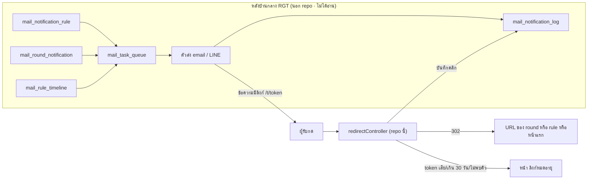
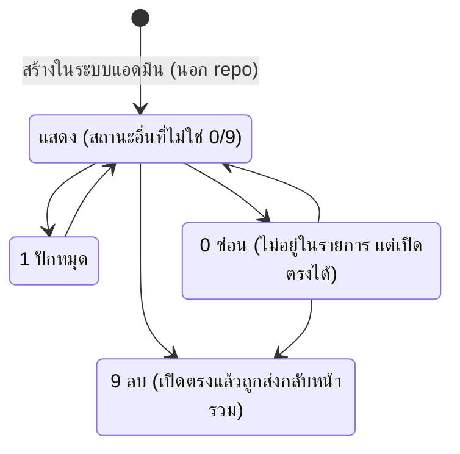

# การแจ้งเตือน และเนื้อหาสาธารณะ

- **ระดับใน MVP:** Notification ในระบบ (email + LINE push) เตือนตามแผนลงมือทำ = **Should** (#18) · รับข้อความ LINE ผ่าน webhook = **Later** (#18b) · หน้าเว็บสาธารณะ + Content ที่แอดมินจัดการเอง = **Should** (#18c) — อ้างหัวข้อ 8 ของ `docs/sila5school-study.md`
- **โค้ดอ้างอิง:** (path ตาม repo เดิม · สำเนาในเครื่องอยู่ที่ `reference/sila5school/` path เดียวกัน)
  - `library/rgt/providers/MailServiceProvider.php` — ตั้ง SMTP mailer
  - `library/module/global-master.php` — `sendEmail`, `sendTelegramMessage`, `sendLineMessage`, `encode` / `decode` (token ที่เซ็นใส่ URL)
  - `library/module/global.php` — `sendTelegramTo`, `sendErrorTelegram`, helper ข่าว, ปุ่มเชื่อม LINE
  - `module/home/controller/redirectController.php` + `library/rgt/routes.php:6` — ลิงก์นับคลิก `/t/{token}`
  - `module/news/controller/indexController.php`, `module/news/controller/detailsController.php`, `library/module/news.php` — หน้าข่าวสาธารณะ
  - `docs/schema/sila5school.sql` — ตาราง `mail_*`, `news*`, `stat`, คอลัมน์ LINE ของ `user`
  - ผู้เรียกที่อ่านประกอบ: `module/console/controller/teamController.php`, `module/line/controller/liffController.php`, `module/project/controller/registerController.php`
- **อ่านประกอบ:** study หัวข้อ 5.1–5.3, 6.1, 7, 7.1 #7, 8 · Context ข้อ 26, 27, 60.7, 60.10.4–60.10.7 · CLAUDE.md (ไม่มีอะไรขึ้นสาธารณะโดยไม่ผ่านการอนุมัติ)

## 1. ฟีเจอร์นี้ทำอะไร

repo นี้มีงานแจ้งเตือนและเนื้อหา 5 ส่วน:
1. **ส่งอีเมลทันทีใน request** ผ่าน SMTP · จุดที่ใช้ในชุดไฟล์นี้คืออีเมลเชิญครูเข้าทีม (`teamController.php:295-319`)
2. **ลิงก์นับคลิก `/t/{token}`** ของข้อความที่หลังบ้านกลางส่ง: ถอด token → บันทึกคลิก → redirect ไป URL ที่เก็บใน DB (`redirectController.php:36-87`)
3. **ฟังก์ชันส่ง LINE push** ข้อความล้วน ไม่มีผู้เรียกใน repo (`global-master.php:1907-1927`)
4. **แจ้งกลุ่ม Telegram ของทีมงาน** เมื่อโรงเรียนสมัคร, ครูผู้ช่วยสมัครเข้าโรงเรียน, ครูเชื่อม LINE, Zoom API error และ helper สำหรับช่อง error (`global.php:3920-3946`)
5. **หน้า "ข่าวสารและบทความ"** อ่านได้โดยไม่ต้อง login: หน้ารวม, รายการตามประเภท, รายละเอียด, ยอดนิยม (`module/news/controller/*.php`) · การสร้าง/แก้/ปักหมุด/ลบข่าวอยู่ในระบบแอดมิน

**สิ่งที่อยู่นอก repo (ไม่ได้อ่านโค้ด สรุปจาก study 5.2):** ระบบ "กฎ → คิว → ส่ง → log" ของ email และ LINE อยู่ที่หลังบ้านกลาง RGT ซึ่งใช้ฐานข้อมูลเดียวกัน
- กฎมี 3 แหล่ง: กฎทั่วไป (ความถี่, วันล่วงหน้า), กฎต่อรอบอบรม (เชิญสมัคร / เตือนโควตา / เตรียมตัว / เตือนก่อนวันงาน), วันส่งตายตัวต่อโครงการ
- คิวเดียวส่งได้ทั้ง email และ LINE กันส่งซ้ำด้วยคู่ (กฎ + ผู้รับ + รอบ) มีโหมด preview · log เก็บ ส่ง / เปิด / คลิก · template ใช้ร่วม email/LINE และมีประวัติเวอร์ชัน
- ข้อมูลจริง (มี.ค.–ก.ค. 2026): คิว 27,882 รายการ ส่งอัตโนมัติทั้งหมด · ส่วนใหญ่เป็นคำเชิญสมัครโครงการ · email คลิก 3% · LINE คลิก 17%
- repo นี้มีแค่ schema ของตาราง `mail_*` และ endpoint นับคลิก
- **การเตือนตามแผนลงมือทำไม่เคยส่งจริง:** `sat_remind_day` และ `sat_notify` แสดงบนหน้าเท่านั้น (`sila5school.sql:1733-1734`)

## 2. ผู้ใช้และสิทธิ์ในระบบเดิม

| ส่วน | ใครใช้ / สิทธิ์ |
|---|---|
| อีเมลเชิญ | ผู้ประสานงานหลักเพิ่มครูในหน้าบริหารทีม → ระบบส่งทันที |
| `/t/{token}` | สาธารณะ ไม่ต้อง login ไม่มี auth ใน constructor · ตรวจแค่ลายเซ็น token (`redirectController.php:25-47`) |
| LINE push | ไม่มีผู้เรียก · ส่งด้วย channel access token ของระบบ |
| Telegram | ผู้รับคือกลุ่มแชทของทีมงานตามชื่อช่องใน config · ผู้ใช้ทั่วไปไม่เห็น |
| ข่าว | ทุกคนอ่านได้ · CRUD และสถานะอยู่ใน `sila5-admin` (ไม่ได้อ่าน) |
| กฎ / template / คิว | ตั้งค่าที่หลังบ้านกลาง (มีคอลัมน์ผู้สร้างและผู้แก้ล่าสุด) · ไม่ได้อ่าน |

## 3. ข้อมูลในระบบเดิม (ตาราง / คอลัมน์สำคัญ / ค่าสถานะ)

| ตาราง (`docs/schema/sila5school.sql`) | คอลัมน์สำคัญ / ค่าสถานะ |
|---|---|
| `mail_notification_rule` (`:863-882`) | `mnr_rule_key`, `mnr_enabled`, `mnr_line_enabled`, `mnr_frequency_days` (ค่าเริ่ม 7), `mnr_days_before`, `mnr_priority`, `mnr_config` JSON, template หัวเรื่อง/เนื้อหา, `mnr_redirect_url` |
| `mail_round_notification` (`:895-921`) | ต่อรอบอบรม · `mrn_rule_type` 4 ค่า · `mrn_channel` 1 email / 2 LINE · `mrn_days_before` · `mrn_priority` 1 ด่วน–10 ต่ำ · template · `mrn_redirect_url` · กลุ่ม draft |
| `mail_rule_timeline` (`:925-948`) | วันส่งตายตัวต่อโครงการ · เปิด email/LINE แยกกัน · `mrt_queued` + จำนวน · `mrt_redirect_url` · UNIQUE (rule_key, project, send_date) |
| `mail_task_queue` (`:952-978`) | อ้าง rule / round / timeline · `mtq_recipient` · `mtq_template_data` JSON · `mtq_status` · `mtq_channel` 1/2 · `mtq_is_admin_summary` · `mtq_is_preview` · index กันซ้ำ (กฎหรือรอบ + ผู้รับ + รอบ + สถานะ) **ไม่ใช่ UNIQUE** (`:973-975`) |
| `mail_notification_log` (`:828-859`) | `mnl_queue_id`, `mnl_channel`, `mnl_status`, `mnl_error`, `mnl_opened` + เวลา, `mnl_clicked` + เวลา, `mnl_mth_id` (template version ที่ใช้), `mnl_sender_user_id` (0 = อัตโนมัติ), `mnl_is_preview` · คอลัมน์ผู้รับชื่อ `mnl_email` ใช้กับทุกช่องทาง (`:836`) |
| `mail_template_draft` (`:982-999`) / `mail_template_history` (`:1016-1028`) | draft ต่อ แหล่ง × ช่องทาง × slot 1–3 พร้อมข้อความปุ่ม LINE · history = snapshot ที่ใช้จริง |
| `mail_admin_recipient` (`:812-824`) | ผู้รับรายงานสรุปของแอดมินต่อ role และโครงการ |
| `user` (`:2557-2561`) | `user_line_uid`, ชื่อแสดง, รูป, เวลาเชื่อม, `user_line_status_id` 0 ไม่เคยเชื่อม / 1 เชื่อม / 2 ยกเลิก (ยังเก็บ UID) |
| `news` (`:1080-1101`) | `news_type_id` 1–4 ข่าว / 5 หน้ากิจกรรม · `news_name` (slug) · `news_filename` (ภาพปก) · `news_views` · `news_template_id` · `news_status_id` 0 ซ่อน / 1 ปักหมุด / 9 ลบ (ค่าอื่นแสดงตามปกติ) |
| `news_content` (`:1105-1122`) | ต่อ block · `nc_type_id` 0 = HTML ใน DB / 1 = ชื่อไฟล์ HTML บน storage · `nc_order` |
| `news_type` (`:1141-1146`) / `stat` (`:2414-2425`) | ชื่อประเภทข่าว / ตัวเลขหน้าแรกที่กรอกมือ |

## 4. Flow และลำดับสถานะ

## 5. Business rule

**อีเมล**
1. mailer เป็น singleton ของ PHPMailer ตั้ง SMTP จาก config (ค่าเริ่ม ssl, UTF-8) — `MailServiceProvider.php:6-20`
2. `sendEmail` เลือก mailer และชุด config ได้ (รองรับหลายผู้ส่ง) และล้างผู้รับ/ไฟล์แนบเดิมทุกครั้งเพราะเป็น singleton — `global-master.php:1736-1748`
3. ผู้ส่ง (from) มาจาก config เท่านั้น — `global-master.php:1760-1762`
4. ส่งเป็น HTML พร้อม AltBody = ตัด tag ออก — `global-master.php:1812-1815`
5. ไม่ throw ออกไป คืนผล success / message / error · เขียน error_log เฉพาะกรณีเกิด exception (ส่งไม่สำเร็จแบบปกติไม่ log) — `global-master.php:1817-1849`
6. อีเมลเชิญส่งใน request ไม่มีคิว ไม่มี log ไม่ดูผลลัพธ์ และแจ้งผู้ใช้ว่า "เพิ่มทีมงานและส่งคำเชิญด้วย Email เรียบร้อยแล้ว" เสมอ — `teamController.php:311-319`

**ลิงก์นับคลิกและ token ที่เซ็น**
7. route `/t/:var` → `home/redirect/index` — `routes.php:6`
8. token = `encode([queue id, timestamp])` ด้วย context ของระบบ (สร้างที่หลังบ้านกลาง) · ตอนถอดยอมรับคีย์รุ่นเก่าด้วย เพราะลิงก์ที่ส่งไปแล้วเรียกคืนไม่ได้ — `redirectController.php:38-47`
9. อายุลิงก์ 30 วัน นับจาก timestamp ใน token — `redirectController.php:52-57`
10. ต้องพบแถวในคิว แล้วจึงบันทึกคลิกลง log — `redirectController.php:59-67` (ฟังก์ชันบันทึกอยู่ใน `library/module/home.php` ซึ่งไม่อยู่ในชุดไฟล์ที่อ่าน)
11. ปลายทาง: คิวที่อ้าง round ใช้ URL ของ round · คิวที่ไม่อ้าง round แต่อ้าง rule ใช้ URL ของ rule · ค่าว่างหรือไม่อ้างอะไร = หน้าแรกของเว็บที่ hard-code ไว้ (คิวที่อ้าง round แต่ URL ว่าง ไม่ตกไปใช้ URL ของ rule) — `redirectController.php:69-86`
12. ไม่ผ่านเงื่อนไขใด → แสดงหน้า "หมดอายุ" — `redirectController.php:89-94`
13. `encode` = บีบอัด + HMAC-SHA1 + base64url (เซ็นแต่ไม่เข้ารหัส ไม่มีวันหมดอายุในตัว) · คีย์ต่อ context = HMAC(context, secret ฝั่ง server) — `global-master.php:2677-2719`
14. ถ้าไม่ได้ตั้ง secret ระบบ derive คีย์จากค่าเชื่อมต่อฐานข้อมูล — `global-master.php:2712-2715`
15. `decode`: ลายเซ็นไม่ผ่าน = null · โหมดคีย์เก่าใช้ชื่อ context เป็นคีย์ตรง ๆ ซึ่งปลอมได้ — `global-master.php:2732-2761`

**LINE**
16. push ข้อความล้วน 1 ข้อความไปที่ UID ด้วย channel access token จาก config timeout 5 วินาที คืน JSON ของ LINE — `global-master.php:1907-1927`
17. ไม่มีผู้เรียก · ไม่ตรวจสถานะการเชื่อม ไม่ retry ไม่ log
18. ปุ่ม/QR ชวนเชื่อม LINE สร้าง QR จาก LIFF URL ด้วยบริการภายนอก — `global.php:3608-3635`
19. การส่ง LINE จริงมาจากคิวเดียวกับ email (`mtq_channel` = 2) ที่หลังบ้านกลาง (study 5.1)

**Telegram**
20. ส่งแบบ HTML parse mode · connect timeout 3 วินาที รวม 6 วินาที · ล้มเหลว = error_log แล้วคืน false ไม่ทำให้ flow หลักล้ม — `global-master.php:1857-1906`
21. `sendTelegramTo(ชื่อช่อง)` อ่าน token และ chat id ตามชื่อช่องจาก config, escape ข้อความทั้งก้อน, ไม่ได้ตั้งค่า = log แล้วข้าม — `global.php:3930-3946`
22. `sendErrorTelegram` ส่งเข้าช่อง error **โดยไม่ escape** — `global.php:3920-3928` · ไม่พบผู้เรียกในชุดไฟล์ที่อ่าน
23. จุดที่เรียกในชุดไฟล์ที่อ่าน: Zoom API error (`global.php:655-658`) · ครูเชื่อม LINE พร้อมชื่อ-นามสกุล (`liffController.php:177-183`) · โรงเรียนสมัครพร้อมชื่อผู้ประสานงาน ห้อง และจำนวนนักเรียน ข้ามเมื่อรันในเครื่อง (`registerController.php:1145-1166`) · ครูผู้ช่วยสมัครเข้าโรงเรียนพร้อมชื่อ ห้อง และจำนวนนักเรียน (`registerController.php:1718-1739`)

**ข่าว**
24. รายการไม่แสดงสถานะ 0 และ 9 · ปักหมุดขึ้นก่อน แล้วเรียงวันที่ใหม่สุด · หน้ารวมแสดง 6 ข่าวต่อประเภท 1–4 · ยอดนิยม 5 ข่าวตามยอดเปิด — `news.php:29-91`, `indexController.php:37-50`
25. หน้ารายการ 8 ข่าวต่อหน้า ค้นจากหัวข้อ — `indexController.php:194-212`, `news.php:94-148`
26. หน้ารายละเอียดหา slug ก่อน (≤ 30 ตัว) ไม่เจอจึงถอด id จาก token (ยอมรับคีย์เก่า) — `detailsController.php:44-54`
27. ประเภท 5 redirect ไปหน้ากิจกรรม — `detailsController.php:56-61`
28. ไม่พบ หรือสถานะ 9 → กลับหน้ารวม — `detailsController.php:63-66`
29. ทุกการเปิด เพิ่ม views 1 — `detailsController.php:68-70`
30. block type 0 = HTML จาก DB แปลง URL เป็นลิงก์แล้วแสดงตรง · type 1 = ดึงไฟล์ HTML จาก storage ฝั่ง server ใส่ iframe `srcdoc` แบบ sandbox ไม่อนุญาต script — `detailsController.php:76-94`
31. แสดงข่าวล่าสุดประเภทเดียวกัน 6 รายการ — `detailsController.php:113-141`, `news.php:164-190`

## 6. การตรวจข้อมูลขาเข้า (validation)

- `sendEmail`: กรองผู้รับด้วยการตรวจรูปแบบอีเมล · แบบหลายคนข้ามตัวที่ไม่ถูกแบบเงียบ ๆ · แบบคนเดียวไม่ถูก = error · cc/bcc กรองแบบเดียวกัน — `global-master.php:1764-1797`
- `/t/{token}`: ลายเซ็น, ต้องเป็น array ≥ 2 ค่า, อายุ, มีแถวคิว — `redirectController.php:42-64` · ไม่ตรวจ URL ปลายทาง (เชื่อค่าใน DB)
- ข่าว: type และ page ต้องเป็นตัวเลข (type > 6 ใช้ 1) — `indexController.php:170-182, 258-263` · slug ≤ 30 ตัว — `detailsController.php:46`
- Telegram: escape `< > & " '` ของค่าที่มาจากผู้ใช้ — `global-master.php:1851-1856`

## 7. Edge case และพฤติกรรมที่ควรรู้

- ข้อความจาก `mail_rule_timeline`: redirect ไม่อ่าน `mrt_redirect_url` (`sila5school.sql:936`) จึงไปตาม rule หรือหน้าแรกแทน — `redirectController.php:72-82`
- คีย์เก่าปลอมได้ จึงปลอม timestamp ใหม่เพื่อเลี่ยงอายุ 30 วัน และปั๊มยอดคลิกของคิวใดก็ได้ (ปลายทางยังมาจาก DB) — `redirectController.php:40-42`
- การ preview ลิงก์ของแอปแชทหรือ bot สแกนลิงก์ในอีเมลอาจถูกนับเป็นคลิก · LINE ไม่มีการนับเปิด (study 5.2)
- หน้า "หมดอายุ" ตอบ HTTP 200 ไม่ใช่ 404/410 — `redirectController.php:89-94`
- `sendEmail` หลายผู้รับใส่ในช่อง To เดียวกัน ผู้รับเห็นอีเมลของกันและกัน — `global-master.php:1765-1770`
- `sendTelegramMessage` แบบมีรูปยังเรียก endpoint ส่งข้อความ โดยส่ง `photo` + `caption` แต่ไม่มี `text` จึงถูกปฏิเสธ (ไม่มีผู้เรียกแบบมีรูปในชุดนี้) — `global-master.php:1860-1868`
- `sendErrorTelegram` ไม่ escape: ข้อความ error ที่มี `<` ทำให้ Telegram ปฏิเสธทั้งข้อความ — `global.php:3927`
- `sendLineMessage` ไม่มี try/catch: LINE ตอบ error แล้ว HTTP client โยน exception ไปถึงผู้เรียก — `global-master.php:1911-1926`
- ข่าวสถานะ 0 ("ซ่อน") เปิดตรงได้ถ้ารู้ slug หรือ token · token ข่าวปลอมได้ด้วยคีย์เก่า จึงไล่ id เปิดข่าวที่ซ่อนได้ — `detailsController.php:51, 63`
- นับ views แบบอ่านแล้วเขียน (race) และ `updateNews` เขียนทับเวลาแก้ล่าสุดและผู้แก้ล่าสุดเป็นผู้อ่านทุกครั้ง — `global.php:352-357`
- ไม่มีการตั้งเวลาเผยแพร่ ข่าวที่ลงวันที่อนาคตก็แสดงทันที — `news.php:42-45`
- block type 1 ดึงไฟล์ HTML จาก storage ทุกครั้งที่เปิด ไม่มี cache และล้มเหลวแบบเงียบ — `detailsController.php:87-92`

## 8. สิ่งที่ห้ามทำตาม

- งานแจ้งเตือนแยกอยู่ระบบอื่นที่ใช้ฐานข้อมูลร่วม (กฎ, คิว, ตัวส่ง) — SkillWise ต้องจบในระบบเดียว (60.10.4, study 6.3)
- อีเมลส่งใน request ไม่มีคิว / retry / log และไม่สนผลลัพธ์ — `teamController.php:311-319`
- กันส่งซ้ำด้วย index ที่ไม่ใช่ UNIQUE ทำให้ส่งซ้ำได้เมื่อมีงานพร้อมกัน — `sila5school.sql:973-975`
- ปลายทางของลิงก์ผูกกับกฎ ไม่ใช่กับข้อความแต่ละชิ้น: แก้ URL ของกฎแล้วลิงก์เก่าเปลี่ยนตาม และ URL ของ timeline หาย
- token ที่ยอมรับคีย์ปลอมได้, ไม่มีวันหมดอายุในตัว, ไม่เข้ารหัส (อ่าน id ได้), derive คีย์จากค่าฐานข้อมูลเมื่อไม่ได้ตั้ง secret — `global-master.php:2708-2761`
- Telegram ส่งชื่อจริงของครูและข้อมูลโรงเรียนออกไปยังแชทของบริการภายนอก (study 6.1) · study หัวข้อ 8 ตัด Telegram ออกแล้ว
- ส่ง LINE ไปที่ UID โดยไม่ตรวจว่าผู้ใช้ยังเชื่อมอยู่ (สถานะ 2 ยังเก็บ UID) — `sila5school.sql:2557-2561`
- ส่ง URL ไปให้บริการภายนอกสร้าง QR — `global.php:3611`
- ชื่อคอลัมน์ผู้รับเป็น `mnl_email` แต่ใช้กับทุกช่องทาง
- ข่าว: สถานะ "ซ่อน" กันแค่ในรายการ · ไม่มีขั้นอนุมัติใน repo · HTML ดิบจาก DB แสดงตรง · นับยอดเปิดทับ field audit · สถิติหน้าแรกกรอกมือ
- hard-code id ประเภทข่าว (1–4, 5, ≤ 6) และ URL หน้าแรกเป็น fallback ของ redirect — `indexController.php:43-46, 171`, `detailsController.php:57`, `redirectController.php:70`
- ประเภทงานแจ้งเตือนผูกกับอบรมและการสมัครโครงการของ Sila5School (`mrn_rule_type` 4 ค่า) — ไม่ใช่แกนของ SkillWise

## 9. แนวทางใน SkillWise

**ตารางใหม่และ mapping**

| ระบบเดิม | SkillWise |
|---|---|
| กฎ 3 แหล่ง (`mail_notification_rule`, `mail_round_notification`, `mail_rule_timeline`) | ค่าเตือนบน `action_items` (`reminder_offset_minutes` + `recurrence_rule`) และ occurrence ใน `practice_sessions` → BullMQ scheduler สร้าง `notification_jobs` · กฎระดับระบบเก็บเป็น config หรือ template |
| `mail_task_queue` | `notification_jobs` (`channel` email/line/in_app, ผู้รับเป็น `user_id` · อีเมลดิบใน `recipient_email` ใช้เฉพาะคำเชิญถึงคนที่ยังไม่มีบัญชี (ข้อ 7), `scheduled_for`, `status`, `attempts`, `dedupe_key` UNIQUE, `payload`, `practice_session_id`) |
| `mail_notification_log` | `notification_events` (`sent` / `delivered` / `opened` / `clicked` / `failed`) ผูกกับ job |
| `mail_template_draft` / `_history` | `notification_templates` (มีเวอร์ชัน · job อ้างเวอร์ชันที่ใช้ แบบเดียวกับ `mnl_mth_id`) |
| `user.user_line_*` + `line_link_tokens` | `user_identities` (provider `line` · `can_receive_messages` · `unlinked_at`) |
| `news` / `news_content` / `news_type` / `stat` | `contents` (สถานะอนุมัติ/เผยแพร่) + `files` (เปิดสาธารณะเฉพาะไฟล์ของ content ที่เผยแพร่แล้ว) · สถิติคำนวณจากข้อมูลจริง (ข้อ 26) |
| Telegram | ไม่นำมา (study หัวข้อ 8) · ใช้ระบบ log/alert ของ hosting ที่ไม่มีข้อมูลส่วนบุคคล |
| การแก้/เผยแพร่ content และส่งแจ้งเตือนแบบ manual | `audit_logs` |

**Permission ที่ endpoint น่าจะต้องประกาศ**
- สร้าง / แก้ / อนุมัติ / เผยแพร่ content: `admin.content.manage` [Should]
- ตั้งค่าแจ้งเตือนของตัวเอง (ช่องทาง, ปิดรับ): `self.profile.manage` (ที่เก็บค่าตั้งรายคนยังไม่มีใน schema MVP) · ตั้งเตือนบน action item ของตัวเอง: `self.tools.use`
- จัดการแม่แบบและดูผลการส่งของระบบ: `admin.notifications.manage`
- ลิงก์นับคลิกและหน้า content ที่เผยแพร่แล้ว: เป็น public endpoint ที่ต้องประกาศชัดว่าเปิดสาธารณะ (ค่าเริ่มต้นของ guard คือปฏิเสธ)
- LINE webhook (Later #18b): public endpoint ที่ตรวจลายเซ็นของ LINE ทุก request

**สิ่งที่ต้องเปลี่ยนจากระบบเดิมตาม Context**
1. ทั้ง pipeline อยู่ใน `apps/api` (BullMQ + Redis) ไม่มีตัวส่งภายนอกที่เขียนฐานข้อมูลเดียวกัน
2. LINE เป็นช่องทางหลัก (60.10.6 [DIRECTION], study 7.1 #7) · ส่งเฉพาะผู้ใช้ที่เชื่อมอยู่และไม่ได้บล็อก (`user_identities.unlinked_at` เป็น null และ `can_receive_messages` = true) · email จะเป็นทางสำรองหรือไม่ยัง OPEN (ข้อ 10 #2)
3. เตือนผูกกับ action item (#18): สร้าง job ตาม occurrence และค่าเตือน · เลื่อน session แล้ว reschedule · บันทึก "ทำแล้ว" แล้วยกเลิก job ที่ค้าง
4. กันซ้ำด้วย dedupe key แบบ UNIQUE เช่น (ประเภท, practice_session, ผู้รับ, ช่องทาง) + worker แบบ idempotent + retry แบบ backoff
5. ลิงก์นับคลิก: token สุ่มแบบ opaque ต่อ job เก็บแค่ hash ใน `notification_jobs.click_token_hash` · ปลายทางเก็บต่อ job ใน `target_url` และต้องเป็น path ภายในหรือ allowlist · ไม่มีโหมดคีย์เก่า · หน้าหมดอายุตอบ 410
6. ข้อความที่ออกไปทาง LINE/email ไม่ใส่ชื่อนักเรียนหรือเนื้อหา reflection / coach feedback ใส่แค่ลิงก์กลับมาดูในระบบที่ตรวจสิทธิ์ (ข้อ 31, 60.2)
7. อีเมลระบบ (เช่นคำเชิญ) เข้าคิวและมี event และหน้าจอบอกผลการส่งจริง · อีเมลถึงคนที่ยังไม่มีบัญชีใช้ `notification_jobs.recipient_email` + `invitation_id` แทน `user_id` (CHECK ให้มีผู้รับแบบเดียว และใช้ได้กับช่องทาง email เท่านั้น) · ผลการส่งดูจาก `notification_events` ของงานนั้น
8. Content: ไม่มีอะไรขึ้นสาธารณะโดยไม่ผ่านการอนุมัติ · API สาธารณะคืนเฉพาะสถานะ published (กันที่ API ไม่ใช่แค่ในรายการ) · sanitize HTML ฝั่ง server หรือใช้ block แบบมีโครงสร้าง · slug UNIQUE · ตั้งเวลาเผยแพร่ได้ (`publish_at`) · นับยอดเปิดแยก ไม่แตะ `updated_at` (ที่เก็บยอดเปิดยังไม่มีใน schema MVP) · ประเภท content ตั้งค่าได้ (`content_type` เป็นข้อความ) ไม่ hard-code id
9. Free Layer (ข้อ 27) ใช้ `contents` เป็นฐาน · ไม่ต้องใช้คำ "ศีล 5 / คุณธรรม / ความดี" เป็นข้อความหลัก และเลี่ยงการสื่อว่า SkillWise มีแค่เรื่องศีล 5 (ข้อ 9, 10.2)
10. ถ้าทำหลังบ้านสั่งงานด้วยแชทในอนาคต ต้องยืนยันก่อนเผยแพร่และใช้สิทธิ์ + audit ชุดเดียวกับหน้าแอดมิน (60.10.7)
11. สร้าง QR ภายในระบบ ไม่ส่ง URL ให้บริการภายนอก

## 10. คำถามที่ยัง OPEN

1. ใช้ n8n หรือเขียน workflow ในระบบ (60.10.6)
2. Phase 1 มี email ด้วยหรือไม่ หรือ LINE + แจ้งในแอปอย่างเดียว · ผู้ให้บริการ email ขึ้นกับ Hosting ที่ยัง OPEN
3. ช่วงเวลางดส่ง (quiet hours), จำนวนข้อความสูงสุดต่อวัน, การปิดรับรายประเภท
4. ใครได้รับเตือนของ action item: ผู้รับผิดชอบเท่านั้น หรือทั้งทีม (เดิม `sat_notify` มี 0 ไม่ระบุ / 1 ผู้ประสานงาน / 2 ครูทุกคน)
5. ต้นทุนและโควตาข้อความของ LINE OA และใครจ่าย
6. รับข้อความจากครูทาง LINE แล้วบันทึกเป็นหลักฐาน (#18b Later): AI จัดประเภท + workflow ตายตัว (60.10.6)
7. ผู้อนุมัติ content เป็นบทบาทไหน และต้องแยกผู้เขียนกับผู้อนุมัติหรือไม่
8. ย้ายข่าวและเนื้อหาเดิมจาก Sila5School มาหรือไม่ (study หัวข้อ 9 ข้อ 11)
9. ประเภทเนื้อหาของ Free Layer และส่วนไหนเปิดสาธารณะ / ส่วนไหนเฉพาะสมาชิก (ข้อ 27)
10. เตือนก่อนวันคอร์ส 2–3 วัน (60.10.6) ทำพร้อมระบบคอร์ส (Phase 1.5) หรือไม่
